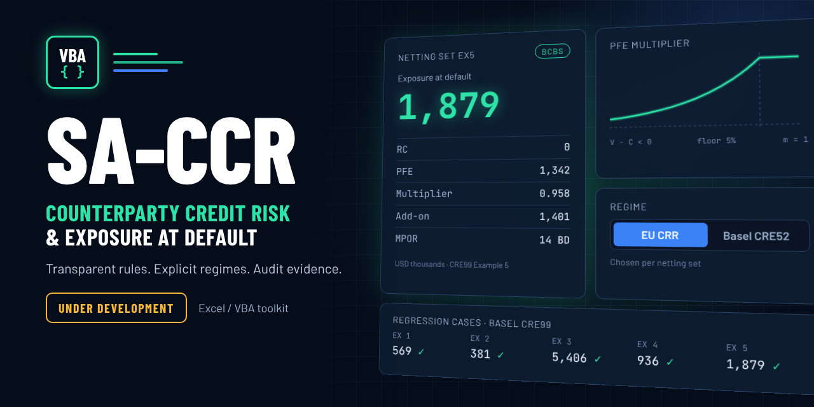
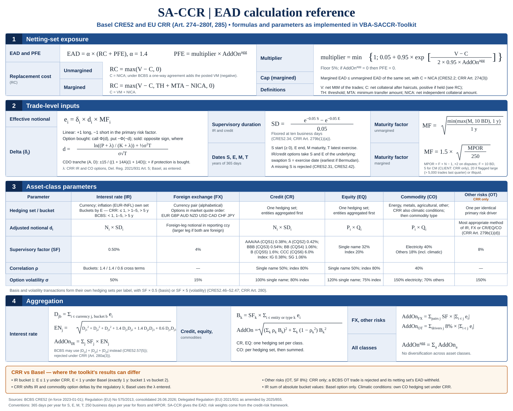

<div align="center">

# 🏦 K-SACCR

### Independent SA-CCR exposure calculation and validation in Excel VBA

**EU CRR and Basel CRE52 · Trade-to-EAD audit trail · Regulatory or what-if runs · Published-example regression · Synthetic data only**

<br>

[](#requirements)
[](#requirements)
[](#regimes)
[](#status)
[](#validation)
[](#test-suites)
[](LICENSE)

<br>

[](https://github.com/danielep71/VBA-SACCR-Toolkit/commits/release/1.0.0)
[](https://github.com/danielep71/VBA-SACCR-Toolkit)
[)](https://github.com/danielep71/VBA-SACCR-Toolkit)
[](https://github.com/danielep71/VBA-SACCR-Toolkit)
[](https://github.com/danielep71/VBA-SACCR-Toolkit/issues?q=is%3Aissue%20is%3Aopen%20label%3AP1)
[](https://github.com/danielep71/VBA-SACCR-Toolkit/issues?q=is%3Aissue%20is%3Aopen%20label%3AP2)
[](https://github.com/danielep71/VBA-SACCR-Toolkit/issues?q=is%3Aissue%20is%3Aopen%20label%3AP3)
[](https://github.com/danielep71/VBA-SACCR-Toolkit/stargazers)

<br>

**No add-in · No external reference · No DLL · No installer · Reviewable source for every calculation**

[Quick start](#quick-start)
&nbsp;·&nbsp;
[How a run works](#how-a-run-works)
&nbsp;·&nbsp;
[Regimes](#regimes)
&nbsp;·&nbsp;
[Validation](#validation)
&nbsp;·&nbsp;
[Worksheet functions](#worksheet-functions)
&nbsp;·&nbsp;
[Limitations](#limitations)
&nbsp;·&nbsp;
[Methodology](docs/methodology/README.md)
&nbsp;·&nbsp;
[Wiki](https://github.com/danielep71/VBA-SACCR-Toolkit/wiki)

---

<p align="center">
  
</p>

---

</div>

> [!IMPORTANT]
> **Nothing has been released yet.** Work takes place on `release/1.0.0` and is
> listed under Unreleased in the [changelog](CHANGELOG.md). The engine
> implements EU CRR and Basel CRE52, but only Basel rules are **validated** in
> v1.0.0, by the published CRE99 examples. CRR rules are implemented and tested
> against illustrative values, not validated ([decision 8](docs/methodology/README.md#assumptions-and-scope)).

> [!NOTE]
> The workbook is **not stored in the repository as a macro-enabled file**. It
> is built from the macro-free template `src/workbook/SACCR_Template.xlsx` and
> the exported VBA source, so every line of calculation code is reviewable in a
> pull request.

## ✨ What this project is

**SA-CCR**, the Standardised Approach for Counterparty Credit Risk, is the
regulatory method for the exposure at default (EAD) of derivatives:

```text
EAD = alpha × (RC + PFE)         alpha = 1.4
PFE = multiplier × AddOn_aggregate
```

**K-SACCR** is an independent Excel/VBA implementation for reproducing,
testing and reconciling that calculation. You enter netting sets and trades;
the engine maps each trade to its asset class, hedging set and bucket, computes
every intermediate quantity, and writes the result per netting set with the
full trail behind it.

It is built for people who need to **check** an SA-CCR number rather than
only produce one:

- each trade's adjusted notional, supervisory delta, maturity factor and
  effective notional is visible on `TradeCalc`;
- each hedging set and bucket is visible on `HedgingSets` and `Buckets`;
- every rejected input is listed on `Checks` with the reason, and the netting
  set's EAD is withheld instead of being computed from a partial portfolio;
- every rule is traced to its CRR article and CRE52 paragraph in the
  [methodology](docs/methodology/README.md#traceability).

<a id="methodology-at-a-glance"></a>

### Methodology at a glance

The reference card below collects the formulas and supervisory parameters on
one page, with the points where CRR and Basel differ. Select it to open the
full-size SVG; the [methodology](docs/methodology/README.md) remains the
authoritative description.

<p align="center">
  <a href="docs/assets/SACCR_EAD_reference.svg">
    
  </a>
</p>

---

## ⭐ Why use it

Most SA-CCR numbers come out of systems whose intermediate steps cannot be
inspected. This toolkit is the opposite:

| Need | How the toolkit meets it |
| --- | --- |
| Reconcile a production EAD | Enter the bank's own figures per netting set and per trade leg; each is compared with the engine's, `MATCH` or `DIFFERENCE` within tolerances, and every row that cannot be compared says why |
| Keep evidence of a run | **Export evidence** writes the run's identity, input fingerprint, parameters, results and reconciliations to one CSV file, and refuses while anything is out of date |
| Compare EU CRR and Basel | Regime chosen per netting set; both rule sets in one engine |
| Know whether a run is regulatory | Every run is classified `REGULATORY` or `WHAT-IF`, with each difference from the regulatory parameter set listed |
| Trust the inputs | Malformed dates, codes, pairs, duplicates and Excel errors reject the trade or stop the run; nothing is silently read as blank |
| Audit the code | Plain exported VBA, house style, static checks on every change, Excel regression suites |
| Work on a locked-down machine | No add-in, COM component, DLL or extra VBA reference |

---

## 🎯 Core capabilities

| Area | Capability |
| --- | --- |
| Regimes | EU CRR (default) and Basel CRE52, per netting set |
| Asset classes | Interest rate, FX, credit, equity, commodity; other risks under CRR |
| Instruments | Linear derivatives; European, American, Bermudan and Asian options; CDO tranches and nth-to-default; basis and volatility transactions |
| Multi-risk trades | Economic trades entered as legs, one per risk category, with one MtM leg |
| Netting sets | Unmargined and margined; VM, NICA, threshold, MTA; MPOR from floor, remargining frequency, large or illiquid flag, disputes and override; cap at the unmargined EAD |
| Client clearing | Clearing-member and client roles with the 5-business-day MPOR floor where the regime allows it |
| CRR specifics | Other-risks class (8%), climatic commodity hedging set (18%), credit quality steps, lambda-shifted option delta (`CRR-RTS` Art. 5) |
| Run classification | `REGULATORY` against parameter set `CRE52-CRR-2026-10-09`, otherwise `WHAT-IF` with each difference on Checks |
| Input validation | Unreadable or locale-dependent dates, 1904 date system, duplicate IDs, codes, FX pairs, Excel error values, moved columns and broken names |
| Reconciliation | Bank figures per netting set (`BankNettingSets`) and per trade leg (`BankTrades`), compared with Results and TradeCalc within an absolute or a relative tolerance |
| Evidence export | One CSV file per run, `;`-separated with a `.` decimal point and UTF-8 whatever the regional settings |
| Worksheet functions | Ten `SACCR_*` functions for the building blocks, returning Excel errors for invalid inputs |
| Testing | Eight Excel suites (227 cases, 975 checks), `Test_RunAll` summary, static checks in CI, and a validator for the Excel evidence record |

The [support matrix](docs/methodology/README.md#support-matrix) lists what is
supported, what the user must enter in a given form, and what is out of scope.

---

<a id="quick-start"></a>

# ⚡ Quick start

## 1. Clone and check

```sh
git clone https://github.com/danielep71/VBA-SACCR-Toolkit.git
cd VBA-SACCR-Toolkit
git switch release/1.0.0
python tools/check.py
```

Use a clone, not **Download ZIP** or GitHub's **Raw** view: a clone checks the
VBA out with the CRLF line endings the VBE expects. The checks need Python 3.10
or later and no packages.

## 2. Build the workbook

1. Open `src/workbook/SACCR_Template.xlsx` and save it as an **Excel
   Macro-Enabled Workbook (`.xlsm`)** outside the checkout.
2. In Excel, enable **Trust access to the VBA project object model**.
3. Close the workbook and drag it onto `tools/Sync-SACCR-VBA.cmd`. It asks
   which workbook to build: **P**roduction, the engine and the sheet macros
   from `src/`, or **D**evelopment, which adds the test modules of
   `tests/modules/` that [section 4](#4-test-development-workbook) needs. The
   tests write to the input and output sheets: never run them on real data.
4. Open the VBE (**Alt+F11**) and run **Debug → Compile VBAProject**.

The manual import order, references and troubleshooting are in
[`INSTALLATION.md`](INSTALLATION.md).

## 3. Run

The template ships with a demonstration portfolio: the five CRE99 examples and
further illustrative netting sets.

| Button | Macro | Does |
| --- | --- | --- |
| **Run SA-CCR** | `RunSACCR` | Validates the inputs, calculates and writes every output sheet |
| **Validate inputs** | `ValidateInputs` | Checks the inputs and lists the findings on Checks without calculating |
| **Clear outputs** | `ClearOutputs` | Empties the output sheets |
| **Export evidence** (on Reconciliation) | `ExportEvidence` | Writes the evidence report of the current run to a CSV file |

To compare the results with your bank's own figures, enter them on
`BankNettingSets`, one row per netting set with its regime, in the amount scale
set at the top of the sheet. **Run SA-CCR** then writes the comparison to
`Reconciliation`: one row per netting set and figure, `MATCH` within either
tolerance or `DIFFERENCE`, and a row for every netting set that cannot be
compared, with the reason. `BankTrades` and `TradeReconciliation` do the same
per trade leg, by Trade ID, against `TradeCalc`: notional, MtM, M,
supervisory duration, adjusted notional, delta, maturity factors, effective
notionals and the stand-alone add-on. Each leg's row also shows its Economic
trade ID from Trades, so legs can be grouped as the bank groups its trades.

**Export evidence** then writes the run to one CSV file, separated by `;`
with a `.` decimal point and UTF-8, whatever Excel's regional settings: the
run's identity and input fingerprint, the parameters, supervisory-factor and
FX tables, Results, both reconciliations, Checks and the report's
limitations, each line starting with its section. It refuses while the
results or a reconciliation are out of date, or after an output cell was
edited, so the file always describes the inputs as they are and what the
run wrote.

## 4. Test (development workbook)

In the Immediate window:

```vb
Test_RunAll
```

```text
SACCR TEST SUMMARY 2026-10-16 09:10:15
  PASS  TEST_Harness          completeness=COMPLETE; cases=4; assertions=6; failures=0; cleanup=PASS  (0,0 s)
  PASS  TEST_Formulas         cases=9; checks=82; failures=0  (0,5 s)
  PASS  TEST_MainState        cases=27; checks=465; failures=0; caller_state=RESTORED  (49,6 s)
  PASS  TEST_Cases            cases=20; checks=39; failures=0; restore=PASS  (11,5 s)
  PASS  TEST_InputValidation  cases=133; checks=209; failures=0; restore=PASS  (35,6 s)
  PASS  TEST_Aggregation      cases=11; checks=11; failures=0; restore=PASS  (3,6 s)
  PASS  TEST_Invariants       cases=4; checks=23; failures=0; restore=PASS  (1,8 s)
  PASS  TEST_Reconcile        cases=19; checks=140; failures=0  (9,1 s)
RESULT=PASS; suites=8; passed=8; failed=0; seconds=111,8
```

The suites rewrite inputs, outputs and Params and restore them afterwards: run
them in a development workbook.

---

<a id="how-a-run-works"></a>

# 🔄 How a run works

```text
Params ─┐
        ├─► validate ─► trades ─► hedging sets ─► asset-class ─► netting set
NettingSets              │          and buckets     add-ons         EAD
Trades ─┘                │                                           │
                         ▼                                           ▼
                      Checks                         Results · HedgingSets
                 (errors, warnings,                  Buckets · TradeCalc
                  what-if differences)                       │
                                                             ▼
BankNettingSets · BankTrades ─────────────────► Reconciliation · TradeReconciliation
                                                             │
                                                             ▼
                                                  Export evidence (CSV)
```

1. **Parameters.** Reporting date and currency, regime, supervisory factors,
   correlations, option volatilities and FX rates are read from Params through
   named ranges. A value outside its range, a missing reporting date or
   currency, or a broken name stops the run; a missing numeric parameter takes
   its regulatory default with a warning.
2. **Netting sets.** Margining, collateral, threshold, MTA, clearing role and
   MPOR inputs are read and checked.
3. **Trades.** Each trade gets its dates in years (S, E, M, T), adjusted
   notional, supervisory delta, maturity factor and effective notional. An
   invalid trade is excluded with all its reasons.
4. **Aggregation.** Trades are grouped into hedging sets and buckets; add-ons
   are aggregated per asset class with the regime's correlations.
5. **Exposure.** RC, multiplier, PFE and EAD per netting set, with the cap for
   margined netting sets. A netting set with a rejected trade or an invalid
   input reports `INCOMPLETE` or `INVALID` and no EAD.
6. **Reconciliation.** When `BankNettingSets` holds figures, each is compared
   with the same figure on Results, netting sets matched by ID and never
   across regimes; `BankTrades` legs are compared with TradeCalc by Trade ID
   (#45). **Export evidence** writes the run and its reconciliations to a CSV
   file.

| Sheet | Role |
| --- | --- |
| `README` | In-workbook guide |
| `Params` | Run parameters, supervisory-factor table, FX rates |
| `NettingSets` · `Trades` | Inputs |
| `Results` | One row per netting set: RC, add-ons by asset class, multiplier, PFE, EAD, MPOR, cap flag, status; a TOTAL row per regime over its `VALID` netting sets; run summary and stale-result indicator |
| `HedgingSets` · `Buckets` | Effective notionals and add-ons per hedging set and bucket |
| `TradeCalc` | Every trade-level quantity, or the reasons a trade was excluded |
| `Checks` | Errors, warnings and what-if differences |
| `BankNettingSets` · `Reconciliation` | A bank's own figures per netting set, and their comparison with Results: `MATCH` or `DIFFERENCE` per figure, and every netting set missing on either side, listed twice, of another regime, withheld or unusable |
| `BankTrades` · `TradeReconciliation` | The same per trade leg against TradeCalc, with `EXCLUDED` legs, `NOT APPLICABLE` figures and each leg's Economic trade ID |
| `TestCatalogue` · `FormulaTest` | Reference-test catalogue; worksheet-function examples |
| `Basel_vs_CRR` | The two regimes side by side |

---

<a id="regimes"></a>

# ⚖️ Regimes

EU CRR is the baseline and the default; Basel CRE52 is implemented as the
differences from it. The regime is set on Params and can be overridden per
netting set, and every result reports the regime it used.

| Topic | EU CRR | Basel CRE52 |
| --- | --- | --- |
| Asset classes | Six, with other risks (Art. 277(1)(f), 280f; 8%) | Five (CRE52.72); other-risk trades are rejected |
| Commodity hedging sets | Adds climatic conditions (Art. 277a(1)(e); 18%) | Energy, metals, agricultural, other |
| Single-name credit factor | By credit quality step (Art. 280c(5)) | By rating AAA to CCC (CRE52.72) |
| IR and commodity option delta | Lambda shift of `CRR-RTS` Art. 5 | CRE52.40 |
| IR maturity bucket 1 | End date up to and including 1 year (Art. 280a(3)) | Under 1 year (CRE52.57(3)) |
| IR aggregation across buckets | Formula with offsets only (Art. 280a(3)) | With offsets, or sum of absolutes (CRE52.57(5)) |

The [regime differences](docs/methodology/README.md#regime-differences) table
gives the locators and test cases of each row; the `Basel_vs_CRR` sheet shows
them in the workbook.

---

<a id="validation"></a>

# ✅ Validation

## Evidence classes

| Class | Meaning | Used for |
| --- | --- | --- |
| `published` | Printed in Basel CRE99 (BCBS 279 Annex 4a), checked against the text | T01–T14: validates Basel rules |
| `illustrative` | Hand calculation or a format example, not independently reviewed | Every other expected value; never counted as validation |

There are no `independent` values: the project has one maintainer, who also
wrote the code under test (#100).

## Published CRE99 examples

| Example | Published values checked | EAD (USD) |
| --- | --- | ---: |
| 1 · interest-rate swaps and a swaption | Adjusted notional, option delta, IR add-on | 569,000 |
| 2 · credit derivatives | Multiplier | 381,000 |
| 3 · commodity forwards | — | 5,406,000 |
| 4 · IR and credit, one netting set | Replacement cost, aggregate add-on | 936,000 |
| 5 · margined, weekly remargining | MPOR 14 business days, aggregate add-on, multiplier | 1,879,000 |

## Test suites

| Suite | Covers | Cases | Checks |
| --- | --- | ---: | ---: |
| `TEST_Harness` | Worksheet-function regression with a completeness and cleanup verdict | 4 | 6 |
| `TEST_Formulas` | Domain and Excel-error contract of every worksheet function | 9 | 82 |
| `TEST_MainState` | Excel state, stale-result detection and failure paths of the workbook macros | 27 | 465 |
| `TEST_Cases` | The numerical cases, generated from `tests/fixtures/` and `tests/expected/` | 20 | 39 |
| `TEST_InputValidation` | Rejection of malformed inputs and the input conventions | 133 | 209 |
| `TEST_Aggregation` | Row-order independence and offsets | 11 | 11 |
| `TEST_Invariants` | Relations every result must satisfy | 4 | 23 |
| `TEST_Reconcile` | Netting-set and trade-leg reconciliation, and the evidence export | 19 | 140 |
| **Total** | | **227** | **975** |

The harness counts assertions as its checks. The counts are those of 64-bit
Excel; on 32-bit, `TEST_Formulas` skips two `LongLong` checks (80).

`python tools/check.py` runs the static gates (source layout, house style,
public API, test-case schema, generated tests and tooling tests) locally and
in CI. Static checks never stand in for Excel evidence; the
[Excel evidence record](docs/EXCEL_EVIDENCE.md) defines what a run must show,
suite by suite, and `tools/check_excel_evidence.py` validates a record against
the exact commit it claims.

---

<a id="worksheet-functions"></a>

# 🧩 Worksheet functions

The supported API is the `SACCR_Formulas` module, listed with its signatures
in [`docs/PUBLIC_API.txt`](docs/PUBLIC_API.txt). An invalid input returns an
Excel error (`#NUM!`, `#VALUE!` or `#REF!`) instead of a misleading number.

| Function | Returns | Reference |
| --- | --- | --- |
| `SACCR_SupervisoryDuration(S, E, [FloorYears])` | Supervisory duration | CRE52.34; CRR Art. 279b |
| `SACCR_MaturityFactor(M, [Margined], [MPOR_BD], …)` | Maturity factor | CRE52.48–53; CRR Art. 279c |
| `SACCR_OptionDelta(P, K, T, Vol, IsCall, IsBought, [Lambda])` | Supervisory delta of an option | CRE52.40; CRR Art. 279a |
| `SACCR_LambdaCRR(P, K, IsInterestRate, [Threshold])` | CRR lambda shift | `CRR-RTS` Art. 5 |
| `SACCR_CDODelta(A, D, IsLong)` | Supervisory delta of a CDO tranche | CRE52.41 |
| `SACCR_IREffectiveNotional(D1, D2, D3, [Rho12], [Rho23], [Rho13])` | IR effective notional across buckets | CRE52.57 |
| `SACCR_FactorAggregation(AddOns, Rhos)` | Single-factor aggregation | CRE52.61, .68, .70 |
| `SACCR_Multiplier(VminusC, AddOn, [FloorPct])` | PFE multiplier | CRE52.23; CRR Art. 278(3) |
| `SACCR_ReplacementCost(V, C, [Margined], [TH], [MTA], [NICA])` | Replacement cost | CRE52.10, .18; CRR Art. 275 |
| `SACCR_NormCDF(x)` | Standard normal distribution | — |

Everything in `src/core/` is internal and may change without notice.

---

## 📦 Repository structure

```text
src/
  core/        engine, configuration and helpers (internal)
  modules/     SACCR_Formulas, the public worksheet functions
  workbook/    SACCR_Template.xlsx, M_Main and the document modules
tests/
  modules/     harness, case runner and suites
  fixtures/    numerical cases (inputs)
  expected/    expected results with their evidence class
docs/
  methodology/ regulatory basis, sources, support matrix, traceability
tools/         static checks, case generator, VBA synchronizer and exporter,
               Excel evidence validator
```

The layout and its rules are in
[`docs/REPOSITORY_STRUCTURE.md`](docs/REPOSITORY_STRUCTURE.md).

---

<a id="requirements"></a>

# 💻 Requirements

| Host | Support |
| --- | --- |
| Microsoft 365 or Excel 2016 and later, Windows, 64-bit | Supported target |
| Same versions, Windows, 32-bit | Best effort: kept compiling, not certified |
| Excel for Mac, Excel for the web, Excel 2013 and earlier | Not supported |

Only the four default VBA references of a new workbook are used. Development
also needs Git and Python 3.10 or later.

---

<a id="limitations"></a>

## ⚠️ Known limitations

- **No release yet.** Behaviour can change on `release/1.0.0` until v1.0.0 is
  published.
- **CRR is implemented, not validated.** The only published reference values
  are Basel examples; CRR results are tested against illustrative values.
- **One leg per FX trade.** The notional is the leg the user enters; choosing
  the leg when both are foreign is the user's.
- **FX options use a fixed quote order.** An FX option is rejected unless its
  pair follows the ranking EUR, GBP, AUD, NZD, USD, CAD, CHF, JPY (USD/JPY, not
  JPY/USD), because the two orders give different deltas (CRE52.59 FAQ1). Two
  currencies outside the ranking are ordered alphabetically, which may differ
  from local market practice.
- **Not supported:** digital options (#120), the optional reductions for sold
  options and sold credit protection, several margin agreements in one netting
  set, the 1904 date system, and the simplified SA-CCR, OEM, CCP default-fund,
  SFT, CVA and RWA calculations.
- **Windows desktop Excel only.**

The full list is in the
[support matrix](docs/methodology/README.md#support-matrix).

---

## 🗺️ Roadmap

| Milestone | Scope |
| --- | --- |
| v1.0.0 | First supported Excel release: the current engine with its evidence |
| v1.1.0 | CSV import and staging for Trades and NettingSets (#206–#212) |
| v1.2.0 | Excel Ribbon interface (#213–#218) |
| v1.3.0 | Diagnostics and independent validation: engine separated from Excel I/O (#220), stable Checks codes (#81), independent cross-check (#100), randomised FormulaTest inputs (#165) |
| v1.4.0 | Advanced products and FX provenance: digital options (#120), FX quote import (#157) |
| v1.5.0 | Simplified SA-CCR (#107) |
| v1.6.0 | Original exposure method (#111) |
| v1.7.0 | CCP exposures and default funds (#112) |
| v1.8.0 | Securities financing transactions (#113) |
| v1.9.0 | Regulatory CVA risk (#114) |
| v1.10.0 | Risk-weighted assets and capital (#115) |

The [milestones](https://github.com/danielep71/VBA-SACCR-Toolkit/milestones)
hold the current scope of each release.

---

## 📚 Documentation

| Document | Covers |
| --- | --- |
| [Wiki](https://github.com/danielep71/VBA-SACCR-Toolkit/wiki) | SA-CCR overview, regulatory sources, worked examples and workbook guide |
| [`docs/methodology/`](docs/methodology/README.md) | Regulatory basis, source register, support matrix, regime differences, parameters, traceability |
| [`docs/methodology/TEST_CASES.md`](docs/methodology/TEST_CASES.md) | Numerical test-case format and evidence classes |
| [`tests/README.md`](tests/README.md) | Test catalogue and suites |
| [`INSTALLATION.md`](INSTALLATION.md) | Developer setup, checks, Excel import and validation record |
| [`CONTRIBUTING.md`](CONTRIBUTING.md) | Workflow, commit messages, evidence and pull requests |
| [`docs/REPOSITORY_STRUCTURE.md`](docs/REPOSITORY_STRUCTURE.md) | Profile decision, source layout, public API boundary |
| [`docs/VBA_HOUSE_STYLE.md`](docs/VBA_HOUSE_STYLE.md) | VBA naming, contracts, errors, Excel-state cleanup, export rules |
| [`docs/EXCEL_EVIDENCE.md`](docs/EXCEL_EVIDENCE.md) | Manual Excel run record for every suite, procedure and validator |
| [`docs/GOVERNANCE.md`](docs/GOVERNANCE.md) | Branches, issue metadata, review checklist, GitHub controls |
| [`tools/README.md`](tools/README.md) | Static checks, CI, evidence validator, VBA synchronizer and traffic export |
| [`docs/LABELS.md`](docs/LABELS.md) | Issue-label catalogue and its workflows |
| [`RELEASING.md`](RELEASING.md) | Integration into `main` and the release sequence |
| [`SECURITY.md`](SECURITY.md) | Private vulnerability reporting and data handling |
| [`CODE_OF_CONDUCT.md`](CODE_OF_CONDUCT.md) | Participant behaviour and conduct reporting |
| [`CHANGELOG.md`](CHANGELOG.md) | Change history |

---

<a id="status"></a>

## 📌 Status

**Pre-release.** Development takes place on `release/1.0.0` through task
branches and pull requests; `main` receives it on the owner's instruction.
Nothing is versioned or tagged until a release is prepared.

The latest recorded Excel run, `Test_RunAll` with eight of eight suites
passing, was made by the owner on 2026-10-16 on the source merged as
[`9722b30`](https://github.com/danielep71/VBA-SACCR-Toolkit/commit/9722b30c7ffde81a2234e3f9b494fb5ce6ec1828).
It is development evidence, not release certification.

---

## 🔐 Data and security

Use synthetic data only. Never commit or attach real trades, netting sets,
counterparty or collateral data, or any client or employer material. VBA runs
with the user's Office permissions: review the source and follow your
organisation's macro policy. Report suspected vulnerabilities privately as
described in [`SECURITY.md`](SECURITY.md).

---

## 👤 Author

**Daniele Penza** — [@danielep71](https://github.com/danielep71)

## 📄 License

[Mozilla Public License 2.0](LICENSE)
