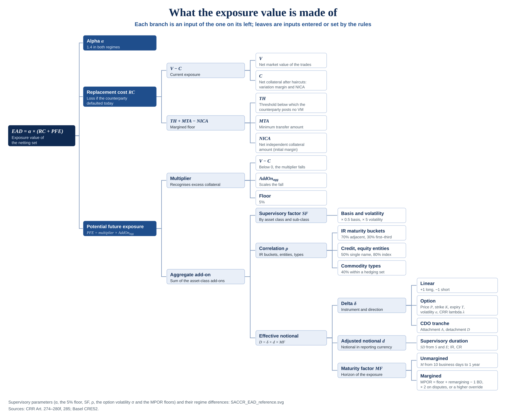

# 📐 Methodology

This directory records **what K-SACCR implements and on what authority**: the
regulatory texts and their versions, assumptions, parameter sources, open
decisions, and the trace from each rule to code and tests. The numerical
test-case format is in [`TEST_CASES.md`](TEST_CASES.md).

> [!IMPORTANT]
> The engine implements CRR and Basel CRE52. Under
> [`TEST_CASES.md`](TEST_CASES.md), only Basel rules are validated, by the
> published CRE99 examples (T01–T14); no CRR rule is validated in v1.0.1
> ([evidence for v1.0.1](#assumptions-and-scope)). The [traceability](#traceability)
> table gives the status of each rule. The CRR and CRE52 versions in the
> source register and the supervisory parameters were checked against the
> official texts on 2026-10-09.

What the exposure value is made of, as a map of the sections below; the
picture summarises them and is not a source (select it to open it full size):

  

## ⚖️ Regulatory basis

See issue #8.

| Regime | Identifier | Role |
| --- | --- | --- |
| EU Capital Requirements Regulation, SA-CCR | `CRR` | **Baseline.** Default for every calculation and test case |
| Basel Framework, CRE52 | `BCBS` | Also supported; implemented as differences from the baseline |

The regime is set on Params, `CRR` by default, and can be overridden per
netting set on the NettingSets sheet. Every result reports the regime it was
calculated under, and every expected result names its regime. Where the two
texts agree, the engine has one implementation tagged with both rule
identifiers. Where they differ, the difference is recorded in
[Regime differences](#regime-differences) before any code depends on it.

## 📚 Source register

Cite sources by ID in code `REFERENCE` sections, in the traceability table and
in test cases. Record the exact version date when a source is first relied on;
a later version is a new row, not an edit.

| ID | Source | Scope relied on | Version / date | Status |
| --- | --- | --- | --- | --- |
| `CRR` | Regulation (EU) No 575/2013, Part Three, Title II, Chapter 6, Section 3 (Articles 274–280f), as amended by Regulation (EU) 2019/876 and Regulation (EU) 2024/1623 | SA-CCR exposure value, replacement cost, PFE, add-ons | Consolidated text of 26.06.2026 (version 021.001), EUR-Lex | Articles 274(2)–(7), 275, 277, 277a, 278(3), 279a–279c, 280–280f and 285(2)–(5) checked 2026-10-09; Article 278(1)–(2) checked 2026-10-10 in the EUR-Lex PDF |
| `CRR-CCP` | Regulation (EU) No 575/2013, Article 4(1)(88)–(91) and Part Three, Title II, Chapter 6, Section 9 (Articles 300–311), as amended by Regulation (EU) 2019/876 | Exposures to central counterparties: the definitions of QCCP, default fund and trade exposure; the clearing member's and the client's treatment, trade exposures and default-fund contributions. Used by the [clearing coverage](CLEARING_COVERAGE.md); K-SACCR calculates nothing from it yet | Consolidated text of 26.06.2026 (version 021.001), EUR-Lex | Articles 4(1)(88)–(91) and 300–311 checked 2026-10-18 in the EUR-Lex PDF |
| `CRR-RTS` | Commission Delegated Regulation (EU) 2021/931, as amended by Delegated Regulation (EU) 2025/855 | Primary risk driver and risk-category mapping; supervisory delta and lambda shift of interest-rate and commodity options | Consolidated text of 25.05.2025 (version 001.001), EUR-Lex | Article 5 checked 2026-10-09. Articles 1–4 (risk drivers and their mapping) and 6 (long or short position) are not checked: the engine does not apply them, and the user maps each leg (#38) |
| `EBA-QA-2023_6962` | EBA Single Rulebook Q&A 2023_6962 | Collateral C in the cap on the exposure value of a margined netting set (CRR Art. 274(3)): NICA | Final, published 15/03/2024 | Answer checked 2026-10-10 |
| `BCBS` | Basel Framework, chapter CRE52 | Basel SA-CCR | Effective 1 January 2023, last updated 5 June 2020 | Paragraph locators and the CRE52.72 table checked 2026-10-09 |
| `CRE54` | Basel Framework, chapter CRE54, *Capital requirements for bank exposures to central counterparties* | MPOR floor of client clearing: at least 5 days for the clearing member facing its client (CRE54.12). For the client facing its clearing member, 10 days: where the conditions of CRE54.15 are met, the client takes the clearing member's treatment towards a CCP (CRE54.14), whose 10-day minimum is stated for OTC derivatives (CRE54.8(2)); where only the protection against the joint default of the clearing member and another client is missing, the risk weight becomes 4% (CRE54.16); where CRE54.14–.16 are not met, the exposure is a bilateral trade (CRE54.17) under the bilateral floors of CRE52.50. K-SACCR does not check the conditions or calculate risk weights | Effective 1 January 2023, published 27 March 2020 | CRE54.8, CRE54.12 and CRE54.14 checked 2026-10-16; CRE54.15 to CRE54.17 checked 2026-10-18; CRE54.1 to CRE54.42 read for the [clearing coverage](CLEARING_COVERAGE.md) 2026-10-18 |
| `BCBS-279` | BCBS, *The standardised approach for measuring counterparty credit risk exposures* (2014) | Background; Annex 4a worked examples (printed pages 22–30) | March 2014, revised April 2014 | Example 4 checked 2026-10-09; copy registered in [`sources/`](sources/README.md) 2026-10-18 |
| `CRE99` | Basel Framework, chapter CRE99, *Application guidance*: the SA-CCR worked examples | Published values of the `cre99-example-*` cases. Amounts in USD thousands; intermediate results unrounded, displayed results and final EAD rounded (CRE99.20); 250 business days a year (CRE99.28) | Effective 1 January 2023, published 27 March 2020 | Examples 1–5: the values used by the cases checked 2026-10-09 |

Reference values may only be taken from a source in this register. Add a row
before citing a new one.

Copies of the checked versions, with their addresses and SHA-256 hashes, are in
[`sources/`](sources/README.md).

## 🧭 Assumptions and scope

| Topic | Current position |
| --- | --- |
| Units | Amounts in the netting set's calculation currency, unscaled; rates and factors as decimals; periods in years. See [`VBA_HOUSE_STYLE.md`](../VBA_HOUSE_STYLE.md#units-and-domains) |
| Inputs | Trade-level data supplied by the caller; K-SACCR does not price trades or source market data |
| Supervisory parameters | Taken from the cited regime text and recorded in the parameter table below, never typed in code without a reference |
| Running test cases | VBA generated from the JSON by a checked tool; cases feed the engine through its input sheets. See [`TEST_CASES.md`](TEST_CASES.md#consumption) (#44) |
| Evidence for v1.0.1 | Release 1.0.1, like 1.0.0, validates rules only with the `published` values of CRE99 (the BCBS 279 Annex 4a examples), checked against the registered text. It has no `independent` values: the project has one maintainer, who also wrote the code under test. Every other case stays `illustrative`. Because the published examples are Basel examples, they substantiate the Basel cases and the calculation paths they exercise, not the whole framework; CRR provisions were checked against the registered sources, but CRR-specific numerical validation remains incomplete under this policy, and the release says so. The comparison with the R package `SACCR` 3.4 in `tools/rsaccr_crosscheck.py` agrees on the values it can compute, but agreement between two implementations is not validation and is not counted as such (#352). A later release cross-checks the results against a second source ([#100](https://github.com/danielep71/VBA-SACCR-Toolkit/issues/100)) (#44) |
| Sources | `CRR` is the consolidated CRR of 26.06.2026 (version 021.001), checked on 2026-10-09, with Delegated Regulation (EU) 2021/931 as amended by (EU) 2025/855 and the EBA Q&A `EBA-QA-2023_6962`; `BCBS` is the Basel Framework CRE52 effective 1 January 2023, last updated 5 June 2020, checked on 2026-10-09 (#33) |
| Scope | The full SA-CCR only. Simplified SA-CCR (CRR Article 281), the original exposure method (Article 282), exposures to central counterparties, securities financing transactions, CVA and RWA are outside v1.0.1. Inputs that ask for them are rejected; a limitation stated only in prose is not enough. Each is planned in its own issue, listed in the [support matrix](#support-matrix); the [milestones](https://github.com/danielep71/VBA-SACCR-Toolkit/milestones) hold the current schedule (#33) |
| Margined netting sets | In scope since v1.0.0, with VM, NICA, threshold, MTA and MPOR as inputs (#33) |
| Day count | S, E, M and T in years of 365 calendar days (`DaysPerYear`); floors and MPOR in business days of 250 a year (`BusinessDaysPerYear`). Articles 279b and 279c say "the relevant business day convention"; this is the convention K-SACCR uses, without holiday calendars. A test case may set `DaysPerYear` to reproduce a published maturity (#33) |
| Currency | Trade amounts are converted into the reporting currency with the FX table on Params, whose rates the user supplies; K-SACCR sources no market data. A test fixture holds amounts already in its calculation currency, whose rate is set to 1 (#33) |
| Interest-rate aggregation | Under `BCBS` both CRE52.57 formulas are supported, chosen with `IRBucketOffset`: the bucket formula that recognises offsets across maturity buckets, and the sum of absolute bucket values. Under `CRR` only the formula with offsets is supported: Article 280a(3), checked on 2026-10-09, prints no other. Each supported formula needs a value test: the formula with offsets has the published T03; the sum of absolutes has `illustrative-ir-sum-of-absolutes` (#39) (#33) |
| Open treatments | Climatic conditions take 18% (Articles 277a(1)(e)(v), 280e(5)); there is no unrated sub-class, and the user enters CQS3, CQS5 where Article 128 applies, or the step mapped from an internal rating (Article 280c(5)(a)); other risks keep one hedging set per identical primary risk driver (Article 277a(1)(f)); inflation is interest rate, entered as a currency followed by `-INFL` (such as `EUR-INFL`) in its own hedging set (Articles 277(4)(a), 277a(1)); the optional reductions for sold options and sold credit protection (Article 274(5) and (7)) are not applied, which gives an exposure value not lower than with them (equal where they would not bind) and is permitted; several margin agreements in one netting set and one agreement over several netting sets (Articles 274(4), 275(3)) move to #39 (#33) |
| Collateral of the cap and one-way agreements | The cap of a margined netting set uses C = NICA in both regimes, the collateral of the same netting set without a margin agreement (CRE52.2, CRE52.10; CRR Art. 274(3), 275(1), `EBA-QA-2023_6962`). VM held on an unmargined netting set is rejected, because a counterparty that posts VM makes it margined (CRE52.2; CRR Art. 272(7)). VM posted on an unmargined netting set is the one-way agreement in favour of the counterparty: under `BCBS` it stays unmargined and C includes that VM with a negative sign (CRE52.10, footnote 2); under `CRR` it is rejected, because a one-way agreement is a margin agreement (Art. 272(7a)) and the netting set must be entered as margined (#39) |
| Client clearing | The NettingSets column is the bank's role, N, CM or CLIENT; CCP declares a netting set facing a CCP, which is rejected until CCP support exists (#112), and MULTI a multi-level client structure, which is rejected (#359). Every CM and CLIENT netting set has an INFO line on Checks with its role, floor and rule. The 5-day MPOR floor applies to CM in both regimes (CRE54.12; CRR Art. 279c(1)) and to CLIENT under `CRR` only; a `BCBS` client keeps the 10-day floor, whether its arrangement qualifies under CRE54.14–.16 (the CCP treatment, 10 days for OTC derivatives, CRE54.8(2); CRE54.16 changes only the risk weight) or not (a bilateral trade, CRE54.17; CRE52.50). Eligibility of the arrangement is the user's to check (#39). The `BCBS` client's 10 days is a conservative interpretation: CRE54.2's footnote applies CRE54.12, which grants five days to the clearing member and does not name the client; the rationale is [decision 1](CLEARING_COVERAGE.md#decisions) of the clearing coverage, which holds every clearing arrangement, CCP rule and gap (#358) |
| MPOR combinations | After margin disputes the engine doubles F + N - 1, which is the `BCBS` rule (CRE52.50(2), CRE52.51(3)) and meets every reading of CRR Art. 285(4)–(5), being higher than the CRR minimum when remargining is not daily. A large or illiquid netting set takes 20 + N - 1 in both regimes: CRR Art. 285(3) and (5) give this; CRE52.51 sets 20 days without saying whether N - 1 is added, and adding it is not lower than either reading (#39). One flag covers both the trade count and illiquidity, so the 20 days also apply where the trade-count floor does not (CRR Art. 285(3)(a), 304(3)(c); CRE54.8(1)): a conservative limitation until CCP support ([decision 3](CLEARING_COVERAGE.md#decisions)) |
| Margin-agreement structures | Several margin agreements, or margined and unmargined trades, in one netting set (CRE52.74; CRR Art. 274(4)) and one agreement over several netting sets (CRE52.75; CRR Art. 275(3), 278(2)) are declared in the Margin agreements column as MIXED or SHARED, and the netting set is rejected (#33, #39) |

## 🧾 Support matrix

What v1.0.1 calculates, what the user must enter in a supported form, and what
is outside it (#33). "Not supported" means nothing is calculated for the case:
it cannot be entered or, where it can be declared, the netting set is
rejected. Whether a supported rule is also validated is in the
[traceability](#traceability) table.

| Area | Item | Status | How it is entered or treated | Reference |
| --- | --- | --- | --- | --- |
| Methods | Full SA-CCR, CRR (default) and Basel CRE52, chosen per netting set | Supported | Regime on Params, override per netting set | [Assumptions](#assumptions-and-scope): sources and scope |
| Methods | Simplified SA-CCR, original exposure method, CCP default-fund exposures, SFTs, CVA, RWA | Not supported | Cannot be entered; planned, per the current [milestones](https://github.com/danielep71/VBA-SACCR-Toolkit/milestones), in #107 (simplified, v1.5.0), #111 (OEM, v1.6.0), #112 (CCP, v1.0.2), #113 (SFT, v1.8.0), #114 (CVA, v1.9.0), #115 (RWA, v1.10.0) | [Assumptions](#assumptions-and-scope): scope |
| Asset classes | Interest rate, foreign exchange, credit, equity, commodity | Supported | Asset class IR, FX, CR, EQ, CO | CRR Art. 277; CRE52.72 |
| Asset classes | Other risks | Supported under CRR; rejected under BCBS | Asset class OT; one hedging set per identical primary risk driver | CRR Art. 277(1)(f), 277a(1)(f), 280f |
| Asset classes | Inflation | Supported | IR with risk factor such as `EUR-INFL`, own hedging set per currency | CRR Art. 277(4)(a), 277a(1) |
| Asset classes | Climatic conditions | Supported under CRR | CO sub-class `CLIMATIC`, own hedging set, factor 18% | CRR Art. 277a(1)(e)(v), 280e(5) |
| Instruments | Linear derivatives (swaps, forwards, futures, single-name and index credit derivatives) | Supported | Instrument `Linear`; delta +1 long, -1 short | CRE52.39; CRR Art. 279a(1)(c) |
| Instruments | Options: European, American and Bermudan (the latest exercise date), Asian (the current value of the average) | Supported | Instrument `Option` with price, strike and expiry; CRR lambda for IR and commodity options | CRE52.40; CRR Art. 279a(1)(a); `CRR-RTS` Art. 5 |
| Instruments | Digital options | Not supported, under either regime | There is no digital instrument. Options entered as legs of one economic trade are calculated as an ordinary option combination, not as a digital: the payoff-sized collar of CRR Art. 274(6) is not defined or checked, and the BCBS cap of the effective notional at the payoff divided by the supervisory factor is not applied. Planned in #120 (v1.4.0) | CRR Art. 274(6); CRE52.42 |
| Instruments | CDO tranches and nth-to-default credit derivatives | Supported | Instrument `CDO` with attachment and detachment; nth-to-default as A = (n - 1)/k, D = n/k | CRE52.41; CRR Art. 279a(1)(b) |
| Instruments | Basis and volatility transactions | Supported | Nature `Basis` or `Volatility` with a hedging-set label | CRE52.46–.47; CRR Art. 277a(2), 280 |
| Instruments | Transactions with several material risk drivers | Supported with legs | One row (leg) per risk category, mapped by the user, all with the same Economic trade ID. Exactly one leg is the MtM leg (Y) and carries the trade's market value; every other leg must hold 0, so the value enters V once. Legs in different netting sets are rejected. The engine checks these rules and rejects every leg of a trade that breaks them; the mapping itself is the user's (#38) | CRR Art. 277(3) (mandatory); CRE52.28 (where the supervisor requires it); `CRR-RTS` Articles 1–4, which the user applies and which K-SACCR has not checked |
| Instruments | Option combinations: collars, spreads, straddles, strangles, caps and floors | Supported with legs | One option leg per component, same Economic trade ID, MtM on the MtM leg; a cap or floor as its caplets or floorlets. Legs in the same asset class must all be options: a linear product such as a swap may not be split (#38) | CRR Art. 274(6) (mandatory); CRE52.42(4), CRE52.43, CRE52.1 FAQ3 (decomposition) |
| Instruments | Sold options and sold credit protection | Supported, without the optional reductions | Calculated as ordinary trades; the zero EAD and premium cap are not applied, so the EAD is not lower than with them (it can be equal) | CRR Art. 274(5), (7); CRE52.1 FAQ1–2 |
| Credit factors | Rated single names; quoted IG and SG indices | Supported | Sub-class AAA–CCC (BCBS) or CQS1–CQS6 (CRR); `IG_INDEX`, `SG_INDEX` | CRE52.72; CRR Art. 280c(5) |
| Credit factors | Unrated single names; unlisted multi-name positions | Entered by the user | CQS3, CQS5 where Art. 128 applies, or the mapped step; for an unlisted multi-name position, the step of its weighted factor | CRR Art. 280c(5) |
| Netting sets | Unmargined netting set | Supported | Margined = N; collateral in NICA | CRE52.10; CRR Art. 275(1) |
| Netting sets | Margined netting set with VM, NICA, threshold and MTA | Supported | Margined = Y; MPOR from floor, remargining frequency, large or illiquid flag, disputes and override. The remargining frequency is a whole number of business days from 0 to 10,000 (0 is read as daily, with a warning); the MPOR override is a whole number above 0, used only if it is not below the computed MPOR | CRE52.18, .50–.53; CRR Art. 275(2), 279c, 285 |
| Netting sets | Cap of a margined netting set | Supported | Cap with C = NICA in both regimes | CRE52.2, CRE52.10; CRR Art. 274(3), 275(1) |
| Netting sets | One-way margin agreement where only the bank posts VM | Supported under BCBS; entered as margined under CRR | BCBS: Margined = N with the posted VM, included in C. CRR: Margined = Y, with the threshold of the agreement; VM on an unmargined CRR netting set is rejected | CRE52.2, CRE52.10 footnote 2; CRR Art. 272(7a), 275(2) |
| Netting sets | Several margin agreements, or margined and unmargined trades, in one netting set; one agreement over several netting sets | Not supported | Declared as MIXED or SHARED in the Margin agreements column; the netting set is rejected | CRR Art. 274(4), 275(3), 278(2); CRE52.74–.76 |
| Netting sets | Client clearing | Supported with a user declaration | Client clearing role CM applies the 5-business-day MPOR floor in both regimes, CLIENT under CRR only; a BCBS client keeps 10 days. Eligibility is the user's to check. See the [clearing coverage](CLEARING_COVERAGE.md) | CRE54.8, CRE54.12, CRE54.14 to CRE54.17; CRR Art. 279c(1) |
| Netting sets | Bank facing a CCP; multi-level client structures | Not supported | A netting set facing a CCP is declared with Client clearing role CCP and rejected; entered with role N instead, it is calculated as bilateral and cannot be detected. A multi-level client structure is declared with role MULTI and rejected; entered as CM or CLIENT instead, it cannot be detected. CCP support is planned in #112; see the [clearing coverage](CLEARING_COVERAGE.md) | CRR Art. 285(3)(a); `CRR-CCP` Art. 300, 304(3), 305(4); CRE54.2, CRE54.8, CRE54.14(3) |
| Collateral | Haircuts, eligibility, segregated initial margin | Entered by the user | Amounts after haircuts; segregated collateral posted by the bank excluded from NICA | CRE52.11, .17; CRR Art. 276 |
| Parameters | IR aggregation without offsets across buckets | Supported under BCBS only | `IRBucketOffset` = FALSE; a CRR netting set with IR trades is then INVALID | CRE52.57(5); CRR Art. 280a(3) |
| Parameters | Alpha override per netting set | Supported for what-if runs | Alpha column on NettingSets; any value other than 1.4 makes the run WHAT-IF (#41) | CRE52.1; CRR Art. 274(2) |
| Parameters | Regulatory or what-if run | Supported | Every run is classified: REGULATORY when the Params values, the factor table and the alpha overrides equal the regulatory parameter set below, WHAT-IF otherwise, with each difference listed on Checks (#41) | Parameter set `CRE52-CRR-2026-10-09` |
| Currency and dates | Reporting currency and conversion | Supported | FX table on Params, rates supplied by the user. The reporting currency must be three letters A-Z (case and surrounding spaces ignored) and its FX rate must be 1, or the run stops | [Assumptions](#assumptions-and-scope): currency |
| Currency and dates | Day count | Supported | 365 calendar days per year, 250 business days for floors and MPOR | [Assumptions](#assumptions-and-scope): day count |
| Currency and dates | Date entry | Supported | A date, a number holding a date serial of the 1900 date system, or text in the form yyyy-mm-dd. Other text, such as 30/09/2031, is not read, because its meaning depends on the Windows regional settings: in a trade it rejects the trade, as the reporting date it stops the run. A workbook set to the 1904 date system stops the run (#40) | [Assumptions](#assumptions-and-scope): day count |
| Currency and dates | Trade dates S, E, M and T | Supported | Years from the reporting date on the `DaysPerYear` basis. M is the maturity date, or else the end date, or else the option expiry; E is the end date, or else M; S is the start date, or 0 when it is blank or before the reporting date; T is the option expiry. For an option on an interest-rate or credit instrument, S and E are those of the underlying: for a swaption S is the exercise date and E the end of the underlying swap; for a Bermudan swaption S is the earliest allowed exercise date and T the latest; for a cap or floor S is the start of the first period. Such an option without a start date is rejected rather than read as S = 0 (#40). A trade with M on or before the reporting date, an option expiring on or before it and an option expiring after M are rejected; an IR or credit trade needs E after S. The IR maturity buckets by E are: under CRR, up to and including 1 year, over 1 to 5 years, over 5 years; under BCBS, under 1 year, 1 to 5 years, over 5 years. An end date of exactly 1 year is in bucket 1 under CRR and bucket 2 under BCBS (#40, #191) | CRE52.31, CRE52.32 Table 1, CRE52.34, CRE52.42(1)–(2), CRE52.57(3); CRR Art. 279b(1)(a), 280a |
| Currency and dates | Variable notionals and resetting trades | Entered by the user | One notional and one maturity per row, as entered; no schedule is read. Enter the time-weighted average of the remaining notionals of an amortising or accreting IR or credit trade; the notional times the leverage factor of a leveraged swap; the notional times the number of principal exchanges (BCBS) or of remaining payments (CRR); and, as M, the next reset date of a trade whose exposure is settled and value reset to zero on set dates (#40) | CRE52.37(2)–(5); CRR Art. 279b(2), 279c(2) |
| Currency and dates | FX pairs and notional | Supported | The risk factor is two different currency codes, such as EUR/USD or EURUSD, and both need an FX rate on Params. The hedging set is the pair in alphabetical order; a pair entered the other way round has its delta sign reversed, so a long USD/EUR forward offsets a long EUR/USD forward of the same notional. The notional is that of one leg, in that leg's currency, which must be one of the pair's: the foreign-currency leg, or, when both legs are foreign, the leg with the larger value in the reporting currency. Choosing the leg is the user's; the engine checks only the currency (#40) | CRE52.35, CRE52.58; CRR Art. 279b(1)(b), 280b |
| Currency and dates | Quote order of FX options | Supported, checked | An FX option must be entered in market quote order, with price and strike quoted in that order: the base currency is the one listed first in EUR, GBP, AUD, NZD, USD, CAD, CHF, JPY (EUR/USD, GBP/USD, USD/JPY, EUR/CHF); a currency not listed comes after the listed ones (USD/SEK), and of two unlisted currencies the alphabetical first is the base (NOK/SEK). An FX option entered the other way round is rejected, because a call on EUR/USD and the economically identical put on USD/EUR give different deltas. The delta is computed on the quote as entered, and its sign is reversed when the market order is not the alphabetical order of the hedging set (USD/JPY in JPY/USD). Linear FX trades may be entered in either order (#40) | CRE52.59 FAQ1 |
| Results | Status of a netting set | Supported | One Results row per input netting set, with a status. `INVALID`: a netting-set-level input error, namely an invalid field on NettingSets (a netting set declared as facing a CCP shows `INVALID: facing a CCP, not supported`), the netting-set ID listed twice, one reference given different sub-classes by two of its trades, or interest-rate trades in a `CRR` netting set while `IRBucketOffset` is FALSE. `INCOMPLETE`: at least one of its trades is rejected. `NO TRADES`: it has no trades. `VALID`: otherwise. The checks run in that order, so a set with both an invalid field and a rejected trade is `INVALID`. `INVALID` and `INCOMPLETE` rows are highlighted in light red. Only a `VALID` netting set has figures. The EAD of an `INVALID` or `INCOMPLETE` set is withheld rather than calculated from part of the portfolio; a `NO TRADES` set has no EAD and is not withheld | #36 |
| Results | Portfolio totals | Supported, one per regime | After the netting-set rows, one row per regime with netting sets: `TOTAL CRR`, then `TOTAL BCBS`. Each sums, over that regime's `VALID` netting sets only, V, C, RC, the add-on of each asset class, the aggregate add-on, PFE and EAD, and shows its regime; every other column stays empty. Its status says what it covers, in the form "6 of 8 netting set(s) VALID; 2 withheld": `VALID` sets of all the regime's sets, then the `INVALID` and `INCOMPLETE` ones. A `NO TRADES` set counts among all the sets but is neither `VALID` nor withheld. There is no total across regimes, because a CRR and a BCBS EAD of the same portfolio are alternatives, not parts. The message box and the silent result line (`total_ead_crr`, `total_ead_bcbs`) follow the same rule. `TOTAL`, `TOTAL CRR` and `TOTAL BCBS` cannot be netting-set IDs | #198 |

## ❓ Open decisions

These are deliberately undecided. Each is settled by the owner in an issue and
moved into the tables above; none may be assumed by code or tests meanwhile.

None at present. Settled points are recorded in
[Assumptions and scope](#assumptions-and-scope); those of the clearing work of
v1.0.2 are in the [clearing coverage](CLEARING_COVERAGE.md#decisions).

## 🔀 Regime differences

Each confirmed difference between `CRR` and `BCBS` that affects a result gets a
row, with locators in both texts. No difference is asserted until both texts
have been compared for that rule.

| Topic | `CRR` (locator) | `BCBS` (locator) | Effect | Test cases |
| --- | --- | --- | --- | --- |
| Interest-rate aggregation across maturity buckets | Only the formula with offsets (Art. 280a(3)) | The formula with offsets, or the sum of absolute bucket values at the bank's choice (CRE52.57(5)) | `IRBucketOffset` = FALSE is valid only under `BCBS` | `TEST_Invariants` (relation); `illustrative-ir-sum-of-absolutes` (BCBS); `TEST_InputValidation` (`params-ir-sum-of-absolutes-crr`, `params-ir-sum-of-absolutes-bcbs`) |
| Asset classes | Six, with other risks (Art. 277(1)(f), 280f: factor 8%) | Five (CRE52.72) | Other-risk trades are rejected under `BCBS` | T24, T25, T26 (illustrative) |
| Commodity hedging sets | Energy, metals, agricultural goods, other commodities and climatic conditions (Art. 277a(1)(e)); climatic conditions take 18% (Art. 280e(5)) | Energy, metals, agricultural and other commodities (CRE52.45, CRE52.70 step 2); CRE52.72 sets the factors by commodity type (electricity, oil/gas, metals, agricultural, other), not the hedging sets | Climatic trades form their own hedging set under `CRR` only | T27 (illustrative) |
| Single-name credit factor | By credit quality step 1–6 (Art. 280c(5), Table 3) | By rating AAA to CCC (CRE52.72) | Same factors on a different scale: CQS 1 = 0.38%, CQS 2 = 0.42%, CQS 3 = 0.54%, CQS 4 = 1.06%, CQS 5 = 1.6%, CQS 6 = 6.0%; AAA and AA = 0.38%, A = 0.42%, BBB = 0.54%, BB = 1.06%, B = 1.6%, CCC = 6.0% | T28 (illustrative) |
| Supervisory delta of interest-rate and commodity options | Shifted by the regulatory lambda (`CRR-RTS` Art. 5) | CRE52.40 | Delta differs when a price or strike is near or below zero | T20–T23 (illustrative) |
| Interest-rate maturity bucket 1 | End date > 0 and <= 1 year (Art. 280a(3), Table 2) | Less than one year (CRE52.57(3)) | An end date of exactly 1 year is in bucket 1 under `CRR` and bucket 2 under `BCBS`; bucket 2 includes exactly 5 years in both (#191) | `TEST_InputValidation` (`ir-bucket-boundaries-crr`, `ir-bucket-boundaries-bcbs`; the add-on effect in `ir-bucket-offset-crr`, `ir-bucket-offset-bcbs`) |
| MPOR floor of a client facing its clearing member | 5 business days: the client, like the clearing member, replaces the 10-day minimum of Art. 285(2)(b) with five business days (Art. 279c(1)(b)) | 10 business days: if the conditions of CRE54.15 are met, the client takes the clearing member's treatment towards a CCP (CRE54.14), whose minimum MPOR for OTC derivatives is 10 days (CRE54.8(2)); CRE54.16 changes only the risk weight, to 4%, when just the protection against a joint default is missing; if CRE54.14–.16 are not met, the exposure is a bilateral trade (CRE54.17) under CRE52.50. The 5-day floor of CRE54.12 is for the clearing member facing its client | A margined netting set with Client clearing role CLIENT has a lower MPOR, and so a lower maturity factor, under `CRR`; CM takes 5 days in both regimes | `TEST_InputValidation` (`netting-set-clearing-client-crr`, `netting-set-clearing-client-bcbs`; CM in `netting-set-clearing-member-crr`, `netting-set-clearing-member-bcbs`) |
| Variation margin posted under a one-way margin agreement (the bank posts, the counterparty does not) | A one-way margin agreement is a margin agreement (Art. 272(7), (7a)), so the netting set is margined (Art. 275(2)); entered as unmargined with VM posted, it is rejected | The netting set is unmargined (CRE52.2) and C includes the posted VM with a negative sign (CRE52.10, footnote 2) | An unmargined netting set with posted VM is `INVALID` under `CRR` and `VALID` under `BCBS`, where the posted VM raises RC | `TEST_InputValidation` (`netting-set-unmargined-vm-posted-crr`, `netting-set-unmargined-vm-posted-bcbs`) |

The cap of a margined netting set is not recorded as a difference. Both texts
cap the EAD at that of the same netting set without margin (CRR Art. 274(3);
CRE52.2), and both define the unmargined collateral without variation margin:
CRR Art. 275(1) uses NICA (`EBA-QA-2023_6962`), and CRE52.10 uses the net
collateral of the NICA methodology in CRE52.17, adding posted variation margin
with a negative sign only for a one-way margin agreement where the bank alone
posts (CRE52.10, footnote 2), which CRE52.2 treats as unmargined. The
engine's cap uses NICA in both regimes (#39).

## 🔢 Supervisory parameters

Values checked on 2026-10-09 against the consolidated CRR of 26.06.2026,
`CRR-RTS` Article 5 and the CRE52.72 table; each matches the template's Params
sheet. Rows marked `CRR` are as printed in the CRR; rows marked `BCBS` are the
CRE52.72 values, which equal the CRR values wherever both texts give one.

| Parameter | Value | Regime | Source locator | Used by |
| --- | --- | --- | --- | --- |
| Alpha | 1.4 | CRR | Art. 274(2) | `Alpha` |
| Multiplier floor | 5% | CRR | Art. 278(3) | `MultiplierFloor` |
| Supervisory discount rate R | 5% | CRR | Art. 279b(1)(a) | `SACCR_SupervisoryDuration` |
| Business days per year (OneBusinessYear) | 250, the [day-count convention](#assumptions-and-scope) | CRR | Art. 279c(1); CRE52.49, CRE52.53 | `BusinessDaysPerYear` |
| Supervisory duration floor | 10 / OneBusinessYear | CRR | Art. 279b(1)(a) | `SDFloorBD` |
| Maturity floor, unmargined | 10 / OneBusinessYear | CRR | Art. 279c(1)(a) | `MinMaturityBD` |
| Maturity factor, margined | 3/2 x sqrt(MPOR / OneBusinessYear) | CRR | Art. 279c(1)(b) | `SACCR_MaturityFactor` |
| MPOR floor | 10 business days; 5 for transactions between a client and a clearing member | CRR | Art. 285(2)(b); Art. 279c(1)(b) | `MPORFloorBilateral`, `MPORFloorCleared` |
| MPOR floor, over 5 000 trades or illiquid collateral or a hard-to-replace OTC derivative | 20 business days | CRR | Art. 285(3) | `MPORFloorLarge` |
| MPOR with margin disputes | at least double | CRR | Art. 285(4) | `CORE_Engine.LoadNettingSets` |
| MPOR with remargining every N days | F + N - 1 | CRR | Art. 285(5) | `CORE_Engine.LoadNettingSets` |
| Hedging-set coefficient | 1; 5 for volatility; 0.5 for basis | CRR | Art. 280 | `VolatilityFactor`, `BasisFactor` |
| Interest rate: factor; option volatility | 0.5%; 50% | CRR | Art. 280a(2); `CRR-RTS` Art. 5(3) | Params row `IR` |
| Interest rate: buckets; correlations | <= 1, 1 to 5, > 5 years; correlations 0.7, 0.7, 0.3 (cross terms 1.4, 1.4, 0.6) | CRR | Art. 280a(3), Table 2 | `IRCorrBucket12`, `IRCorrBucket23`, `IRCorrBucket13` |
| Foreign exchange: factor; option volatility | 4%; 15% | CRR | Art. 280b(2); Art. 279a Table 1 | Params row `FX` |
| Credit, single name: factor by credit quality step 1 to 6 | 0.38%, 0.42%, 0.54%, 1.06%, 1.6%, 6.0% | CRR | Art. 280c(5), Table 3 | Params rows `CR_CQS1` to `CR_CQS6` |
| Credit, unrated single name | 0.54% under the standardised approach, 1.6% where Art. 128 applies; IRB banks map the internal rating | CRR | Art. 280c(5)(a) | Entered as `CQS3`, `CQS5` or the mapped step |
| Credit, quoted index: factor | 0.38% investment grade; 1.06% non-investment grade | CRR | Art. 280c(5), Table 4 | Params rows `CR_IG_INDEX`, `CR_SG_INDEX` |
| Credit: correlation; option volatility | 50% single name, 80% index; 100% single name, 80% index | CRR | Art. 280c(3); Art. 279a Table 1 | Params credit rows |
| Equity: factor; correlation; option volatility | 32%, 50%, 120% single name; 20%, 80%, 75% index | CRR | Art. 280d(3)–(4); Art. 279a Table 1 | Params rows `EQ_SINGLE`, `EQ_INDEX` |
| Commodity: factor | 18%; 40% for electricity | CRR | Art. 280e(5) | Params `CO_` rows |
| Commodity, climatic conditions: factor | 18% (a commodity hedging set other than electricity) | CRR | Art. 277a(1)(e)(v); Art. 280e(5) | Params row `CO_CLIMATIC` |
| Commodity: correlation; option volatility | 40%; 70%, 150% for electricity | CRR | Art. 280e(4); `CRR-RTS` Art. 5(3) | Params `CO_` rows |
| Other risks: factor; option volatility | 8%; 150% | CRR | Art. 280f(2); Art. 279a Table 1 | Params row `OT` |
| Lambda thresholds | 0.10% for interest rate; 0.1 for commodity | CRR | `CRR-RTS` Art. 5(2) | `LambdaThresholdIR`, `LambdaThresholdCO` |
| Interest rate: factor; option volatility | 0.50%; 50% | BCBS | CRE52.72 | Params row `IR` |
| Foreign exchange: factor; option volatility | 4.0%; 15% | BCBS | CRE52.72 | Params row `FX` |
| Credit, single name by rating AAA, AA, A, BBB, BB, B, CCC | 0.38%, 0.38%, 0.42%, 0.54%, 1.06%, 1.6%, 6.0%; correlation 50%; volatility 100% | BCBS | CRE52.72 | Params rows `CR_AAA` to `CR_CCC` |
| Credit, index IG, SG | 0.38%, 1.06%; correlation 80%; volatility 80% | BCBS | CRE52.72 | Params rows `CR_IG_INDEX`, `CR_SG_INDEX` |
| Equity, single name; index | 32%, correlation 50%, volatility 120%; 20%, 80%, 75% | BCBS | CRE52.72 | Params rows `EQ_SINGLE`, `EQ_INDEX` |
| Commodity: electricity; oil/gas, metals, agricultural, other | 40%; 18%; correlation 40%; volatility 150%; 70% | BCBS | CRE52.72 | Params `CO_` rows |

These values are the regulatory parameter set `CRE52-CRR-2026-10-09`
(`CORE_Config.REF_SET_ID`), built into the engine with the Basel and CRR
factor rows of the template (#41). Every run compares the numeric parameters
on Params, every factor-table row and each netting set's alpha override with
it. When all are equal the run is `REGULATORY`: the run summary on Results C4
and the message box name the set, and the result line gives
`run_class=REGULATORY`; any difference makes it `WHAT-IF`, and each
difference is a warning starting "What-if:" on Checks. `DaysPerYear` (a
day-count convention, 360 in CRE99 example 3) and `IRBucketOffset` (the
bank's option under CRE52.57(5), rejected under CRR) do not change the class.
The reporting currency's FX rate must be 1.

How the points found in the CRR text are handled (#33):

- Article 280a prints only the formula with offsets across maturity buckets.
  With `IRBucketOffset` = FALSE, a `CRR` netting set with interest-rate trades
  is `INVALID` and its EAD withheld; `BCBS` netting sets may use either
  formula.
- Inflation trades are entered as `EUR-INFL` and similar, each in its own
  hedging set.
- The optional reductions of Article 274(5) and (7) are not applied
  ([open treatments](#assumptions-and-scope)). As printed, Article 274(5) allows a
  zero exposure value only for a netting set that consists solely of sold
  options, whose current market value is negative at all times, whose
  premiums were all received upfront, and that is not subject to a margin
  agreement. Article 274(7) allows a credit derivative long the underlying
  (protection sold) to be capped at the outstanding unpaid premium only if it
  is its own netting set, not subject to a margin agreement. CRE52.1 FAQ1 and
  FAQ2 give the Basel counterparts for options and protection outside netting
  and margin agreements. Implementing either would need these conditions as
  inputs.
- Article 274(4) and 275(3) are declared as MIXED or SHARED in the Margin
  agreements column, and the netting set is rejected (#39).
- Article 280c(5)(b)(ii) (an unlisted multi-name credit position takes the
  notional-weighted factor of its constituents) is not automated: the user
  enters the resulting factor's credit quality step or a quoted index.

## 🔗 Traceability

One row per implemented rule. Rule IDs are the regime identifier and the
article or paragraph, for example `CRR.275.1` or `CRE52.<paragraph>`; `CRE52` alone
marks a paragraph not yet located. A rule shared by
both regimes lists both IDs.

Article numbers were checked against the CRR on 2026-10-09. CRE52 paragraph
numbers were checked against the CRE52 contents for EAD and alpha (.1), the cap
(.2), RC (.10, .18), PFE (.20), the multiplier (.22–.23), the aggregate add-on
(.25), supervisory duration (.34), adjusted notional (.35, .36), delta (.39,
.40, .41), basis and volatility (.46, .47, .73), maturity factor (.48–.49,
.52–.53), MPOR (.50, .51), interest rate (.56, .57), FX (.58, .59), credit
(.60, .61, .64), equity (.65, .66, .68), commodity (.69, .70) and the
parameters (.72).
CRE52.64 concerns the single credit hedging set and CRE52.68 the equity
supervisory factors; CRE52.65 and CRE52.69 introduce the equity and commodity
offsets.
Test IDs `T01`–`T28` are listed in
[`tests/README.md`](../../tests/README.md#ported-prototype-catalogue). Status
uses four terms:

- **Validated**: a `published` output whose rule is this one passes in Excel
  for that regime. Only these count for the
  [completeness policy](TEST_CASES.md#completeness-policy).
- **Exercised**: no published output names the rule, but a published value
  that passes depends on it, so an error in it would very probably fail that
  value. Not counted as validated.
- **Not validated**: implemented; any cases are illustrative.
- **Not implemented**: listed below the table.

| Rule ID | Requirement | VBA procedure | Test cases | Status |
| --- | --- | --- | --- | --- |
| `CRE52.1`, `CRR.274.2` | EAD = alpha x (RC + PFE), alpha 1.4 | `CORE_Engine.ComputeNettingSets` | Published: T04, T06, T07, T10, T14. Illustrative: T15, T19, T25. Relations: `TEST_Invariants` | BCBS validated; CRR not validated |
| `CRE52.2`, `CRR.274.3` | EAD of a margined netting set capped at its unmargined EAD; the cap uses C = NICA in both regimes (CRE52.10; `EBA-QA-2023_6962`) | `CORE_Engine.ComputeNettingSets` | Illustrative: T15, T16, T17, T18 (the CRR cap flag) and the `cap_applied` output of `illustrative-posted-vm-cap.bcbs`. Relations: `TEST_Invariants` | Not validated: no published example makes the cap bind |
| `CRE52.10`, `CRR.275.1` | RC of an unmargined netting set = max(V - C, 0); under BCBS, C includes VM posted under a one-way agreement (CRE52.10 footnote 2); VM held, or VM posted under CRR, is rejected | `SACCR_ReplacementCost`, `CORE_Engine.LoadNettingSets`, `CORE_Engine.ComputeNettingSets` | Published: T08. Illustrative: `illustrative-ir-swap-unmargined`, `TEST_InputValidation` (one-way agreement) | BCBS validated; CRR not validated |
| `CRE52.18`, `CRR.275.2` | RC of a margined netting set = max(V - C, TH + MTA - NICA, 0) | `SACCR_ReplacementCost`, `CORE_Engine.ComputeNettingSets` | Published EAD T14 (Example 5) | BCBS exercised; CRR not validated |
| `CRE52.20`, `CRR.278.1` | PFE = multiplier x aggregate add-on | `CORE_Engine.ComputeNettingSets` | Published EADs T04, T06, T07, T10, T14. Relations: `TEST_Invariants` | BCBS exercised; CRR not validated |
| `CRE52.23`, `CRR.278.3` | Multiplier, floor 5% | `SACCR_Multiplier`, `CORE_Engine.ComputeNettingSets` | Published: T05, T13. Relations: `TEST_Invariants` | BCBS validated; CRR not validated |
| `CRE52.25`, `CRR.278.1` | Aggregate add-on = sum of the asset-class add-ons; under CRR only the risk categories to which at least one trade of the netting set is mapped | `CORE_Engine.ComputeNettingSets` | Published: T09, T12. Relations: `TEST_Invariants` | BCBS validated; CRR not validated |
| `CRE52.34`, `CRR.279b` | Supervisory duration, floored at 10 business days, and adjusted notional of interest-rate and credit trades | `SACCR_SupervisoryDuration`, `CORE_Engine.ProcessTrades` | Published: T01 | BCBS validated; CRR not validated |
| `CRE52.40`, `CRR.279a` | Supervisory delta of options | `SACCR_OptionDelta`, `CORE_Engine.ProcessTrades` | Published: T02. Illustrative: T21 | BCBS validated; CRR not validated |
| `CRR-RTS.5` | CRR lambda shift for interest-rate and commodity options with negative or low prices | `SACCR_LambdaCRR`, `CORE_Engine.ProcessTrades` | Illustrative: T20, T23; T22 (rejected under BCBS) | Not validated |
| `CRE52.41` | Supervisory delta of CDO tranches | `SACCR_CDODelta`, `CORE_Engine.ProcessTrades` | `TEST_Harness` (input domain only); FormulaTest row 16 (illustrative) | Not validated |
| `CRE52.46`, `CRE52.73`, `CRR.277a`, `CRR.280` | Basis transactions: own hedging set per basis, factor x 0.5 | `CORE_Engine.ProcessTrades` | `TEST_Aggregation` (relation: a basis swap adds half a standard swap's add-on) | Not validated |
| `CRE52.47`, `CRE52.73`, `CRR.277a`, `CRR.280` | Volatility transactions: own hedging sets built as in CRE52.45, factor x 5 | `CORE_Engine.ProcessTrades` | Relations only: `TEST_Invariants` on the demo portfolio (trade B09); no value test | Not validated |
| `CRE52.48`, `CRE52.49`, `CRR.279c` | Maturity factor of an unmargined trade, sqrt(min(M, 1)), M floored at 10 business days | `SACCR_MaturityFactor`, `CORE_Engine.ProcessTrades` | Published EAD T07 (9-month trade) | BCBS exercised; CRR not validated |
| `CRE52.50`, `CRE52.52`, `CRE52.53`, `CRR.279c`, `CRR.285` | MPOR floor F plus the remargining period N less one: F is 10 business days for a bilateral netting set and 5 for client clearing: the clearing member facing its client in both regimes (CRE54.12, `CRR.279c.1`), the client facing its clearing member under CRR only, a BCBS client keeping 10 (CRE54.8, CRE54.14); maturity factor of a margined netting set, 1.5 x sqrt(MPOR / 250) | `CORE_Engine.LoadNettingSets`, `SACCR_MaturityFactor` | Published: T11 (weekly remargining, 14 days); EAD T14. Illustrative: `TEST_InputValidation` (MPOR of each clearing role, also with a large flag, disputes and an override), `illustrative-clearing-member-listed`, `illustrative-clearing-client-listed` | BCBS validated (MPOR with remargining), exercised (maturity factor); CRR not validated |
| `CRE52.51`, `CRR.285` | MPOR exceptions: 20 business days for over 5,000 trades or illiquid collateral or a hard-to-replace derivative; the floor doubled after margin disputes | `CORE_Engine.LoadNettingSets` | Illustrative: `TEST_InputValidation` (disputes, 28 days, and a large netting set, 24 days, with weekly remargining; the warning for more than 5,000 trades with the flag N) | Not validated. The engine doubles F + N - 1 after disputes. Under BCBS this is the text: the floor for non-daily remargining is nine business days plus N (CRE52.50), and CRE52.51(3) doubles that floor. Under CRR, Art. 285(4) doubles F and Art. 285(5) adds N - 1 to F, so the engine's MPOR is higher than the CRR text requires when remargining is not daily. A large or illiquid set takes 20 + N - 1 in both regimes. Both are recorded under [MPOR combinations](#assumptions-and-scope). The flag is the user's: the 20-day floor follows from the trade count in the previous quarter, which the workbook does not see, so a margined netting set of more than 5,000 trades with the flag N gives a warning |
| `CRE52.57`, `CRR.280a` | Interest rate: hedging set per currency (CRE52.57(2)), maturity buckets (.57(3)), bucket formula or, under `BCBS` only, sum of absolutes (.57(5)) | `CORE_Engine.ProcessTrades`, `SACCR_IREffectiveNotional`, `CORE_Engine.ComputeHedgingSets` | Published: T03. Illustrative: `illustrative-ir-sum-of-absolutes` (sum of absolutes). Relations: `TEST_Invariants`, `TEST_Aggregation` | BCBS validated (formula with offsets); sum of absolutes not validated; CRR not validated |
| `CRE52.58`, `CRE52.59`, `CRR.280b` | Foreign exchange: hedging set per currency pair, add-on = factor x abs(effective notional) | `CORE_Engine.ProcessTrades`, `CORE_Engine.ComputeHedgingSets` | Illustrative: `TEST_InputValidation` (legs-two-risk-categories, FX add-on 400) | Not validated |
| `CRE52.60`, `CRE52.61`, `CRE52.64`, `CRR.280c` | Credit: entity buckets, single-factor aggregation, factor by rating (BCBS) or credit quality step (CRR) | `CORE_Engine.ProcessTrades`, `CORE_Engine.ComputeHedgingSets` (the worksheet function `SACCR_FactorAggregation` implements the same formula) | Published EAD T06. Illustrative: T28. Relations: `TEST_Aggregation` | BCBS exercised; CRR not validated |
| `CRE52.65`, `CRE52.66`, `CRE52.68`, `CRR.280d` | Equity: entity buckets, single-factor aggregation | `CORE_Engine.ProcessTrades`, `CORE_Engine.ComputeHedgingSets` (the worksheet function `SACCR_FactorAggregation` implements the same formula) | Illustrative: `TEST_InputValidation` (legs-two-risk-categories, equity add-on 3,200) | Not validated |
| `CRE52.69`, `CRE52.70`, `CRR.280e` | Commodity: hedging sets energy, metals, agricultural and other, commodity-type buckets, single-factor aggregation | `CORE_Engine.ProcessTrades`, `CORE_Engine.ComputeHedgingSets` (the worksheet function `SACCR_FactorAggregation` implements the same formula) | Published EADs T07, T12 | BCBS exercised; CRR not validated |
| `CRR.277a`, `CRR.280e` | CRR climatic-conditions commodity hedging set, factor 18% | `CORE_Engine.ProcessTrades` | Illustrative: T27 | Not validated. The 18% factor was checked against Art. 280e(5) on 2026-10-09; that is a source check, not a numerical validation |
| `CRR.277.1`, `CRR.280f` | CRR other-risks asset class, factor 8%; rejected under BCBS | `CORE_Engine.ProcessTrades`, `CORE_Engine.ComputeHedgingSets` | Illustrative: T24, T25, T26 | Not validated |
| `CRE52.72` | Supervisory factors, correlations and option volatilities on Params | `CORE_Engine.LoadSFTable` | Published values T01–T14, for the factors their trades use | BCBS exercised for those factors; CRR not validated |

Not implemented, as recorded on the template's Basel_vs_CRR sheet; where the
sheet says so, the user enters such trades in a form the engine supports: several margin agreements in one netting set
(CRE52.74, `CRR.274.4`) and one margin agreement covering several netting sets
(`CRR.275.3`, `CRR.278.2`), which the user declares so that the netting set is
rejected; the special treatment of sold options and sold credit
protection (`CRR.274.5`, `CRR.274.7`); automatic decomposition of option
combinations (`CRR.274.6`) and automated mapping of risk drivers
(`CRR.277.2`, `CRR.277.3`), both of which the user enters as legs of one
economic trade (#38);
simplified SA-CCR (`CRR.281`) and the original exposure method (`CRR.282`).
Collateral is an input after haircuts, and trade amounts are converted with
the FX table on Params ([currency](#assumptions-and-scope)); neither is
validated.

A rule is **validated** only when at least one case with a `published` or
`independent` reference passes for it in each regime it claims; see the
[completeness policy](TEST_CASES.md#completeness-policy). Illustrative cases
never count.
