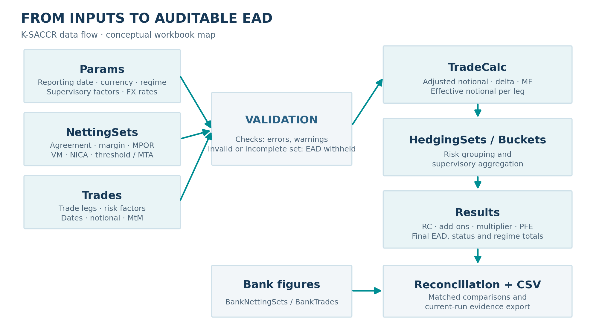
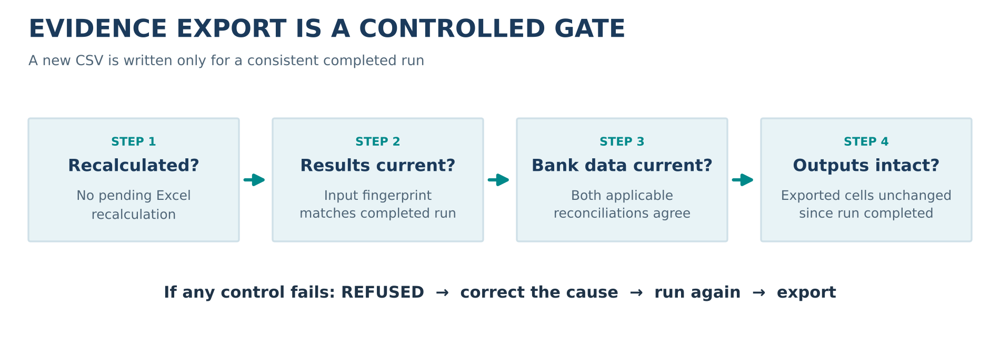

> **RELEASE STATUS — IMPORTANT**\
> This manual is prepared for the **v1.0.0 release candidate**, using the `release/1.0.0` source branch at commit `1152170c842d52acad166f93dbc84ea4f6546669` (16 October 2026). At the time of this documentation baseline, **no v1.0.0 GitHub Release or annotated version tag had been published**, and the final-package acceptance requirements of issue #46 remained open. Before attaching this PDF to a release, confirm that the published artifact matches the certified source and review any changes after this commit. This manual does not itself constitute certification.

**Document purpose.** A practical and technical operating reference for analysts, validators, model owners, risk managers, reviewers and developers using the Windows Excel/VBA implementation of the **Standardised Approach for Counterparty Credit Risk (SA-CCR)**. It explains how to construct the workbook, enter and validate portfolios, interpret trade-to-EAD calculations, reconcile an external bank calculation, export reproducible evidence and understand the declared scope and limitations.

**Reader convention.** `CRR` means the European Union Capital Requirements Regulation implementation in this toolkit; `BCBS` means the Basel Framework CRE52 implementation. “Bank” is shorthand for the independent upstream calculation being compared. “Trade” may mean a row-level **leg**, not necessarily a whole economic trade. Amounts are **unscaled units** unless an explicit bank-reconciliation scale is used. A result generated under one regime must not be added to the same portfolio's result under another regime.

**Documentation source:** [K-SACCR source repository](https://github.com/danielep71/VBA-SACCR-Toolkit), [`README.md`](https://github.com/danielep71/VBA-SACCR-Toolkit/blob/release/1.0.0/README.md), [`INSTALLATION.md`](https://github.com/danielep71/VBA-SACCR-Toolkit/blob/release/1.0.0/INSTALLATION.md), and [methodology / support matrix](https://github.com/danielep71/VBA-SACCR-Toolkit/blob/release/1.0.0/docs/methodology/README.md). The workbook, source, methodology and release evidence take precedence over an outdated copy of this manual.

\newpage


\Needspace{12\baselineskip}

# Orientation and safe use


\Needspace{9\baselineskip}

## What the toolkit does

K-SACCR is an independent, locally executed Microsoft Excel/VBA calculator that implements the full SA-CCR methodology for supported derivatives. Its main purpose is **transparent validation**: not only producing an exposure-at-default figure, but also showing the trace from a trade leg through effective notionals, hedging sets, maturity buckets, asset-class add-ons, replacement cost and potential future exposure to the reported EAD. It is designed for regulatory-methodology analysis, second-line challenge, independent reconciliation, education and controlled what-if analysis.

The calculation is performed for each **netting set**. A netting set represents the group of transactions under a legally and operationally relevant netting arrangement whose eligible exposure is calculated together. Inputs consist of (a) model settings, supervisory factors and FX conversion rates; (b) netting-set and collateral conditions; and (c) derivatives and, where relevant, trade legs. Optional bank figures provide an external comparator. The workbook neither prices derivatives nor retrieves market data: values and descriptors must be supplied by the user.


\Needspace{6\baselineskip}

### Calculation overview

The high-level SA-CCR structure is:

\[
\mathrm{EAD}=\alpha\times(\mathrm{RC}+\mathrm{PFE}),\qquad
\mathrm{PFE}=\mathrm{Multiplier}\times\mathrm{AddOn}_{\mathrm{aggregate}}.
\]

For a standard regulatory run, **alpha is 1.4**. `RC` is replacement cost; `PFE` is potential future exposure; `AddOn_aggregate` combines the supervisory add-ons of the relevant asset classes. A separate unmargined cap is applied where the netting set is margined. The workbook also records intermediate quantities needed to explain why two EAD calculations differ.


\Needspace{6\baselineskip}

### Intended and unintended uses

**Appropriate uses:** reproduce published Basel examples; challenge a bank's SA-CCR calculation; inspect treatment of dates, FX conversion, option delta and margin terms; document reconciliation exceptions; produce a controlled evidence CSV; and test the effect of changed supervisory parameters, explicitly labeled `WHAT-IF`.

**Not established by this version:** universal regulatory certification, independent validation of the CRR rules, counterparty legal enforceability, collateral-eligibility assessments, derivative valuation, regulatory reporting submissions, exposures to CCP default funds, securities-financing transactions, CVA or RWA. These are distinct controls and processes. An output labeled `REGULATORY` indicates that the workbook parameters match the identified reference set; it is **not** a certification of the input data, legal netting arrangements or final release package.


\Needspace{9\baselineskip}

## Version, evidence and validation boundary

The v1.0.0 branch implements both Basel CRE52 and EU CRR rules. The **published, independently external numerical reference values** used in v1.0.0 come from Basel CRE99 examples 1–5. Additional regression cases, including CRR-specific ones, are explicitly **illustrative**, not independently validated. As a result, describe the result as **“BCBS published-example regression coverage; CRR implemented and illustratively tested”**—not as independently validated CRR.

The source README at this documentation baseline records **eight Excel test suites, 228 cases and 1,001 checks** on its documented development-run candidate. This is not a substitute for executing the full suites and recording evidence against the final certified package. Similarly, reports of passing development tests do not prove that the final distributed workbook has been freshly built and certified.


\Needspace{9\baselineskip}

## Recommended user journey

{width=98%}


1. Obtain the exact source/release asset and verify provenance.
2. Build a **production** `.xlsm` from the provided template, or use a certified release workbook if one is actually supplied.
3. Compile, inspect the workbook tabs and work through the synthetic demonstration.
4. Set Params, then populate NettingSets and Trades with synthetic or properly authorized test inputs.
5. Use **Validate inputs** before **Run SA-CCR**; resolve all `ERROR` findings.
6. Inspect Results, TradeCalc, HedgingSets, Buckets and Checks; do not rely on EAD alone.
7. Optionally enter external bank figures on BankNettingSets and BankTrades; run again to refresh the two reconciliations.
8. Export evidence only when the result and any reconciliation are `CURRENT` and the exported output cells are unmodified.
9. Archive the input description, expected sources, evidence CSV, source identity and review conclusions under your organization's controls.


\Needspace{9\baselineskip}

## A map of the 16 worksheets

| Sheet | Type | What you do / find |
|:--|:--|:--|
| `README` | In-workbook guide | Read the quick instructions, purpose and buttons. |
| `Params` | Input and reference data | Reporting date/currency, selected default regime, supervisory parameters, supervisory-factor lookup and FX rates. |
| `NettingSets` | Input | One row per netting set; margin terms, VM, NICA, collateral conditions, regime and alpha override. |
| `Trades` | Input | One row per trade leg; identifiers, instrument/risk drivers, currency, dates, pricing inputs and economic-trade links. |
| `Results` | Output | Netting-set RC, add-ons, PFE, EAD, capped EAD, status; separate totals for CRR and BCBS, run summary and freshness. |
| `HedgingSets` | Output | Per-hedging-set effective notionals and associated add-on components. |
| `Buckets` | Output | Per-bucket and underlying-reference aggregation details. |
| `TradeCalc` | Output | Accepted/excluded trade legs and every major leg-level numerical intermediate. |
| `Checks` | Output | Blocking errors, nonblocking warnings, explanatory notices and what-if deviations. |
| `BankNettingSets` | Optional bank input | External netting-set metrics and reconciliation scale/tolerances. |
| `Reconciliation` | Output | Bank-vs-calculator comparisons, one netting set and metric per row. |
| `BankTrades` | Optional bank input | External trade-leg metrics and trade comparison settings. |
| `TradeReconciliation` | Output | Bank-vs-calculator comparisons per trade leg and metric; includes economic trade ID. |
| `TestCatalogue` | Reference | Catalogue of numerical demonstrations and test expectations. |
| `FormulaTest` | Reference | Worksheet-function examples and expected formulas. |
| `Basel_vs_CRR` | Reference | Comparison of regulatory treatments and their impact. |

**Layout convention.** Every worksheet table begins in **column C**; columns A–B and rows 1–2 are margins. The input tables are found through workbook names pointing to their first header cell. Do not move or delete named header cells, break named ranges, or rearrange input columns.


\Needspace{12\baselineskip}

# Installation and workbook creation


\Needspace{9\baselineskip}

## Supported environment

| Component | Requirement / supported level |
|:--|:--|
| Host | **Microsoft Excel for Windows, 64-bit**, Microsoft 365 or Excel 2016 and later. |
| 32-bit Windows Excel | Best effort, **not certified**. |
| Excel for Mac, Excel for web, Excel 2013 or earlier | **Not supported**. |
| VBA references | Four defaults: Visual Basic for Applications, Microsoft Excel 16.0 Object Library, OLE Automation, Microsoft Office 16.0 Object Library. |
| Repository checkout | Git, for one identifiable commit and correct VBA checkout line endings. |
| Repository checking | Python **3.10+**; standard library, no extra packages needed for `tools/check.py`. |
| Optional build automation | Windows PowerShell and `tools/Sync-SACCR-VBA.cmd`; Excel's VBA-project trust setting during code synchronization. |
| External runtime components | No add-in, DLL, COM registration, or extra VBA reference required. |

**Macro security.** The workbook runs VBA with the user's Office permissions. Review its source, verify its origin and comply with your organization's Office macro policy. “Trust access to the VBA project object model” is used for **building/synchronizing**, not a reason to disable organizational security measures permanently. Turn it off afterward if it was enabled solely for setup.


\Needspace{9\baselineskip}

## Obtain the correct source

The recommended reproducible route is a Git clone of the exact release branch or, once formally published, a verified tagged release. For the manual's documented snapshot:

```console
git clone https://github.com/danielep71/VBA-SACCR-Toolkit.git
cd VBA-SACCR-Toolkit
git switch release/1.0.0
git rev-parse HEAD
python tools/check.py
```

Record the **40-character SHA** shown by `git rev-parse HEAD`. It identifies a source state, not necessarily an approved release. A normal clone preserves the `.bas` and `.cls` line-ending conventions expected by the VBA editor; GitHub's Raw browser view and casual copy/paste are not recommended as import sources. If the release provides prebuilt assets, verify their documented hashes before opening them.


\Needspace{9\baselineskip}

## Build the production workbook using the launcher

1. From the **same checkout**, open `src/workbook/SACCR_Template.xlsx` in desktop Excel.
2. Use **File > Save As** and choose **Excel Macro-Enabled Workbook (`*.xlsm`)**. Save in a local working directory **outside the source checkout**. Do not overwrite the macro-free template.
3. In Excel, enable **Trust access to the VBA project object model** only if the macro synchronization operation needs it and policy allows it. Close the workbook before synchronization.
4. Drag your saved `.xlsm` onto `tools/Sync-SACCR-VBA.cmd`, or invoke the launcher with that workbook path. There is intentionally **no default workbook**.
5. At the prompt choose **P (Production)**. Production imports the seven standard VBA modules and relies on the 17 workbook/document components. Do **not** choose Development for a workbook containing business inputs: development tests overwrite inputs and outputs during execution.
6. The launcher may ask whether to refresh `ThisWorkbook` and worksheet code modules; their source contains only `Option Explicit`, so either answer works for the current template. Read the synchronization log and resolve any errors.
7. Open the `.xlsm`, press **Alt+F11**, and select **Debug > Compile VBAProject**. Compilation must complete without errors. Confirm the expected VBA references and save the workbook.
8. Return to Excel and open the `README`, `Params`, `NettingSets`, `Trades` and `Results` tabs; check that the existing sheet buttons are present. Execute the synthetic demo before replacing inputs.

**Production components:** `CORE_Config`, `CORE_Engine`, `CORE_Export`, `CORE_Reconcile`, `CORE_Util`, `SACCR_Formulas`, `M_Main`. `ThisWorkbook` and the worksheet code modules remain workbook document components, not separately imported ordinary class modules. The template has no VBA project of its own.


\Needspace{9\baselineskip}

## Manual import alternative

When policy prevents VBA-project automation, open the `.xlsm` and use **Alt+F11 > File > Import File** in this order: all `.bas` files under `src/core/`; then all `.bas` under `src/modules/`; then `src/workbook/M_Main.bas`. Import source from **one commit only**, preserving component names. Document module `.cls` files cannot be imported as ordinary classes: open the existing `ThisWorkbook` or corresponding worksheet code window and paste the code **below** the `Attribute` lines from the matching source file. The FormulaTest worksheet has a historical code name `shTests`. Finally compile and save.


\Needspace{9\baselineskip}

## Build a separate development workbook

Create another `.xlsm` from a fresh template and choose **D (Development)** in the synchronization launcher. Development adds the ten source test modules in `tests/modules/` to the seven production `.bas` modules (17 standard modules in total), plus the 17 workbook/document components. It is used for compiler checks, regression and harness execution. **Never use a development workbook for real data**, because tests intentionally modify input, Params and output areas, then attempt to restore them.

In the VBA Immediate window (Ctrl+G in the editor), invoke:

```vb
Test_RunAll
```

A passing development run is useful functional evidence but must be tied to the exact source SHA, workbook and host used. The required release certification has further lifecycle and evidence obligations; see the release-verification chapter.


\Needspace{9\baselineskip}

## Upgrade, rebuild and remove

If **only VBA source** has changed, resynchronize the source code from a single new commit, compile and retest. If the **template changes** (headers, named cells, validation, worksheets or buttons), construct a **new workbook from the new template** and migrate input values carefully; importing VBA into an old workbook does not migrate its worksheet layout. Use the changelog and diff of `src/workbook/SACCR_Template.xlsx` to decide. A missing or relocated workbook name or header often indicates template drift.

No system-wide installation is registered. Removing the `.xlsm`, any `*.pre-vba-sync.*` backups and user-generated CSVs removes the local working artifacts; also undo any temporary VBA-project trust setting. Do not accidentally delete retained audit evidence.


\Needspace{12\baselineskip}

# First calculation: guided demonstration


\Needspace{9\baselineskip}

## What is included in the template

The macro-free template contains a **synthetic demonstration portfolio**: the five published Basel CRE99 examples and additional illustrative netting sets. Some illustrative rows are deliberately invalid to demonstrate the rejection mechanism. Test cases derived from published reference data are also maintained as structured files under `tests/fixtures/` and `tests/expected/`; the workbook's demonstration rows are not automatically equivalent to every exact fixture convention.

For example, CRE99 Example 3's published calculation uses a nine-month remaining maturity (`M = 0.75`); one spreadsheet illustration computes elapsed dates on a 365-day basis, giving `M = 0.7507` and an EAD around **5,405** in the example's printed thousand-unit scale rather than the published **5,406**. The exact fixture uses the stated period and reproduces the published figure. Treat this as a **day-count illustration**, not a discrepancy requiring an arbitrary manual adjustment.


\Needspace{9\baselineskip}

## Walkthrough in Excel

1. **Preserve an untouched copy.** Save a separate working `.xlsm` from the just-built demo. Use only synthetic information.
2. **Inspect `Params`.** Find `AsOfDate`, `ReportingCcy`, `Regime`, `DaysPerYear`, `BusinessDaysPerYear`, `Alpha`, `SF_Table` and `FX_Table`; verify the reporting-currency FX row has rate 1.
3. **Inspect `NettingSets`.** Note each ID, `Margined (Y/N)`, VM, NICA, threshold, MTA, any MPOR condition and `Regime override`.
4. **Inspect `Trades`.** Each row has a unique **TradeID** (the leg ID). Follow a sample row from `NettingSetID` to its asset class, risk factor, notional, currency and dates. If an economic trade has several legs, use the economic-trade columns.
5. Click **Validate inputs** (`ValidateInputs`). Read `Checks`. Errors describe excluded trades, unusable netting sets or a run-stopping defect; warnings describe accepted inputs needing attention.
6. Click **Run SA-CCR** (`RunSACCR`). The macro validates, calculates and updates output sheets. It does **not** quietly compute a netting set's EAD using only valid trades when another trade in that set was rejected.
7. Open `Results` and locate the status for each netting set. Inspect `VALID`, `INCOMPLETE`, `INVALID` and `NO TRADES` behavior before focusing on numbers. The **CRR** and **BCBS** totals are separate, and they include only `VALID` netting sets.
8. For a valid example, trace its `TradeCalc` rows to `HedgingSets` / `Buckets` and the add-on columns on `Results`; verify the reported `RC`, multiplier, `PFE` and EAD.
9. Inspect `Checks` to understand all demonstration exclusions. Resolve exclusions on **copies**, not by modifying the frozen published-fixture evidence.
10. Optionally fill `BankNettingSets` and `BankTrades` with illustrative comparison figures; run again and study the result codes on `Reconciliation` and `TradeReconciliation`.
11. Click **Export evidence** on the `Reconciliation` sheet, select an output CSV path and review the exported text. Repeat only after confirming freshness and output integrity.


\Needspace{9\baselineskip}

## Published Basel example reference points

The following are **published CRE99 target results** used in the numerical catalogue, not a promise that every demonstration row uses identical date assumptions. They are listed in original **USD units** here, whereas the source tables print USD thousands.

| Published case | Selected printed target in unscaled USD | What it helps check |
|:--|--:|:--|
| CRE99 Example 1 | EAD **569,000** | Interest-rate components, including option delta and add-on. |
| CRE99 Example 2 | EAD **381,000** | Collateral and multiplier behavior. |
| CRE99 Example 3 | EAD **5,406,000** | Cross-asset/add-on and maturity precision. |
| CRE99 Example 4 | EAD **936,000** | Replacement cost and aggregation. |
| CRE99 Example 5 | EAD **1,879,000** | Margined MPOR, add-ons, multiplier and cap context. |

A reference comparison is meaningful only when **regime, reporting currency, unit scale, dates, market inputs and netting terms** match the reference. Rounded values should be checked against their printed precision and published tolerance, not mistaken for machine-precision oracle values.


\Needspace{9\baselineskip}

## Buttons and their exact roles

| Displayed button | VBA entry point | Safe operating interpretation |
|:--|:--|:--|
| **Run SA-CCR** | `RunSACCR` | Validate inputs, calculate accepted netting sets and populate all relevant output sheets; update reconciliations where possible. |
| **Validate inputs** | `ValidateInputs` | Examine data and write findings to Checks **without calculating exposure**. |
| **Clear outputs** | `ClearOutputs` | Clear calculated output areas and invalidate the previous completed run; do not assume an error while clearing leaves no residual values. |
| **Export evidence** | `ExportEvidence` | Interactive CSV export of a **current and unmodified** run; refuse if freshness/integrity requirements fail. |

After running, `Results!C4` contains the summary, and `Results!C5` contains the freshness status. Reconciliation sheets likewise have summary (`C4`) and status (`C5`) positions.


\Needspace{12\baselineskip}

# Global settings and supervisory data


\Needspace{9\baselineskip}

## Params: identity and values

The `Params` sheet is a **named-range-driven table**. Each parameter has a code in the `Code` column, a value in the `Value` column and a workbook name of that code. The underlying source uses workbook names `Params_Code`, `Params_Value`, `SF_Table` and `FX_Table`. Names—not fixed row positions—locate the tables; their first header cells must be structurally correct.

| Setting | Typical regulatory value / convention | Meaning and user action |
|:--|:--|:--|
| `AsOfDate` | User-supplied valid reporting date | All dates and exposures are referenced to this date. |
| `ReportingCcy` | Three-letter code, e.g. `EUR` | All output amounts are in this currency. Its FX table rate must be **1**. |
| `Regime` | `CRR` by default; `BCBS` possible | Default rule set, with optional netting-set override. |
| `Alpha` | **1.4** | Supervisory EAD multiplier unless explicitly overridden for a netting set. |
| `MultiplierFloor` | **0.05** | Lower bound on the PFE multiplier. |
| `DaysPerYear` | **365** | Calendar-day basis for S, E, M and T; fixture conventions may change it. |
| `BusinessDaysPerYear` | **250** | Business-day convention for maturity floors and MPOR. |
| `MinMaturityBD` | **10** | Floor on the unmargined maturity factor's M. |
| `SDFloorBD` | **10** | Floor used in supervisory-duration treatment. |
| `MPORFloorBilateral` | **10** | Base bilateral MPOR floor. |
| `MPORFloorCleared` | **5** | Eligible client-clearing MPOR floor, subject to regime/role. |
| `MPORFloorLarge` | **20** | Large / illiquid netting-set floor. |
| `BasisFactor` | **0.5** | Factor for eligible basis hedging sets. |
| `VolatilityFactor` | **5** | Factor for volatility transactions. |
| `IRCorrBucket12`, `IRCorrBucket23`, `IRCorrBucket13` | **0.7**, **0.7**, **0.3** | Interest-rate maturity-bucket correlations. |
| `IRBucketOffset` | `TRUE` for offset formula | `FALSE` selects sum-of-absolutes **only for BCBS**; invalid for a CRR netting set with IR trades. |
| `LambdaThresholdIR` | **0.001** | CRR lambda threshold for interest-rate options. |
| `LambdaThresholdCO` | **0.1** | CRR lambda threshold for commodity options. |

**Unit discipline.** Rates, correlations and percentages are decimal values (`0.05` means 5%); notional, valuation and collateral are unscaled currency units; business-day settings are days; S/E/M/T are year fractions. Do not enter `5` to represent 5% unless a particular field expressly requires it. Missing optional numeric settings may be replaced by their regulatory defaults **with a warning**; invalid mandatory settings stop the calculation.


\Needspace{9\baselineskip}

## Regulatory versus what-if classification

The source records the regulatory reference set **`CRE52-CRR-2026-10-09`**. The engine compares the relevant Params numeric fields, supervisory-factor rows and per-netting-set alpha overrides to the set. If they all match, the run is `REGULATORY`; otherwise `WHAT-IF`, with a **separate “What-if:” warning** in Checks for each deviation. `DaysPerYear` and `IRBucketOffset` are treated as conventions and do not by themselves change the classification; nevertheless they affect calculations and must be documented. A `REGULATORY` class is not a judgment that the user entered correct data or that the release package is certified.


\Needspace{9\baselineskip}

## SF_Table: supervisory-factor register

The supervisory lookup contains the following columns, in this order: `SF_Key`; `Asset class`; `Category`; `Supervisory factor`; `Correlation`; `Supervisory option vol`; `Commodity hedging set`; `Regimes`. A key's classification and eligible regimes determine what the engine may use. The table extends from its named header to the **first blank key**, including rows below the originally named range. Do not leave a blank key in the middle of the intended data.

Selected **regulatory** reference values are shown below. This is a navigation aid, not permission to overwrite the workbook's complete table without an independent review.

| Class/category | Supervisory factor | Correlation / supervisory volatility where relevant |
|:--|--:|:--|
| IR | 0.50% | Supervisory option volatility 50%. |
| FX | 4.00% | Supervisory option volatility 15%. |
| CR single name | 0.38% to 6.00% | By Basel rating or CRR CQS; single-name correlation 50%, option vol 100%. |
| CR index | 0.38% (IG), 1.06% (SG) | Index correlation 80%, option vol 80%. |
| EQ single name | 32% | Correlation 50%, option vol 120%. |
| EQ index | 20% | Correlation 80%, option vol 75%. |
| CO electricity | 40% | Commodity correlation 40%, option vol 150%. |
| CO other categories | 18% | Commodity correlation 40%, option vol 70% for non-electricity commodities. |
| CO climatic conditions | 18% | **CRR-only** hedging set. |
| OT other risks | 8% | **CRR-only**; supervisory option volatility 150%. |

**Credit steps:** CRR CQS1 through CQS6 map to **0.38%, 0.42%, 0.54%, 1.06%, 1.60%, 6.00%**. Basel single-name ratings AAA/AA/A/BBB/BB/B/CCC correspond to **0.38%, 0.38%, 0.42%, 0.54%, 1.06%, 1.60%, 6.00%**. A bank must apply the appropriate rating/CQS mapping and report its methodology; K-SACCR does not fetch ratings.


\Needspace{9\baselineskip}

## FX_Table: conversion into reporting currency

The FX lookup has header fields `FX_Ccy`, a spacer, and `Units of reporting ccy per 1 unit`. Enter each relevant three-letter currency key and the number of units of **reporting currency per one unit** of that currency. Example: when reporting in EUR, a hypothetical `USD -> 0.92` means one USD is converted into 0.92 EUR. The rate for EUR itself **must be 1**. The code and direction matter: entering reciprocal quotes changes amounts.

**Example (illustrative only):** a USD 1,000,000 trade amount multiplied by a user-supplied USD/EUR conversion rate of 0.92 produces EUR 920,000. This is a **currency conversion example**, not an SA-CCR EAD prediction. The engine does not retrieve spot prices or market FX rates; the user must establish the correct as-of prices and reconcile them with the bank's data.

For **FX derivatives**, two currencies must both be present in the FX table and the entered risk-factor currency pair must be coherent with the notional currency. The special pair-order rules for options and linear FX are detailed later in this manual.


\Needspace{9\baselineskip}

## Dates, named ranges and error handling

The workbook supports an actual Excel date, a serial number in Excel's **1900 date system**, or literal `YYYY-MM-DD` text. Text such as `30/09/2031` is deliberately **rejected** because its interpretation depends on locale. A workbook using the 1904 date system stops the run. An invalid reporting date stops the run; an invalid trade date rejects that trade. Be deliberate with future maturities, option expiries and products with reset schedules.

**Never rearrange `NettingSets` or `Trades` columns or rewrite their headings.** Header comparison tolerates case, spaces and line breaks, but not a changed schema. A missing required workbook name, an invalid reference or a moved header can stop the run. Visible formatting alone is not a controlled way to change the data contract.


\Needspace{12\baselineskip}

# Enter netting sets and collateral terms


\Needspace{9\baselineskip}

## NettingSets data contract

The `NettingSets` input table has **15 fields** in an exact sequence. Each row represents one netting set; the same netting-set ID must not be entered twice. A row can override the default regime, but all trades assigned to it follow that regime. The `Counterparty` field is descriptive; legal enforceability, eligible margin arrangements and transaction classification remain external responsibilities. The two margin columns (`VM`, `NICA`) and the three credit support settings (`TH`, `MTA`, MPOR conditions) have a **material numerical effect** and must not be approximated casually.

| # | Exact header / field | Accepted concept, sign and key checks |
|--:|:--|:--|
| 1 | `NettingSetID` | Required unique key; referenced by every trade. Do not use `TOTAL`, `TOTAL CRR` or `TOTAL BCBS` as IDs, because these are output total labels. |
| 2 | `Counterparty` | Description / controlled identifier. Use synthetic identifiers in public test workbooks. |
| 3 | `Margined (Y/N)` | `Y` for a supported margin agreement; `N` for an unmargined netting set. Drives RC and maturity-factor treatment. |
| 4 | `Client clearing role (N / CM / CLIENT)` | Bank's role: `N` ordinary, `CM` clearing member facing client, or `CLIENT` client facing clearing member. Blank is treated as `N`. |
| 5 | `Remargin frequency N (BD)` | Whole number of business days; `0` is interpreted as daily **with a warning**; accepted maximum 10,000. Used in MPOR `F + N - 1`. |
| 6 | `>5,000 trades or illiquid collateral (Y/N)` | `Y` triggers relevant 20-business-day MPOR floor; the business definition also covers hard-to-replace OTC transactions. Confirm actual eligibility and threshold. |
| 7 | `Margin disputes (Y/N)` | `Y` triggers the toolkit's doubled MPOR treatment; verify whether dispute conditions actually apply. |
| 8 | `MPOR override (BD)` | Optional strictly positive whole-business-day override; may not be **below** the computed MPOR. |
| 9 | `Net VM held (+) / posted (-)` | Net variation margin. Held is **positive**; posted is **negative**. VM treatment differs for unmargined one-way agreements by regime. |
| 10 | `NICA` | Net independent collateral amount; its regulatory definition includes eligible independent collateral held less relevant posted independent collateral, subject to eligibility, haircut and segregation rules. |
| 11 | `Threshold TH` | Margin threshold, expressed as an unscaled amount in the calculation currency. |
| 12 | `MTA` | Minimum transfer amount, expressed as an unscaled amount. |
| 13 | `Alpha override` | Optional per-netting-set alpha; values different from 1.4 classify the run `WHAT-IF`. |
| 14 | `Regime override (blank = Params)` | Blank inherits the Params regime; otherwise use `CRR` or `BCBS`. The comparison and output retain the effective regime. |
| 15 | `Margin agreements (blank / MIXED / SHARED)` | Blank represents the supported single agreement/no agreement structure; `MIXED` or `SHARED` explicitly declares **unsupported structures** and causes rejection. |

**Data ownership rule.** One input row is not necessarily a legal agreement record. The analyst must ensure that exposures, collateral and margin settings are correctly mapped to the intended netting set under the applicable rule. A workbook that calculates without warnings can still contain a poor legal or economic mapping.


\Needspace{9\baselineskip}

## Margined and unmargined replacement cost

For an **unmargined** netting set, the relevant replacement cost is essentially:

\[
\mathrm{RC}_{u}=\max(V-C,0),
\]

where `V` is current portfolio value and `C` is the collateral recognized under the appropriate unmargined convention. For the **margined** calculation, the standard structure is:

\[
\mathrm{RC}_{m}=\max(V-C,\ \mathrm{TH}+\mathrm{MTA}-\mathrm{NICA},\ 0).
\]

The toolkit's **cap calculation** compares the margined EAD with the EAD of the *same netting set without margin*; for the cap, `C = NICA` under both supported regimes. **Do not include margined VM in the unmargined cap's C.** This treatment was explicitly clarified in the project's source/methodology and is important when interpreting a cap flag.

For an unmargined BCBS one-way agreement in which **only the bank posts VM**, posted VM is negative and enters collateral appropriately. Conversely, **VM held** is not supported as an unmargined input. Under CRR, a one-way agreement is treated as a margin agreement: enter the set as margined; posted VM on an `N` CRR netting set is rejected. The bank must determine which regulatory description accurately represents its arrangement.


\Needspace{9\baselineskip}

## MPOR calculation and clearing role

The Margin Period of Risk (MPOR) is measured in **business days**. The engine calculates the relevant floor from the margin agreement, frequency, large/illiquid flag, dispute flag, client-clearing role, and any permissible override. The basic approach combines a floor `F` with remargining frequency `N` as `F + N - 1`. Under the documented implementation, dispute treatment doubles that result, while large/illiquid treatment applies the 20-day floor with the documented frequency adjustment. An entered MPOR override cannot reduce the calculated requirement.

| Condition | Toolkit treatment |
|:--|:--|
| Ordinary margined bilateral | Base floor of 10 business days. |
| Clearing member (`CM`) facing client | 5-day floor under both CRR and BCBS, subject to eligibility. |
| Client (`CLIENT`) facing clearing member | 5-day floor under **CRR**, 10-day floor under **BCBS**. |
| Large/illiquid conditions | Relevant 20-business-day floor, with frequency treatment. |
| Remargin every N business days | MPOR floor plus `N-1`. |
| Margin dispute | Doubled calculated period under toolkit's deliberately conservative rule. |
| User MPOR override | Allowed only when not below the calculated MPOR. |

**Important:** `CM`/`CLIENT` is a bank-role declaration, **not** evidence that a transaction qualifies for special client-clearing treatment. The user must separately establish regulatory eligibility and documentation.


\Needspace{9\baselineskip}

## Collateral, haircuts and amount scales

Collateral amounts on `NettingSets` are entered **after the user has applied** legal/eligibility and applicable valuation/haircut treatment. The workbook does not price collateral, establish eligibility, determine legally enforceable close-out netting, or automatically remove segregated bank-posted initial margin from NICA. The user must apply these definitions before entering inputs. Use one internally consistent reporting-currency unit scale for every netting-set amount. A missing or incorrect conversion is a data-control failure, not merely a reconciliation tolerance issue.


\Needspace{9\baselineskip}

## Status and exclusion rules

The engine assigns the following status, in this precedence order:

| Status | Trigger | What is shown |
|:--|:--|:--|
| `INVALID` | Netting-set-level error, duplicate netting-set ID, inconsistent trade reference/sub-class combination, or a CRR IR netting set with unsupported `IRBucketOffset=FALSE`. | The netting set is represented on Results, but no EAD is calculated. |
| `INCOMPLETE` | The netting set is otherwise structurally valid, but at least one associated trade leg is rejected. | EAD is **withheld** rather than calculated on a partial portfolio. |
| `NO TRADES` | The netting set contains no accepted/relevant trades. | No EAD; it is not counted as a withheld incomplete set. |
| `VALID` | Netting set and all of its trades satisfy the supported input contract. | Calculation figures and EAD can be used for further review. |

The order matters: a netting set with both an invalid netting field and an excluded trade is `INVALID`. An excluded trade is listed on `TradeCalc` and `Checks` with its reason. In a portfolio total, only `VALID` sets contribute, and withheld sets must be identified separately. **A reported total of valid netting sets is not necessarily the exposure of the full input portfolio.**


\Needspace{12\baselineskip}

# Enter derivative trades and trade legs


\Needspace{9\baselineskip}

## Trades data contract

`Trades` contains **26 fields**. The **TradeID is a unique leg identifier**. Every leg is linked to a netting set by `NettingSetID`. An economic trade may require one row or multiple rows depending on its material risk drivers or decomposition. The workbook reads fixed column positions verified against expected headings, not arbitrary user-added columns.

| # | Exact header / field | Meaning, format and common mistakes |
|--:|:--|:--|
| 1 | `TradeID` | Required unique **leg** ID. Duplicate IDs are errors and affect reconciliation population diagnostics. |
| 2 | `NettingSetID` | Must reference a valid netting-set ID from `NettingSets`. |
| 3 | `Asset class` | `IR`, `FX`, `CR`, `EQ`, `CO`, or `OT` (`OT` only under CRR). |
| 4 | `Sub-class` | Regulatory category, e.g. `AAA`/`CQS3` for credit or `SINGLE`/`INDEX` for equity; must be coherent with asset class and regime. |
| 5 | `Risk factor / reference` | Currency, pair, reference entity, commodity risk driver or other hedging key. Exact identifiers influence aggregation. |
| 6 | `Instrument` | `Linear`, `Option` or `CDO`. Digital options are not a supported instrument type. |
| 7 | `Direction` | `Long` or `Short`, affecting supervisory delta and aggregation. |
| 8 | `Option type` | `Call` or `Put` for options; only meaningful where relevant. |
| 9 | `Nature` | `Standard`, `Basis` or `Volatility`; changes hedging-set treatment. |
| 10 | `Basis / vol hedging-set label` | User-supplied distinguishing label for basis and volatility transactions. |
| 11 | `Notional` | Unscaled monetary or relevant underlying notional, in the specified notional currency; product-specific adjusted-notional rules apply. |
| 12 | `Notional ccy` | Currency of notional; for FX trades, must be a leg currency in the specified pair. |
| 13 | `MtM` | Current mark-to-market for this leg/economic trade, in the specified MtM currency. Exactly one leg carries it in a multi-leg economic trade. |
| 14 | `MtM ccy` | MtM currency; blank defaults to the notional currency. Must be convertible via Params. |
| 15 | `Start date (S)` | Relevant effective/start date; mandatory for specified underlying IR/credit options. |
| 16 | `End date (E)` | Date used in duration and IR bucket logic; often underlying end date. |
| 17 | `Maturity date (M)` | Remaining maturity or next eligible value-reset date, according to product rules. |
| 18 | `Option expiry (T)` | Required option expiry; must be after the reporting date and not after M. |
| 19 | `Underlying price P` | Option underlying price/rate (including FX quote conventions). |
| 20 | `Strike K` | Option strike in the same market convention as price. |
| 21 | `Lambda shift` | Where appropriate, the input/derived shift used by the CRR IR/commodity option treatment. Follow the documented rule; do not use it as an arbitrary delta adjustment. |
| 22 | `Attachment A` | CDO tranche attachment point as a decimal fraction. |
| 23 | `Detachment D` | CDO tranche detachment point as a decimal fraction; greater than A. |
| 24 | `Economic trade ID` | Optional group key identifying legs belonging to the same economic instrument. Blank means this row is a whole trade. |
| 25 | `MtM leg (Y/N)` | Exactly one leg of a grouped economic trade carries the full MtM (`Y`); other legs hold zero MtM. |
| 26 | Unnamed free-text `Comment` column | Operator note; not read into calculations. Do not rely on this field for mandatory machine-readable inputs. |

**Safety distinction:** a trade being accepted means its **declared** instrument, dates, rates and structure comply with the engine's supported field contract; it does not prove that its declared underlying risk drivers, decomposition or model inputs are economically correct.


\Needspace{9\baselineskip}

## Assets and supported instruments

| Asset class | What is supported | What requires care |
|:--|:--|:--|
| `IR` | Linear interest-rate derivatives, IR options, inflation exposures declared as IR | Currency/`-INFL` identifiers, supervisory duration, maturity buckets and underlyings of swaptions/caps/floors. |
| `FX` | FX linear trades and options | Currency pair, correct notional leg, quote order and delta sign. |
| `CR` | Credit single names and indices, options and credit CDO/tranche rules | Rating versus CRR CQS, reference consistency, sub-class factors and tranche attachment/detachment. |
| `EQ` | Equity single-name and index instruments and options | Index versus single-name classifications, reference-based aggregation. |
| `CO` | Commodity instruments and options, CRR climatic hedging set | Commodity category, electricity factor, negative price/strike treatment and special CRR classification. |
| `OT` | Other-risk drivers **under CRR only** | Each identical primary risk driver maps to its own hedging set; rejected under Basel. |

A **linear trade** uses supervisory delta +1 when long and -1 when short, with the relevant product-level signed interpretation. **Options** use the supported supervisory-option-delta treatment. European, American, Bermudan and Asian styles are covered under the documented input conventions: for Bermudan use the **latest exercise** date as expiry; for Asian options the input price represents the current value of the relevant average. **Credit CDO tranches and nth-to-default** use attachment/detachment treatment. Basis or volatility nature changes hedging-set coefficients rather than creating a new asset class.

**Not included:** digital options under either regime, automatic decomposition/pricing of arbitrary exotic structures, optional zero-EAD treatment for qualifying sold options, the optional unpaid-premium cap for certain sold credit protection, unsupported multiple/shared margin-agreement structures, and other methods outside full SA-CCR.


\Needspace{9\baselineskip}

## Multi-leg economic trades: prevent MtM double-counting

A derivative can have several material risk drivers, or an option combination can require decomposition. The supported representation is **one row per eligible leg**, all sharing the same `Economic trade ID`. Exactly one leg is marked `MtM leg = Y` and carries the **entire economic trade's MtM**; the other legs are marked `N` and have MtM **zero**. All legs must belong to the **same netting set**. If this fails, the engine rejects all legs of that economic trade. The user remains responsible for mapping the risk drivers and choosing the correct economic decomposition.


\Needspace{6\baselineskip}

### Illustrative three-leg example

| TradeID | Economic trade ID | NettingSetID | MtM leg | MtM |
|:--|:--|:--|:--:|--:|
| `TRD-101-IR` | `TRD-101` | `NS-01` | `Y` | +250,000 |
| `TRD-101-FX` | `TRD-101` | `NS-01` | `N` | 0 |
| `TRD-101-EQ` | `TRD-101` | `NS-01` | `N` | 0 |

This example represents a **possible input structure only**: no claim is made that the instrument economically has these three risk categories. If the user repeated +250,000 in each row, a naive approach would triple the portfolio MtM. K-SACCR's grouping check is designed to reject such errors rather than silently aggregate an inconsistent economic trade.

**Option combinations** such as spreads, straddles, strangles, collars and caps/floors can be represented using suitable option component legs. Within the same asset class, grouped option combinations must be option legs; a normal linear swap should not be split as if it were an option combination. A digital payoff is **not made supported** merely by approximating it with a collection of standard options.


\Needspace{9\baselineskip}

## Date conventions and maturity inputs

The workbook derives year quantities on its `DaysPerYear` basis. **S** is years from reporting date to the start date, floored to zero if blank or already begun except where a start date is mandatory. **E** is years to the end date (or the derived fallback); **M** is years to maturity (or eligible fallback / reset); **T** is years to option expiry. The **regulatory business-day** floors are calculated using `BusinessDaysPerYear` and MPOR settings, not by assuming a particular holiday calendar.

* For an interest-rate or credit trade, **E must be later than S** where duration is required.
* A maturity at or before the reporting date is invalid; options that are expired, or have expiry after M, are rejected.
* For an **option on an interest-rate or credit underlying**, S and E describe the underlying rather than only the option's own life. A swaption's S is ordinarily the exercise/start of the underlying swap and E its final end. A Bermudan swaption can need S as the earliest permitted exercise and T as the latest. Missing mandatory S is rejected.
* For an amortizing or accreting IR/credit trade, enter the correct **time-weighted average remaining notional**. For leveraged or notional-exchange products apply the required leverage/payment conventions before input.
* For certain reset-to-zero arrangements, **M is the next reset date**, not necessarily final contractual maturity. There is no automatic notional schedule reader.


\Needspace{6\baselineskip}

### Interest-rate maturity buckets

| End date E (years) | CRR bucket | BCBS bucket |
|:--|:--|:--|
| `0 < E < 1` | Bucket 1 | Bucket 1 |
| `E = 1` | **Bucket 1** | **Bucket 2** |
| `1 < E <= 5` | Bucket 2 | Bucket 2 |
| `E > 5` | Bucket 3 | Bucket 3 |

This **exact one-year boundary difference** is deliberate; it can change aggregation and EAD even with identical economic trade data. The bucket boundary at exactly five years is bucket 2 under both regimes.


\Needspace{9\baselineskip}

## FX forwards: pair orientation and notional

FX risk factor is two distinct three-letter currency codes, e.g. `EUR/USD`, `EURUSD` or the reverse. Both currencies need a rate in the FX table. A forward may be entered in either orientation; the hedging key is normalized in alphabetical order, and the supervisory-delta sign changes appropriately when input orientation is reversed.

The entered notional represents **one leg**, not the sum of both. It must be in one of the pair's currencies. Use the **foreign-currency leg** against reporting currency or, if both legs are foreign to reporting currency, the leg with the **larger reporting-currency value** under the relevant rule. The workbook checks that the notional currency is a pair currency, but **does not independently decide whether the selected leg was the correct one**.


\Needspace{9\baselineskip}

## FX options: mandatory market-quote order

Unlike linear FX, an FX option must be entered in the market-quote order used for the regulatory delta. The toolkit's priority ranking is:

**EUR, GBP, AUD, NZD, USD, CAD, CHF, JPY**.

Examples: **EUR/USD, GBP/USD, USD/JPY, EUR/CHF**. A ranked currency comes before an unranked one, so `USD/SEK` is accepted. If neither is in the ranking, the alphabetically earlier currency is the base, e.g. `NOK/SEK`. Options entered in reverse order are **rejected**, because a numerically analogous call/put on inverse quotes does not generally yield the same supervisory delta. Price P and strike K must be quoted in the entered orientation.


\Needspace{9\baselineskip}

## Credit, commodity, inflation and other-risk coding

For **credit single names**, classify by `AAA` through `CCC` in Basel or `CQS1` through `CQS6` in CRR; index categories `IG_INDEX` and `SG_INDEX` are supported. For CRR unrated exposures, the appropriate CQS is an **input determination**, not automatically a separate “unrated” factor. Use the prescribed relevant CQS rule, including CQS5 where Article 128 applies.

For **inflation**, use class `IR` and a separate factor identifier such as `EUR-INFL` to keep inflation from ordinary interest-rate risk within the same currency. For **commodity climatic** exposures, the `CLIMATIC` sub-class and associated hedging treatment are CRR-only; a Basel climatic trade is not converted into an invented class. For **other risks**, `OT` is CRR-only and the same primary risk driver forms a hedging set. For **CDO/nth-to-default**, ensure attachment and detachment are proper fractions and that `A < D`; nth-to-default may be represented by `A = (n-1)/k`, `D = n/k` when that mapping is applicable.


\Needspace{9\baselineskip}

## Examples of inputs that must be corrected, not ignored

| Problem | Typical observation | Resolution principle |
|:--|:--|:--|
| Two rows with the same `TradeID` | Duplicate-ID error; trade-level bank matching may become non-comparable. | Allocate unique leg IDs; do not solve it by hiding a row. |
| An unrecognized `NettingSetID` | Trade excluded and netting population exception. | Add/correct the corresponding netting set and its metadata. |
| Option expiry `T` earlier than or on AsOfDate | Excluded trade. | Verify the valuation date / expiry or remove already-matured trade appropriately. |
| Currency pair in reverse order for FX **option** | Excluded option despite economically equivalent wording. | Normalize to the mandated market quote orientation and adjust price/strike. |
| Invalid locale-formatted date string | Excluded row or stopped run. | Use a true Excel date or ISO `YYYY-MM-DD`. |
| Unsupported margin structure `MIXED` / `SHARED` | `INVALID` netting set; EAD withheld. | Split/restructure under a supported legal arrangement; do not misdeclare its status. |
| Inconsistent grouped MtM legs | All legs of economic trade rejected. | One shared economic ID, exactly one `Y` leg with full MtM, others zero. |
| CRR IR set and `IRBucketOffset=FALSE` | `INVALID`; CRR does not offer this option. | Set TRUE for CRR or use BCBS only when that is the intended comparison. |
| `OT` under Basel | Excluded trade. | Do not invent Basel support for sixth asset class. |


\Needspace{12\baselineskip}

# Calculation anatomy: from trade leg to EAD


\Needspace{9\baselineskip}

## Traceable calculation path

Every accepted trade is enriched with normalized values and a supervisory interpretation. The workbook first calculates or assigns a **supervisory factor, supervisory delta, adjusted notional and maturity factor**. It then forms **effective notionals**, aggregates those by **hedging set** and, where relevant, **maturity bucket or reference**, produces **asset-class add-ons**, combines the add-ons into the **aggregate add-on**, and finally calculates **replacement cost, PFE and EAD** per netting set. The detailed views exist precisely to make this hierarchy challengeable.

```
Params + NettingSets + Trades
             |
             v
  Validate columns / dates / IDs / regimes / amounts
             |
             v
 TradeCalc: leg normalization and effective notionals
             |
             v
 HedgingSets + Buckets: grouping and regulatory offsets
             |
             v
 Results: add-ons -> multiplier -> PFE -> RC -> EAD
             |
             v
 Bank comparisons -> Reconciliation + TradeReconciliation
             |
             v
 Current, unmodified run -> one evidence CSV
```


\Needspace{9\baselineskip}

## Trade-level intermediary quantities

A **linear** trade's signed supervisory delta is ordinarily +1 for long or -1 for short. For options, the delta is obtained from the regulatory supervisory-option approach (the project exposes `SACCR_OptionDelta` and `SACCR_LambdaCRR` to inspect the building blocks). In IR and credit, adjusted notional depends on supervisory duration and the input notional; FX and other asset classes apply their respective definitions. The resulting **effective notional** combines adjusted notional, supervisory delta and the corresponding maturity factor. `TradeCalc` records both unmargined and, when applicable, margined versions to support comparison and cap analysis.

The basic supervisory duration function, when used, follows the continuous-rate expression:

\[
\mathrm{SD}(S,E)=\frac{e^{-0.05S}-e^{-0.05E}}{0.05},
\]

with the appropriate supervisory floor and product-specific date conventions. This is **not** a valuation-based DV01 or market-risk duration: it is a prescribed SA-CCR supervisory quantity.

For illustrative orientation, the maturity-factor structures are:

\[
\mathrm{MF}_{u}=\sqrt{\min(\max(M,\,10/250),\,1)},
\qquad
\mathrm{MF}_{m}=\frac{3}{2}\sqrt{\frac{\mathrm{MPOR}_{BD}}{250}}.
\]

The exact runtime uses configured parameters such as business days per year and minimum maturity business days; **do not use these display equations instead of the workbook's named parameter values or regime-specific conditions**. The margined factor applies only in the relevant margined treatment.


\Needspace{9\baselineskip}

## Hedging sets, maturity buckets and correlation

Netting within a **hedging set** is not a simple sum across all trades. Regulatory rules differ by asset class and sub-class. The workbook exposes hedging sets, buckets and entity/reference dimensions so that offsetting, correlations and category distinctions can be reviewed. Pay special attention to an unexpected zero or low add-on: it could be valid netting or an incorrectly shared hedging identifier.

For interest-rate exposures, effective notionals are allocated to **three maturity buckets**, commonly represented as `D1`, `D2` and `D3`. The bucket formula with offsets has schematic form:

\[
\mathrm{EN}_{IR}=\sqrt{D_1^2+D_2^2+D_3^2 +
1.4D_1D_2+1.4D_2D_3+0.6D_1D_3}.
\]

Under **BCBS** the user may choose an alternative **sum of absolute bucket values** (`|D1|+|D2|+|D3|`) using `IRBucketOffset=FALSE`. Under **CRR**, that switch is not supported for a netting set with IR trades. Other asset classes apply their own aggregation rules using prescribed categories and correlations. **Never use an IR bucket formula as a general-purpose formula for equity, credit or commodities.**


\Needspace{9\baselineskip}

## Multiplier, PFE and replacement cost

The multiplier reflects portfolio MtM net of applicable collateral relative to aggregate add-on. The familiar supervisory form, when aggregate add-on is positive, is:

\[
\mathrm{Multiplier}=\min\left[1,\ f+(1-f)
\exp\left(\frac{V-C}{2(1-f)\mathrm{AddOn}_{aggregate}}\right)\right],
\quad f=0.05.
\]

The implementation handles input domains and exceptional cases; the user should inspect these through **Results**, **Checks** and the formula tests rather than implementing the expression independently in an uncontrolled spreadsheet. PFE is the product of the multiplier and aggregate add-on. The exposure calculation applies alpha and, for a margined set, the appropriate unmargined cap.

**Key interpretation:** a low multiplier does not imply the exposure can fall without bound, because the regulatory floor applies. A margined cap flag does not mean the netting set is invalid; it means the permitted unmargined ceiling constrains the margined calculation. A zero or blank EAD **with non-VALID status** is not the same as an eligible zero regulatory exposure.


\Needspace{9\baselineskip}

## Output field guide: Results

`Results` has **28 columns** and a row per input netting set, followed by one total per regime with netting sets. The principal measures include the effective regime, margining, trade count, MPOR, portfolio value `V`, recognized collateral `C`, replacement cost `RC`, IR/FX/CR/EQ/CO/OT add-ons, aggregate add-on, multiplier, PFE, alpha, margined EAD, unmargined cap, final EAD, cap-applied indicator and status. Read the **status column first**; any blank numerical values due to `INVALID`, `INCOMPLETE` or `NO TRADES` have a different interpretation from zero.

**Totals:** the workbook creates `TOTAL CRR` and `TOTAL BCBS` as applicable. Each sums the figures of that regime's **VALID sets only** and reports a completeness statement such as “6 of 8 netting set(s) VALID; 2 withheld.” The two regime totals **must not be added together** because they may describe alternate regulatory views of the same trades. The message box and silent result line follow that policy.


\Needspace{9\baselineskip}

## Output field guide: TradeCalc, HedgingSets and Buckets

`TradeCalc` shows one row per input trade leg. Review at least: TradeID, netting set, asset class, `OK` or `EXCLUDED`, hedging set, bucket, supervisory factor, converted notional, converted MtM, S/E/M/T, supervisory duration, adjusted notional, supervisory delta, unmargined/margined maturity factors, effective notionals, stand-alone add-on, lambda and messages. Some fields are legitimately **not applicable** (for example option expiry for a linear trade; supervisory duration outside IR/credit; margined MF in an unmargined set).

`HedgingSets` summarizes effective notionals, component add-ons and regulatory aggregation, including the three IR buckets where relevant. `Buckets` exposes the finer underlying, maturity or commodity-category contributions. Reconcile these data against the identifiers supplied on Trades before treating any numerical difference as a calculation bug.


\Needspace{9\baselineskip}

## Checks: interpret warnings and error messages

`Checks` has a severity field with **`ERROR`**, **`WARNING`** and **`INFO`** entries. An error can exclude a trade, invalidate a netting set or stop an entire run depending on its scope. A warning may record a defaulted optional parameter, interpreted remargining value or `WHAT-IF` deviation without invalidating the result. An INFO line provides trace context. The `Checks` table should be reviewed **on every run**, even when Results includes some valid EAD values.

Recommended discipline: export or retain all error/warning rows; connect them to input table row numbers and trade/netting IDs; correct the **source input**; rerun the full calculation; compare fresh fingerprints; and document any consciously accepted warnings. Editing Checks itself is **not** equivalent to resolving the input cause and also invalidates the evidence-export integrity guard.


\Needspace{12\baselineskip}

# Reconcile against a bank calculation


\Needspace{9\baselineskip}

## What the two reconciliations compare

K-SACCR provides **two independent comparison levels**:

1. **Netting-set reconciliation:** enter the bank's EAD and other high-level measures on `BankNettingSets`; `Reconciliation` compares those figures with `Results`, **by NettingSetID and regime**.
2. **Trade-leg reconciliation:** enter the bank's trade-leg quantities on `BankTrades`; `TradeReconciliation` compares them with `TradeCalc`, **by unique TradeID** and records the economic trade grouping ID for interpretation.

These are not substitute controls for one another. A close EAD could mask offsetting differences in inputs and components; a close set of leg-level inputs may still produce a different aggregated EAD if grouping, margin, correlation or cap treatment differs. Use both where the external system provides sufficiently granular data.

Both comparison mechanisms are **optional**. If no bank figures are provided, the calculator can run, but reconciliation will report that it was **not made**, rather than inventing comparisons. You can use the calculator alone for published examples and exploratory analysis.


\Needspace{9\baselineskip}

## BankNettingSets: scale, tolerances and fields

Before populating bank figures, enter the **amount scale** and two tolerances in the named settings at the top of `BankNettingSets`: `BankNS_Scale`, `BankNS_AbsTol` and `BankNS_RelTol`. For instance, if bank values are expressed in thousands while the calculator is in units, the amount scale is 1,000. The **multiplier is not an amount** and is **not scaled**. The absolute tolerance is stated in reporting-currency **units**, not necessarily in the units displayed in the bank extract; the relative tolerance is a unitless decimal fraction.

| Column | External metric | Reconciliation rule |
|:--|:--|:--|
| `NettingSetID` | Bank netting-set key | Match the calculator's exact set key; duplicate bank keys are diagnostic. |
| `Regime (BCBS / CRR)` | Bank method | Must match the effective calculator regime; cross-regime comparisons are **not** automatically accepted. |
| `EAD` | Bank final EAD | Amount, scaled by `BankNS_Scale`. |
| `RC` | Replacement cost | Amount. |
| `PFE` | Potential future exposure | Amount. |
| `AddOn aggregate` | Aggregate supervisory add-on | Amount. |
| `AddOn IR` | Interest-rate component | Amount. |
| `AddOn FX` | FX component | Amount. |
| `AddOn CR` | Credit component | Amount. |
| `AddOn EQ` | Equity component | Amount. |
| `AddOn CO` | Commodity component | Amount. |
| `AddOn OT` | Other-risk component | Amount; meaningful under CRR where supported. |
| `Multiplier` | PFE multiplier | **Dimensionless; not scaled.** |
| Unnamed `Comment` | Analyst annotation | Not read as a numerical comparison. |

Blank bank figures are **not compared**, and are different from an explicit zero. The calculator creates comparison rows and population findings rather than silently assuming missing measurements equal zero.


\Needspace{9\baselineskip}

## BankTrades: scale, tolerances and fields

The analogous settings on `BankTrades` are `BankTR_Scale`, `BankTR_AbsTol` and `BankTR_RelTol`. Amounts are converted to unscaled units; **M (years), supervisory duration, delta and maturity factors are not scaled**. Enter each bank metric against the **calculator's unique leg-level TradeID**—not just the aggregated economic-trade number—if a meaningful leg-level reconciliation is required.

| Column | External metric | Amount scale applied? |
|:--|:--|:--:|
| `TradeID` | Leg key | No |
| `Notional (rep ccy)` | Converted notional | **Yes** |
| `MtM (rep ccy)` | Converted MtM | **Yes** |
| `M (years)` | Remaining maturity | No |
| `Supervisory duration` | Supervisory duration | No |
| `Adjusted notional d` | Adjusted notional | **Yes** |
| `Supervisory delta` | Signed delta | No |
| `MF unmargined` | Unmargined maturity factor | No |
| `MF margined` | Margined maturity factor, when applicable | No |
| `Effective notional unmargined` | Unmargined effective notional | **Yes** |
| `Effective notional margined` | Margined effective notional | **Yes** |
| `Stand-alone add-on` | Trade-level amount | **Yes** |
| Unnamed `Comment` | Analyst explanation | No |

The `TradeReconciliation` output carries the **Economic trade ID** so that several legs can be examined together without incorrectly comparing one aggregate bank trade to only one calculator leg. If an input leg is `EXCLUDED`, do not force a numerical `MATCH`: first investigate the exclusion.


\Needspace{9\baselineskip}

## How a comparison is classified

For an applicable bank-versus-calculator metric, the tool calculates **calculator minus bank**, a relative difference using the absolute bank figure as denominator where it is not zero, and a result. The rule depends on the kind of metric:

- **Amounts** (EAD, RC, PFE, add-ons, notionals, MtM, effective notionals): the bank figure is multiplied by the sheet's scale, and the figure is a `MATCH` if it meets the **absolute OR relative** tolerance. When the bank figure is zero there is no relative difference, so only the absolute tolerance applies.
- **Ratios** (`Multiplier` on BankNettingSets; `M`, supervisory duration, supervisory delta and both maturity factors on BankTrades): the scale is not applied and the absolute tolerance is **not** used. The figure is a `MATCH` only within the relative tolerance, or, when the bank figure is zero, only if the calculator figure is exactly zero.

A figure outside the applicable tolerance is a `DIFFERENCE`.

| Result on reconciliation | Meaning | Primary next action |
|:--|:--|:--|
| `MATCH` | Applicable comparison within the applicable tolerance (see above). | Check that source, regime, scale and coverage are correct; do not infer independent model certification from a match. |
| `DIFFERENCE` | Comparison outside the applicable tolerance. | Trace inputs, valuation, maturity, netting, categories and regulatory rules. |
| `MISSING IN CALCULATOR` | Bank key not represented by the corresponding calculator output. | Reconcile source populations and identifiers. |
| `NOT IN BANK FILE` | Calculator key has no bank-side population match. | Verify the bank extract's scope/filtering. |
| `DUPLICATE` | Duplicate identifiers make an unambiguous bank population comparison impossible. | Correct the duplicate-ID issue; do not select an arbitrary first row. |
| `REGIME MISMATCH` | Bank and calculator use different regulatory regimes. | Align CRR/BCBS before comparing amounts. |
| `WITHHELD` | Netting-set EAD is not usable because calculator status is not VALID. | Resolve input errors and rerun. |
| `INVALID INPUT` | Bank figure or comparison setting is unusable. | Correct scale, tolerance, measurement or key. |
| `EXCLUDED` | Calculator rejected the trade leg. | Resolve trade validation; do not treat blank figures as zero. |
| `NOT APPLICABLE` | A calculator quantity has no meaning for the trade (for example a non-option's T). | Do not turn legitimate blanks into zero-valued comparisons. |

**Illustrative tolerance example:** bank EAD = 1,000,000; calculator EAD = 1,000,050; absolute tolerance = 100 reporting-currency units; relative tolerance = 0.001 (0.1%). The difference of 50 is within the **absolute** tolerance and is also within the relative tolerance; the result is `MATCH`. If the absolute tolerance were 10 but relative tolerance 0.001, it would still be `MATCH` because the relative criterion is satisfied. This example explains the classification rule, not a prescribed tolerance policy.


\Needspace{9\baselineskip}

## Practical root-cause investigation sequence

For every material `DIFFERENCE`, follow a **top-down, then bottom-up** approach:

1. **Population and regime:** are the same trade legs in both systems, assigned to identical netting sets and regimes? Check `MISSING`, `NOT IN BANK FILE`, `DUPLICATE`, `WITHHELD` first.
2. **Data normalization:** do the same as-of date, currencies, FX rates, notionals, marks, signed directions and date conventions apply? Review converted notional/MtM on TradeCalc.
3. **Instrument treatment:** check asset class, category, option quote, option delta, supervisory duration, start/end/expiry and possible multi-leg decomposition.
4. **Margin and collateral:** check VM sign, NICA, TH, MTA, MPOR, clearing role, large/illiquid and disputes.
5. **Add-on aggregation:** check hedging-set and bucket assignment, offset option (where permitted) and regulatory correlations.
6. **Exposure build:** explain RC, aggregate add-on, multiplier, PFE, alpha and the cap flag.
7. **Documentation:** distinguish input issue, methodology difference, deliberate policy/conservatism, upstream data issue and suspected implementation defect. Retain the exact source and comparison evidence.

For a trade-level issue, start with the metric furthest **upstream** that differs. If Notional or M is different, do not begin debugging the final stand-alone add-on. For a netting-set issue, work backwards from EAD to RC/PFE, and then PFE to multiplier/aggregate add-on.


\clearpage

# Evidence export, freshness and integrity


\Needspace{9\baselineskip}

## What the export is for

The evidence function produces **one semicolon-delimited CSV per completed run** that captures the run identity and the principal values needed to reproduce and review it. This is **not** a regulatory return, a full trade portfolio export, or a substitute for the release-certification evidence bundle. It is a compact, self-describing **run report** for audit and reconciliation.

The file uses **UTF-8 without BOM**, **CRLF** line endings, semicolon separators and a **dot** decimal separator, independent of Excel's regional settings. The first field in each line identifies the section. The first line identifies the format: `RUN;format;K-SACCR evidence 1`. Text that looks like an Excel formula (leading `=`, `+`, `-`, `@`, tab or carriage return) is escaped with a leading apostrophe to reduce spreadsheet-formula injection risk; numerical signs remain meaningful. Excel error values are serialized by their conventional names.


\Needspace{9\baselineskip}

## Sections in the evidence CSV

| CSV section | Typical contents |
|:--|:--|
| `RUN` | Format ID, run summary/classification, input and output fingerprints, reporting date/currency, default regime, counts, totals per regime, reconciliation status and tolerances when comparisons were made. |
| `PARAMS` | The parameter codes/values used. |
| `SF_TABLE` | Supervisory-factor lookup table rows actually read. |
| `FX_TABLE` | FX conversion rows actually read. |
| `RESULTS` | Netting-set figures and status / applicable totals. |
| `RECONCILIATION` | Netting-set bank comparisons, where made. |
| `TRADE_RECONCILIATION` | Trade-level bank comparisons, where made. |
| `CHECKS` | Errors, warnings, information and what-if deviations. |
| `LIMITATIONS` | Limitations and caveats relevant to the run format. |

The bank comparison's amount scales and tolerances are included in the `RUN` section **when that reconciliation was made**, because they affect how differences are interpreted and enter the fingerprint. The workbook's current **file name is not used as run identity**: Save As could change a name without changing the calculation.


\Needspace{9\baselineskip}

## Freshness model: when is a result current?

K-SACCR stores **hidden workbook names** to distinguish the completed calculation from subsequent edits. The core indicators to understand are:

| Hidden name | Meaning |
|:--|:--|
| `SACCR_RunInputs` | Fingerprint of the calculator inputs used for the last completed run. Empty when no completed result exists. |
| `SACCR_ReconInputs` | Fingerprint of the netting-set bank comparison settings, bank figures and calculator context. |
| `SACCR_TradeReconInputs` | Fingerprint of the trade bank comparison settings, bank figures and calculator context. |
| `SACCR_RunOutputs` | Fingerprint of output cells from the run that are included in the evidence CSV; detects post-run output edits. |

`ResultsStatus()` returns **`CURRENT`** when the completed results match the input state, **`STALE`** when it has changed, and **`NONE`** when there is no valid completed run. The visible `Results!C5` status formula reports this in user-friendly form and becomes **OUT OF DATE** when needed. The equivalent status cells on `Reconciliation!C5` and `TradeReconciliation!C5` watch bank data and comparison settings as well as calculator inputs. An empty or absent comparison is presented as no reconciliation, not a fictitious current comparison.

The input fingerprint covers dates, currency, parameter and lookup values, the two input tables (including headers), Excel-error/number/text distinctions and the workbook date system. Moving Params rows without breaking the workbook names should still allow changes to be detected. Cosmetic formatting or a purely descriptive label may not count as a parameter change: do not confuse the fingerprint with a universal change-tracking or audit-log service.

**Manual calculation mode:** when Excel has recalculation pending, press **F9** and confirm status updates before export. The status formulas are designed to detect edits without a macro that erases Excel's Undo history, but they depend on calculation having taken place.


\Needspace{9\baselineskip}

## How to export evidence interactively

1. Finish a **Run SA-CCR** calculation and inspect `Checks` and the `Results` status.
2. If populated, inspect both reconciliations and their **CURRENT**/not-made status. Correct or intentionally clear bank-side data and **rerun** as appropriate.
3. Ensure Excel is not awaiting recalculation. Confirm no output result/check/comparison values have been manually edited after the run.
4. Go to `Reconciliation` and click **Export evidence** (`ExportEvidence`). Choose a filename and directory that satisfy your local data-classification requirements.
5. Verify the resulting CSV exists, starts with the expected format record and contains the expected section labels. In a text editor, confirm its exact source/run identity and that numeric separators are invariant to locale.
6. Archive the CSV together with any external bank source extracts, the workbook source identity, the review decision and the approved data-retention location.

If an export is **refused**, do **not** disable the guard or hand-edit the CSV to force success. Resolve the underlying stale/recalculation/output-integrity condition, rerun and export again.


\Needspace{9\baselineskip}

## Why an export can be refused

{width=96%}


The implementation deliberately refuses export when:

* Excel still has recalculation pending and the current input state cannot be trusted;
* `ResultsStatus()` is not `CURRENT`, including after an input changed since the run;
* either reconciliation is stale against its relevant bank input/settings, including after its bank figures were removed;
* an exported output cell on Results, Checks or a reconciliation sheet differs from what the run produced;
* another operational or file-write failure prevents generation of the complete report.

The exact final-package release verification should test these **negative paths** as well as a successful export. A CSV that was once successfully exported does not remain evidence for a **new** workbook state after subsequent edits.


\Needspace{9\baselineskip}

## Silent export for controlled automation

`ExportEvidence_Silent(filePath)` creates the same evidence content without a file-dialog. On success, it returns a line like `RESULT=OK; lines=...; file=...`. On a guard failure, it returns `RESULT=REFUSED; reason=...`. It is used for controlled testing and external orchestration, not as a way to bypass the interactive guard.

A reproducibility test can run the same inputs, export twice to separate files, and compare their contents under the established output identity. The repository's final-package evidence requirements explicitly call for testing **both interactive and silent export**, plus output-integrity and stale-result refusal paths. Preserve the generated CSV in its original byte encoding whenever deterministic comparison matters.


\Needspace{12\baselineskip}

# Automation, worksheet functions and developer controls


\Needspace{9\baselineskip}

## Noninteractive calculation: RunSACCR_Silent

For a caller that automates Excel on Windows, `M_Main.RunSACCR_Silent` calculates without message boxes, logs to the Immediate window and raises failures to the caller. Its structured result line includes operation status; error/warning counts; trade-leg and economic-trade usage; withheld netting sets; separate CRR/BCBS total EAD; input fingerprint; run classification; reconciliation states; and cleanup status.

An **illustrative recorded development run** in the source documentation is:

```text
RESULT=OK; operation=run; errors=5; warnings=0;
trades_used=62; trades_read=65;
economic_trades_used=62; economic_trades_read=65;
incomplete=2; total_ead_crr=48595558.4974488;
total_ead_bcbs=40784020.3398879; inputs=74A6C31F;
run_class=REGULATORY; reconciliation=DONE;
trade_reconciliation=NONE; cleanup=PASS
```

This **is not a new execution or release-wide performance benchmark**; it is a documented demonstration-line example. `RESULT=STOPPED` means input loading could not complete; inspect Checks and the raised error as applicable. Reconciliation state may be `DONE`, `NONE`, `FAILED` or `UNAVAILABLE` according to input presence and sheet/configuration conditions. A stopped or failed run must never be reported as successful merely because an earlier workbook cell still contains a number.

The silent entry points are useful for testing and orchestration, but a caller must manage Excel lifecycle, capture exceptions, verify cleanup (including changes to Excel's global state), and preserve the source/package identity. They do not transform the workbook into a headless stand-alone engine independent of Excel.


\Needspace{9\baselineskip}

## Worksheet function API

The published user-accessible worksheet functions are provided by the `SACCR_Formulas` module. Inputs are generally dimensionless fractions or year quantities where stated; invalid inputs return appropriate Excel errors (`#NUM!`, `#VALUE!` or `#REF!`) instead of silently returning misleading numbers. These functions help reproduce **building blocks**; they are not a substitute for the entire netting-set engine or for regulatory classification.

| Function | Main use | Points to verify |
|:--|:--|:--|
| `SACCR_NormCDF(x)` | Standard normal cumulative distribution function. | Numeric domain and spreadsheet error behavior. |
| `SACCR_SupervisoryDuration(S,E,[FloorYears])` | Supervisory duration for IR/credit adjusted notional. | S/E in years, E > S, floor conventions. |
| `SACCR_MaturityFactor(M,[Margined],[MPOR_BD],...)` | Unmargined/margined maturity factor. | M in years; MPOR in business days. |
| `SACCR_OptionDelta(P,K,T,Vol,IsCall,IsBought,[Lambda])` | Supervisory option delta. | Pricing-unit conventions, T, option sign and CRR lambda if applicable. |
| `SACCR_LambdaCRR(P,K,IsInterestRate,[Threshold])` | CRR rate/commodity lambda shift. | Regulatory threshold and applicability. |
| `SACCR_CDODelta(A,D,IsLong)` | Credit-tranche supervisory delta. | Attachment/detachment fractions and direction. |
| `SACCR_IREffectiveNotional(D1,D2,D3,[Rho12],[Rho23],[Rho13])` | IR effective notional across maturity buckets. | Correct bucket populations, correlations and regime option. |
| `SACCR_FactorAggregation(AddOns,Rhos)` | Factor/correlation-based aggregation. | Matching vector dimensions and valid correlations. |
| `SACCR_Multiplier(VminusC,AddOn,[FloorPct])` | PFE multiplier. | V-C, aggregate add-on and floor, not EAD directly. |
| `SACCR_ReplacementCost(V,C,[Margined],[TH],[MTA],[NICA])` | Replacement cost. | C, VM/NICA conventions and margin flag. |

The **exact signatures and public contract** are in [`docs/PUBLIC_API.txt`](https://github.com/danielep71/VBA-SACCR-Toolkit/blob/release/1.0.0/docs/PUBLIC_API.txt). The `src/core/` procedures and module members are **internal** and are not a promised stable external API.


\Needspace{9\baselineskip}

## Regression suite inventory

The development workbook's `Test_RunAll` runs the following eight suites; the counts below reflect the published README's **documented candidate snapshot** of 16 October 2026, not a newly executed release candidate:

| Excel suite | Cases | Checks / assertions | Focus |
|:--|--:|--:|:--|
| `TEST_Harness` | 4 | 6 | Harness completeness / cleanup. |
| `TEST_Formulas` | 9 | 82 | Public worksheet-function values, domains and error contracts. |
| `TEST_MainState` | 28 | 491 | Sheet macro lifecycle, failure/cleanup and caller-state restoration. |
| `TEST_Cases` | 20 | 39 | Published and illustrative numerical-case consumption. |
| `TEST_InputValidation` | 133 | 209 | Rejection of bad input, dates, FX, names and structures. |
| `TEST_Aggregation` | 11 | 11 | Aggregation ordering and offsets. |
| `TEST_Invariants` | 4 | 23 | Required numerical relations and invariant properties. |
| `TEST_Reconcile` | 19 | 140 | Reconciliation, trade matching and population diagnostics. |
| **Total** | **228** | **1,001** | **8/8 suites PASS in the documented development summary**. |

Regulatory **published** reference values and **illustrative** cases have fundamentally different assurance weight. The repository identifies cases by reference class in structured fixture/expected files; do not recategorize an illustrative expected value as “independent” just because an automated test passed.


\Needspace{12\baselineskip}

# Troubleshooting and controlled recovery


\Needspace{9\baselineskip}

## Diagnostic table

| Symptom | Likely cause / first check | Recommended action |
|:--|:--|:--|
| Sheet button does nothing or macro is missing | `M_Main` not imported, macros blocked, wrong workbook, or incomplete code set. | Confirm provenance and macro policy; compile from one commit; verify component set and button binding. |
| “Ambiguous name” / duplicate procedure | Old/duplicate VBA components imported. | Remove redundant modules; rebuild cleanly rather than patching blindly. |
| VBA compile error | Source lines, encoding, references or mixed commits. | Check standard four references; import via Git checkout / sync; recompile. |
| Broken workbook name or missing header | Older template or edited named range / column position. | Rebuild from the source-matched template and migrate only validated inputs. |
| `Results` is `OUT OF DATE` | Input, Params, header or date-system change after last run. | Press F9 as needed; rerun; do not rely on old figures. |
| `ResultsStatus()` is `NONE` | No valid completed run; failed/cleared run. | Review Checks and operation status; complete a fresh successful run. |
| Trade `EXCLUDED` | Failed domain, date, code, pair, group or currency check. | Read its TradeCalc/Checks messages, correct source and rerun. |
| Netting set `INCOMPLETE` | One or more associated trades rejected. | Trace every excluded leg; do not use the withheld EAD. |
| Netting set `INVALID` | Invalid netting data, duplicate set IDs or unsupported regime treatment. | Correct netting terms, IDs and regime/options. |
| `NO TRADES` | No usable transactions in that set. | Confirm population and as-of scope. |
| Reconciliation `REGIME MISMATCH` | Bank comparison is across BCBS/CRR. | Align regimes; never compare by EAD amount alone. |
| Reconciliation `DUPLICATE` | Duplicate population key on one side. | Audit all duplicate rows and identifiers. |
| Unexpected `DIFFERENCE` | Amount scale, FX quote, date convention, margin setting, class or aggregation. | Apply top-down/bottom-up reconciliation sequence. |
| Export `REFUSED` | Stale or edited data/results, pending recalc or failed comparison. | Restore consistency; calculate; rerun and retry; keep guard enabled. |
| Accented text looks garbled | Source imported from browser/wrong encoding. | Resync actual source files from checkout, not browser copy. |
| No externally visible output but old cells remain | Failure while clearing a protected/invalid output sheet. | Treat result as invalid; restore template/output integrity and run again. |
| A larger portfolio is slow | Large population and/or inflated Excel UsedRange. | Use the verified supported-size evidence for the **exact release**, not an assumed maximum. |


\Needspace{9\baselineskip}

## When a run stops

A stopped operation is materially different from an excluded trade. A run can stop at the **workbook-level** when mandatory Params names, reporting date/currency, schema, error-valued settings, the 1904 date system or other structural prerequisites are unusable. In these cases, calculation cannot safely proceed. Capture the on-screen/Immediate-window error, preserve the source, fix the **root cause** and perform a clean rerun. Do not copy output cells from an earlier valid run into the newly failed workbook.


\Needspace{9\baselineskip}

## Safe manual recovery procedure

1. Save a **diagnostic copy** of the problematic workbook if organizational rules allow; do not overwrite an audit snapshot.
2. Write down the exact source SHA, workbook filename, Excel version/bitness, operation, status and error text.
3. Inspect `Checks`, `Results!C4:C5` and reconciliation summaries; determine whether the issue is **schema**, **input**, **regime**, **calculation**, **comparison** or **export**.
4. If the schema is broken, construct a fresh workbook from the **matching template and source** rather than attempting to restore every named range by hand.
5. Correct source input or configuration. Never edit calculated cells to make a comparison match.
6. Recompile if source was changed, repeat validation and a complete calculation, and verify the result is CURRENT.
7. Rerun both comparisons where input exists; check output integrity and export only after successful recomputation.
8. Record the corrective change and its effect, especially when previously reported EAD was incomplete or stale.


\Needspace{9\baselineskip}

## Known limitations at v1.0.0

* CRR is **implemented** but **not independently numerically validated** in this release boundary; Basel published CRE99 values supply the external reference benchmarks.
* Windows desktop Excel 64-bit is the supported target; 32-bit is best effort and not certified; Mac and web are not supported.
* The tool uses user-supplied marks, market values, dates, classifications, factor/FX data and collateral amounts; it does not source/prices these automatically.
* FX derivatives use one selected notional leg; selecting the correct leg when both are foreign is the **user's** responsibility.
* FX options enforce the stated quote ordering, including alphabetical order for two unranked currencies, which may not match every local market convention.
* Digital options are not supported under either regime.
* Optional reductions/caps for certain qualifying sold options and sold credit protection are not implemented; using the ordinary method may produce a higher exposure.
* Multiple margin agreements in one netting set and one shared agreement across multiple netting sets are not modeled; declarative input is rejected.
* No 1904 date system and no built-in holiday calendar; S/E/M/T use the specified day-count convention and MPOR floors use 250 business days per year.
* Variable-notional schedules, collateral haircuts, rating mapping and risk-driver decomposition must be prepared by the user.
* Simplified SA-CCR, original exposure method, CCP default-fund exposures, SFT, CVA and RWA are beyond v1.0.0.
* There is no declared supported-size threshold in the reviewed candidate's release evidence; **do not invent a certified portfolio capacity**.


\Needspace{12\baselineskip}

# Operational control checklists


\Needspace{9\baselineskip}

## Checklist: before a first business run

- [ ] Build from a documented source SHA or verify the certified published workbook asset and its SHA-256.
- [ ] Use Windows desktop Excel in the supported environment; comply with macro policy.
- [ ] Compile successfully and check component/sheet/defined-name integrity.
- [ ] Confirm a **production** workbook rather than a development workbook containing `TEST_` modules.
- [ ] Save an untouched synthetic demonstration copy; keep operational work separately.
- [ ] Set and independently check reporting date, currency, default regime, reference parameters and FX rates.
- [ ] Validate every netting-set ID, regime, margin role, VM/NICA sign and supported legal structure.
- [ ] Validate trade-leg IDs, economic IDs, one MtM leg per group, dates and FX quote orientation.
- [ ] Confirm that source extracts and output quantities use the documented unit conventions.
- [ ] Run **Validate inputs**, resolve errors and review all warnings.


\Needspace{9\baselineskip}

## Checklist: before accepting an EAD

- [ ] `Results` is **CURRENT** after a successful completed run.
- [ ] The relevant netting set is **VALID**; `INCOMPLETE`, `INVALID` and `NO TRADES` have been addressed appropriately.
- [ ] The reported netting-set portfolio is complete; separate CRR/BCBS totals are not combined.
- [ ] Material differences in V, C, RC, add-ons, multiplier, PFE, alpha and cap are understood.
- [ ] FX rates, supervisory factors, days, thresholds and classifications have an attributable source.
- [ ] TradeCalc/HedgingSets/Buckets substantiate the key numerical steps.
- [ ] `Checks` has been reviewed and material warnings or what-if deviations are recorded.
- [ ] Bank comparison metrics were normalized to the same units and regime, with appropriate tolerance policy.
- [ ] An independent reviewer has evaluated material exceptions and the assurance boundary.


\Needspace{9\baselineskip}

## Checklist: before exporting and archiving

- [ ] No pending Excel recalculation; status cells have refreshed.
- [ ] Results and relevant reconciliations are **CURRENT**, or bank comparisons were intentionally not made.
- [ ] Calculated results, Checks and reconciliation outputs have not been manually modified after the run.
- [ ] Interactive or silent export succeeds **without disabling a guard**.
- [ ] CSV contains `RUN;format;K-SACCR evidence 1`, expected sections, correct currency and regime-specific totals.
- [ ] The archive identifies input data provenance, run scope, source SHA, workbook hash where applicable and reviewer decision.
- [ ] Data classifications, confidentiality, retention and access controls are satisfied.


\clearpage

# Release attachment and certification guidance


\Needspace{9\baselineskip}

## Distinguish the user manual, evidence CSV and release report

Three artifacts serve **different purposes**:

| Artifact | Main purpose | What it is **not** |
|:--|:--|:--|
| **This user manual (PDF)** | Teach a user how to install, operate, interpret and troubleshoot the version. | Not proof that the release workbook was built or tested. |
| **Evidence CSV** | Document a particular **calculator run** and its inputs/outputs/comparisons. | Not a replacement for test logs or the release certification record. |
| **One-off v1.0.0 release report** | Summarize certified candidate SHA, host, package hashes, full test results, demo findings, size tests and deviations. | Not the same as user instructions or the per-run CSV. |

Issue #46 explicitly requires a final-package **release report** after its certification tasks; the separate PDF should summarize the actual retained evidence, **not** assert validation based only on development snapshots. A future workbook-generated report, if ever introduced, is outside the v1.0.0 CSV feature.


\Needspace{9\baselineskip}

## Final-package checks before publishing v1.0.0

At the documentation baseline, the v1.0.0 milestone had outstanding final-package gates. They are included here as a **maintainer appendix**, not as instructions a normal end user must execute:

1. Freeze and record the **exact candidate SHA**, final source tree, corresponding macro-free template and planned distributable workbook identity.
2. Rebuild and verify final component parity against the current **24-component production** / **34-component development** manifest: **7/17** and **17/17** standard/document components, respectively. Earlier 18/27 comparisons do not certify this later package.
3. Verify no unexpected external references/links, all 16 worksheets, named ranges, validation, formula/button bindings, required layout and `FormulaTest` details.
4. Record host operating system, Excel version/build and **64-bit** architecture; open, import/synchronize, compile, run, validate, clear, save and reopen the **final package** on the owner's host.
5. Execute all eight suites against the accepted candidate; retain **each log**, counts, pass/fail results, restoration and a validated bundle bound to the exact source and candidate hashes. Do not reuse results from prior commits.
6. Test demo amounts, regime-specific totals, intentionally excluded trades, `Checks`, netting-set and trade-level reconciliation populations and duplicate-ID handling.
7. Test the four freshness/integrity hidden names (`SACCR_RunInputs`, `SACCR_ReconInputs`, `SACCR_TradeReconInputs`, `SACCR_RunOutputs`), negative export/refusal cases, **both manual and silent** exports, and unchanged-run reproducibility.
8. Measure and publish the supported-size envelope, including an **inflated UsedRange** scenario. Do not market an unmeasured size claim.
9. Archive source/template/workbook hashes, package build/parity logs, Excel host records, full test evidence, limits, release notes, a one-off release report and this manual's final SHA/PDF hash.
10. Only after owner authorization and passing release gates: integrate into main if needed, prepare the version/changelog, apply the **annotated tag** and publish the GitHub Release, attaching only identified certified artifacts.

**Release caution.** Attaching this document to an eventual GitHub Release is a separate future action: it has **not** been taken in preparation of this manual. When a release is finally published, update its documentation baseline, version date and any numerical or layout changes relative to commit `1152170c...`; do not silently present a candidate manual as final-certified documentation.


\Needspace{12\baselineskip}

# Regulatory references and terminology


\Needspace{9\baselineskip}

## Principal regulatory/documentary sources

| Source | Role in K-SACCR v1.0.0 |
|:--|:--|
| [Basel Framework CRE52](https://www.bis.org/basel_framework/chapter/CRE/52.htm) | Basel SA-CCR calculation, effective 1 January 2023 in the repository's registered source. |
| [Basel Framework CRE54](https://www.bis.org/basel_framework/chapter/CRE/54.htm) | Clearing-related regulatory context. |
| [Basel Framework CRE99](https://www.bis.org/basel_framework/chapter/CRE/99.htm) | **Published numerical examples 1–5**, foundation for the external regression targets. |
| Regulation (EU) No 575/2013 (CRR), consolidated text as registered | EU CRR Articles 272–280f and related rules; repository baseline describes the consolidated 26 June 2026 text. |
| Commission Delegated Regulation (EU) 2021/931, as amended by (EU) 2025/855 | Technical standards including the CRR option lambda-shift methodology. |
| EBA Q&A 2023_6962 | Regulatory clarification informing NICA/cap treatment. |
| [`docs/methodology/README.md`](https://github.com/danielep71/VBA-SACCR-Toolkit/blob/release/1.0.0/docs/methodology/README.md) | Implemented decisions, full support matrix, supervisory parameters and paragraph/article traceability. |
| [`docs/methodology/TEST_CASES.md`](https://github.com/danielep71/VBA-SACCR-Toolkit/blob/release/1.0.0/docs/methodology/TEST_CASES.md) | Fixtures, expected values, tolerance and evidence class definitions. |
| [`docs/EXCEL_EVIDENCE.md`](https://github.com/danielep71/VBA-SACCR-Toolkit/blob/release/1.0.0/docs/EXCEL_EVIDENCE.md) | Excel evidence recording and automated validation. |
| [`RELEASING.md`](https://github.com/danielep71/VBA-SACCR-Toolkit/blob/release/1.0.0/RELEASING.md) | Owner-controlled release process and certification invariants. |

The repository also retains dated regulator-source extracts for reproducibility. When a conflict arises between general explanatory prose and the **actual applicable legal text**, investigate the exact legal rule and date rather than treating the manual as a replacement for the regulation. K-SACCR's methodology records its chosen interpretations and conservative choices; legal applicability remains the bank's responsibility.


\Needspace{9\baselineskip}

## Compact glossary

| Term | Meaning in this manual |
|:--|:--|
| **SA-CCR** | Standardised Approach for Counterparty Credit Risk. |
| **EAD** | Exposure at Default under the supported supervisory calculation. |
| **RC** | Replacement Cost, calculated for a netting set. |
| **PFE** | Potential Future Exposure = multiplier × aggregate add-on. |
| **MtM / V** | Mark-to-market value of a leg or netting-set portfolio, with specified sign/currency. |
| **C** | Recognized collateral value under the relevant replacement-cost/cap context. |
| **VM** | Variation Margin; positive when net held, negative when net posted. |
| **NICA** | Net Independent Collateral Amount, after the relevant eligibility/segregation treatment. |
| **TH / MTA** | Margin threshold / minimum transfer amount. |
| **MPOR** | Margin Period of Risk measured in business days. |
| **Supervisory delta** | Prescribed signed risk sensitivity used for SA-CCR notional scaling, not a full valuation-model Greek. |
| **Adjusted notional** | Supervisory scaling of input notional, with asset-class methodology. |
| **MF** | Maturity Factor, with margined/unmargined conventions. |
| **Hedging set / bucket** | Regulatory aggregation grouping / maturity or asset category. |
| **CQS** | Credit Quality Step, used for CRR credit supervisory factors. |
| **CRR / BCBS** | EU CRR / Basel CRE52 calculation regimes. |
| **REGULATORY / WHAT-IF** | Parameter-reference classification; not a certification grade. |
| **CURRENT / STALE / NONE** | Completed-run input freshness status. |
| **INVALID / INCOMPLETE / NO TRADES / VALID** | Netting-set calculation status; only VALID produces EAD. |
| **Economic trade ID** | Shared identifier linking modeled legs of one economic trade. |
| **TradeID** | Unique input **leg** identifier and trade comparison key. |
| **Evidence CSV** | Semicolon-delimited versioned run report; not a release-certification report. |


\Needspace{9\baselineskip}

## End-user quick-reference card

**Build:** get one source SHA → save `SACCR_Template.xlsx` as `.xlsm` → synchronize **Production** → compile → keep demo copy.\
**Configure:** AsOfDate, ReportingCcy, Regime, supervisory parameters and FX table → verify netting terms → load trade legs.\
**Calculate:** Validate inputs → resolve `ERROR` → Run SA-CCR → read **status** before numerical EAD → trace intermediates.\
**Reconcile:** normalize bank currency/units/regime → BankNettingSets/BankTrades → rerun → inspect `MATCH`, `DIFFERENCE` and population exceptions.\
**Archive:** ensure CURRENT and unedited outputs → export CSV → record exact source, data and review conclusion.\
**Escalate:** unsupported instrument, missing legal/market input, withheld EAD or release-certification gap is an **explicit limitation**, not a blank cell to work around.

---

**Document control:** K-SACCR v1.0.0 candidate user manual; drafted from the public `release/1.0.0` branch at `1152170c842d52acad166f93dbc84ea4f6546669` (commit date 16 October 2026). This Markdown source is kept in the repository under `docs/user-manual/v1.0.0/`; the PDF built from it is not committed and is not yet attached to a GitHub Release. Validate applicability again when the candidate is frozen and published.
