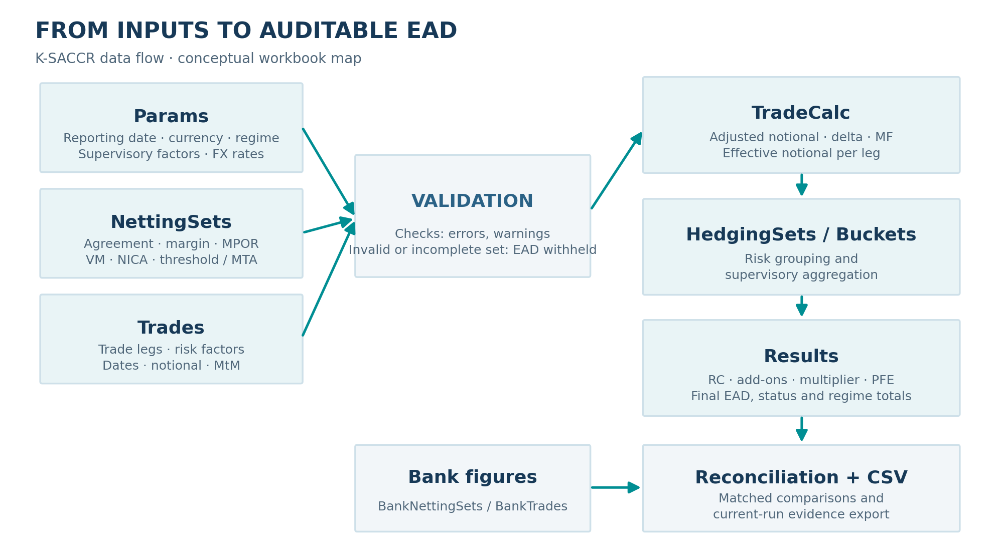
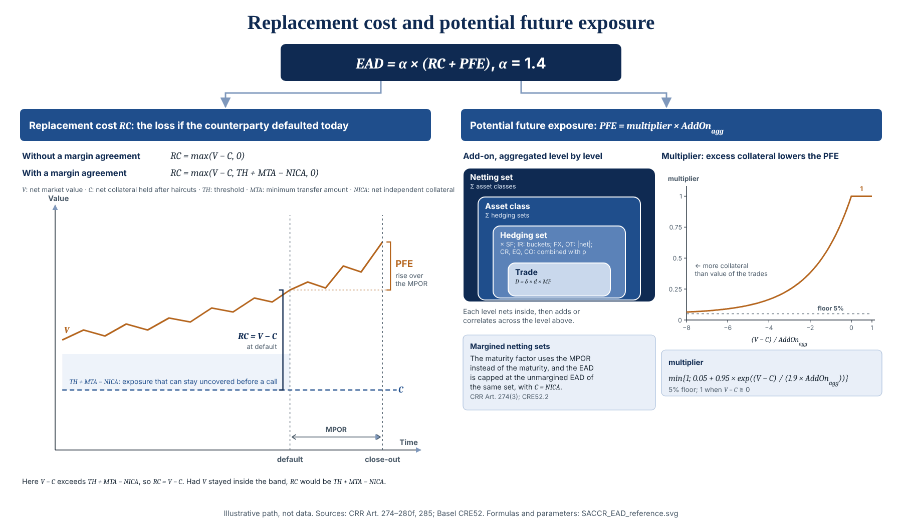
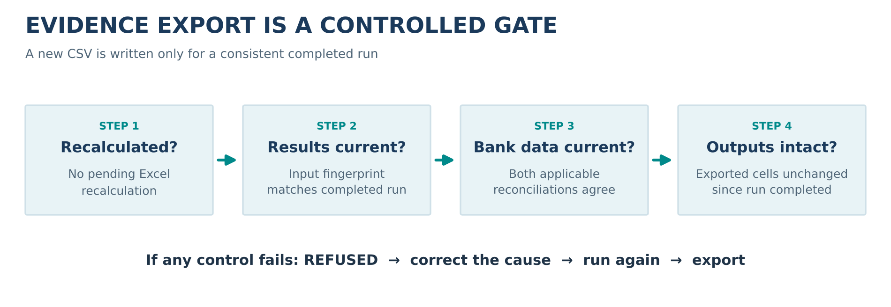

> **RELEASE STATUS**\
> This manual documents **K-SACCR 1.1.0**. It is delivered with the workbook `K-SACCR_1.1.0.xlsm` and the file `SHA256SUMS.txt`, which holds the SHA-256 of the workbook and of this manual. The workbook was tested in Excel before release. This manual explains the software; it does not certify it, and it is not regulatory approval.

**Document purpose.** A practical and technical operating reference for analysts, validators, model owners, risk managers and reviewers using the K-SACCR workbook, a Windows Excel/VBA implementation of the **Standardised Approach for Counterparty Credit Risk (SA-CCR)**. It explains how to check and open the workbook, what its protection lets you edit, enter portfolios by hand or import them from CSV files, validate them, interpret trade-to-EAD calculations, reconcile an external bank calculation, export reproducible evidence and understand the declared scope and limitations.

**Reader convention.** `CRR` means the European Union Capital Requirements Regulation implementation in this toolkit; `BCBS` means the Basel Framework CRE52 implementation. “Bank” is shorthand for the independent upstream calculation being compared. “Trade” may mean a row-level **leg**, not necessarily a whole economic trade. Amounts are **unscaled units** unless an explicit bank-reconciliation scale is used. A result generated under one regime must not be added to the same portfolio's result under another regime.

**Precedence.** This manual describes version 1.1.0 only. The workbook's own `README` sheet and its messages take precedence over an outdated copy of the manual, and the applicable legal text takes precedence over both.

\newpage


\Needspace{12\baselineskip}

# Orientation and safe use


\Needspace{9\baselineskip}

## What the toolkit does

K-SACCR is an independent, locally executed Microsoft Excel/VBA calculator that implements the full SA-CCR methodology for supported derivatives. Its main purpose is **transparent validation**: not only producing an exposure-at-default figure, but also showing the trace from a trade leg through effective notionals, hedging sets, maturity buckets, asset-class add-ons, replacement cost and potential future exposure to the reported EAD. It is designed for regulatory-methodology analysis, second-line challenge, independent reconciliation, education and controlled what-if analysis.

The calculation is performed for each **netting set**. A netting set represents the group of transactions under a legally and operationally relevant netting arrangement whose eligible exposure is calculated together. Inputs consist of (a) model settings, supervisory factors and FX conversion rates; (b) netting-set and collateral conditions; and (c) derivatives and, where relevant, trade legs. Optional bank figures provide an external comparator. The workbook neither prices derivatives nor retrieves market data: values and descriptors must be supplied by the user, typed on the input sheets or imported from two CSV files through staging sheets where they are checked before they replace the inputs.


\Needspace{6\baselineskip}

### Calculation overview

The high-level SA-CCR structure is:

\[
\mathrm{EAD}=\alpha\times(\mathrm{RC}+\mathrm{PFE}),\qquad
\mathrm{PFE}=\mathrm{Multiplier}\times\mathrm{AddOn}_{\mathrm{aggregate}}.
\]

For a standard regulatory run, **alpha is 1.4**. `RC` is replacement cost; `PFE` is potential future exposure; `AddOn_aggregate` combines the supervisory add-ons of the relevant asset classes. A separate unmargined cap is applied where the netting set is margined. The workbook also records intermediate quantities needed to explain why two EAD calculations differ.


\Needspace{6\baselineskip}

### Intended and unintended uses

**Appropriate uses:** reproduce published Basel examples; challenge a bank's SA-CCR calculation; inspect treatment of dates, FX conversion, option delta and margin terms; document reconciliation exceptions; produce a controlled evidence CSV; and test the effect of changed supervisory parameters, explicitly labeled `WHAT-IF`.

**Not established by this version:** universal regulatory certification, independent validation of the CRR rules, counterparty legal enforceability, collateral-eligibility assessments, derivative valuation, regulatory reporting submissions, default-fund contributions to a CCP, risk weights (including those of CCP trade exposures, which are stated but not applied), securities-financing transactions, CVA or RWA. These are distinct controls and processes. An output labeled `REGULATORY` indicates that the workbook parameters match the identified reference set; it is **not** a certification of the input data, legal netting arrangements or final release package.


\Needspace{9\baselineskip}

## Version, evidence and validation boundary

K-SACCR 1.1.0 implements both Basel CRE52 and EU CRR rules. The **published, independently external numerical reference values** it was tested against come from Basel CRE99 examples 1–5. The other test cases, including the CRR-specific ones and those for client clearing, settled-to-market trades and trade exposures to a CCP, are **illustrative**, not independently validated: their values come from a separate implementation by the same author, with no independent review. As a result, describe the result as **“BCBS published-example regression coverage; CRR implemented and illustratively tested”**—not as independently validated CRR.

Before release, the workbook's VBA code was compiled and tested in 64-bit Windows Excel with **ten automated test suites, a test harness among them (453 cases, 1,855 checks)**, all passing. The tests are not part of the delivered workbook. That testing covers the code as delivered: check the workbook's SHA-256 when you receive it (see *Getting started*) and do not change its VBA code.

**Changes from 1.0.2.** The calculation is unchanged, and so are the input sheets: a portfolio entered as in 1.0.2 gives the same EAD. New are:

* **CSV import.** `NettingSets` and `Trades` can be loaded from two CSV files: **Export CSV template** writes a blank file, **Import CSV** loads a file onto the new staging sheet `Import_NettingSets` or `Import_Trades`, **Validate staging** checks the staged rows, and **Commit import** replaces the input sheets with them. See *Import a portfolio from CSV files*.
* **Import specification.** **Export import specifications**, on both staging sheets, saves a description of the two files, with an example of each, as one HTML page that can be read offline and printed.
* **Workbook protection.** Every sheet and the workbook structure are protected, without a password, against accidental edits: only input cells can be changed. The reference regulatory parameters on `Params` are now filled grey and locked. See *What you can edit: workbook protection*.
* **Origin on Checks.** `Checks` gains an **Origin** column: `RUN` for the lines of **Run SA-CCR** and **Validate inputs**, `IMPORT` for those of **Validate staging**. The `CHECKS` section of the evidence CSV carries the same column.

See *Moving inputs from 1.0.2*.


\Needspace{9\baselineskip}

## Recommended user journey

{width=98%}


1. Check that the workbook you received is the released file: its SHA-256 must equal the expected value, obtained from a source you trust.
2. Keep that file unchanged as a reference copy, and work in a copy of it.
3. Open the copy, enable macros as your policy allows, inspect the worksheets and work through the synthetic demonstration. The yellow cells are the ones you can change; every other cell is protected.
4. Set Params, then populate NettingSets and Trades with synthetic or properly authorized test inputs: type or paste them, or import two CSV files onto `Import_NettingSets` and `Import_Trades`, correct them there, press **Validate staging** until no finding remains and press **Commit import**.
5. Use **Validate inputs** before **Run SA-CCR**; resolve all `ERROR` findings. A commit calculates nothing: press **Run SA-CCR** after it.
6. Inspect Results, TradeCalc, HedgingSets, Buckets and Checks; do not rely on EAD alone.
7. Optionally enter external bank figures on BankNettingSets and BankTrades; run again to refresh the two reconciliations.
8. Export evidence only when the result and any reconciliation are `CURRENT` and the exported output cells are unmodified.
9. Archive the input description, expected sources, any imported CSV files, the evidence CSV, the workbook's file name and SHA-256, and review conclusions under your organization's controls.


\Needspace{9\baselineskip}

## A map of the 18 worksheets

| Sheet | Type | What you do / find |
|:--|:--|:--|
| `README` | In-workbook guide | Read the quick instructions, purpose and buttons. |
| `Params` | Configuration and reference data | Reporting date/currency, selected default regime and FX rates, which you set; supervisory parameters and supervisory-factor lookup, which are locked reference values. |
| `NettingSets` | Input | One row per netting set; margin terms, VM, NICA, collateral conditions, regime and alpha override. |
| `Trades` | Input | One row per trade leg; identifiers, instrument/risk drivers, currency, dates, pricing inputs and economic-trade links. |
| `Import_NettingSets` | Staging | Netting sets loaded from a CSV file, as text, to check and correct before they replace `NettingSets`. |
| `Import_Trades` | Staging | Trade legs loaded from a CSV file, as text, to check and correct before they replace `Trades`. |
| `Results` | Output | Netting-set RC, add-ons, PFE, EAD, capped EAD, status; separate totals for CRR and BCBS, run summary and freshness. |
| `HedgingSets` | Output | Per-hedging-set effective notionals and associated add-on components. |
| `Buckets` | Output | Per-bucket and underlying-reference aggregation details. |
| `TradeCalc` | Output | Accepted/excluded trade legs and every major leg-level numerical intermediate. |
| `Checks` | Output | Blocking errors, nonblocking warnings, explanatory notices and what-if deviations of a run, or the findings of a staging validation, each line with its origin. |
| `BankNettingSets` | Optional bank input | External netting-set metrics and reconciliation scale/tolerances. |
| `Reconciliation` | Output | Bank-vs-calculator comparisons, one netting set and metric per row. |
| `BankTrades` | Optional bank input | External trade-leg metrics and trade comparison settings. |
| `TradeReconciliation` | Output | Bank-vs-calculator comparisons per trade leg and metric; includes economic trade ID. |
| `TestCatalogue` | Reference | Catalogue of numerical demonstrations and test expectations. |
| `FormulaTest` | Reference | Worksheet-function examples and expected formulas. |
| `Basel_vs_CRR` | Reference | Comparison of regulatory treatments and their impact. |

**Layout convention.** Every worksheet table begins in **column C**; columns A–B and rows 1–2 are margins. The input tables are found through workbook names pointing to their first header cell. Do not move or delete named header cells, break named ranges, or rearrange input columns. The workbook's protection refuses these changes in normal use; it is described in *What you can edit: workbook protection*.


\Needspace{12\baselineskip}

# Getting started


\Needspace{9\baselineskip}

## Supported environment

| Component | Requirement / supported level |
|:--|:--|
| Host | **Microsoft Excel for Windows, 64-bit**, Microsoft 365 or Excel 2016 and later. |
| 32-bit Windows Excel | Best effort, **not certified**. |
| Excel for Mac, Excel for web, Excel 2013 or earlier | **Not supported**. |
| Macros | The workbook needs macros enabled. |
| External components | None: no add-in, DLL, COM registration or extra VBA reference. |

**Macro security.** The workbook runs VBA with your Office permissions. Accept it only from a source you trust, check its SHA-256, and follow your organization's macro policy. Its VBA code can be read in the Visual Basic editor (**Alt+F11**). The workbook does not need *Trust access to the VBA project object model*; leave that setting off.


\Needspace{9\baselineskip}

## Check the delivered workbook

You receive `K-SACCR_1.1.0.xlsm` together with `SHA256SUMS.txt`, which holds one line per delivered file: its SHA-256 and its name.

1. Save both files in the same local folder.
2. Compute the workbook's SHA-256 in PowerShell, in that folder:

   ```powershell
   Get-FileHash .\K-SACCR_1.1.0.xlsm -Algorithm SHA256
   ```

   or in a Command Prompt: `certutil -hashfile K-SACCR_1.1.0.xlsm SHA256`.
3. Compare it with the line for `K-SACCR_1.1.0.xlsm` in `SHA256SUMS.txt` (letter case does not matter). If they differ, do not open the file: delete it and ask for a new copy.

   A match shows that the workbook arrived unchanged, not who made it: anyone able to replace the workbook on its way to you can replace `SHA256SUMS.txt` too. If both reached you through the same channel, confirm the expected SHA-256 with the supplier through a separate channel you trust, for example by telephone or from the supplier's own published release information, before you unblock the file and enable macros.
4. Windows marks a downloaded or e-mailed file as coming from the internet, and Office then blocks its macros. If your macro policy allows it, right-click the file → **Properties** → tick **Unblock** → **OK**, or run `Unblock-File .\K-SACCR_1.1.0.xlsm` in PowerShell. Do this only after the hash check.
5. Open the workbook in desktop Excel and enable macros as your policy allows. Open the `README`, `Params`, `NettingSets`, `Trades`, `Import_NettingSets`, `Import_Trades` and `Results` sheets and check that the sheet buttons are present.

A renamed copy (for example `K-SACCR_1.1.0 (1).xlsm`) has the same SHA-256 as long as its content is unchanged. Once you save the workbook, its SHA-256 changes: check it before the first save.


\Needspace{9\baselineskip}

## Keep a reference copy and work in a copy

Keep the delivered file unchanged as your reference copy. Use **File > Save As** to create a working copy, and keep business data out of the demonstration copy. If a working copy is damaged, for example after a header or named range was deleted, start again from the reference copy and enter your inputs again.

Do not change the workbook's VBA code, its worksheet structure, its named ranges or its buttons. A workbook whose code was changed is no longer the tested workbook. The protection of the sheets and of the workbook structure guards against such changes by accident, not against deliberate ones.


\Needspace{9\baselineskip}

## A new version, and removal

A new version of K-SACCR is delivered as a new workbook with its own file name, SHA-256 and manual. Check it as above and read any migration notes delivered with it. Then, in a copy of the new workbook:

1. Clear the contents of the demonstration rows on `NettingSets`, `Trades`, `BankNettingSets` and `BankTrades`, so that no demonstration value stays attached to your portfolio. Rows cannot be deleted on a protected sheet: clear their cells.
2. Move your inputs by what identifies each value, never as one block, pasting values only (not formats or formulas): on those four sheets column by column under the same header; on `Params` the reporting date, reporting currency and default regime under the same `Code`, and the FX rates in `FX_Table` by the same `FX_Ccy`; and the reconciliation settings above the bank tables (`BankNS_Scale`, `BankNS_AbsTol`, `BankNS_RelTol`, `BankTR_Scale`, `BankTR_AbsTol`, `BankTR_RelTol`) by their names. A new version can add, rename or reorder columns and rows, and a value moved to the wrong place can still be accepted and give a wrong EAD.
3. Fill every column, code or key that is new in this version as its migration notes and manual say.
4. Run **Validate inputs**, then compare the results of the two versions on the same inputs before relying on the new one.

The other values on `Params`, the supervisory parameters and `SF_Table`, are the new workbook's reference values and are locked. Change one only if you changed it deliberately in the earlier version, for a what-if analysis, by the maintenance unlock described in *What you can edit: workbook protection*; the run is then classified `WHAT-IF`.

Do not copy VBA code between versions: a new version can change worksheets, headers and named ranges as well as code.

Nothing is installed on the computer. Deleting the workbook and the CSV files you exported or imported removes K-SACCR; keep any evidence your organization requires you to retain.


\Needspace{6\baselineskip}

### Moving inputs from 1.0.2

Version 1.1.0 changes no input: `NettingSets`, `Trades`, `BankNettingSets` and `BankTrades` keep their headers in the same order, and `Params` keeps its codes and tables. Moved as described above, a 1.0.2 portfolio gives the same EAD in 1.1.0. The differences that matter when moving are:

* The 1.1.0 workbook is protected. Paste values only, into the input columns; a paste into a locked cell is refused. The 1.0.2 workbook is not protected, so its cells can be selected and copied as before.
* On `Params`, only the reporting date, the reporting currency, the default regime and the FX table can be changed; the reference parameters are locked, as described above.
* Instead of pasting `NettingSets` and `Trades`, you can move them as two CSV files. Export the blank templates from the 1.1.0 workbook (**Export CSV template** on `NettingSets` and `Trades`), fill them with your 1.0.2 inputs using a program that writes the file format of *Import a portfolio from CSV files* (a file from Excel's own CSV save is rejected when it holds commas between fields, decimal commas or local dates), then import, validate and commit them. Each CSV column fills the sheet column the import specification names, and the validation checks every value before anything replaces the inputs. The bank sheets and `Params` are not imported: enter them as above.

Either way, run both workbooks on the same inputs and compare their `Results`, as step 4 says.


\Needspace{12\baselineskip}

# First calculation: guided demonstration


\Needspace{9\baselineskip}

## What is included in the workbook

The delivered workbook contains a **synthetic demonstration portfolio**: the five published Basel CRE99 examples and additional illustrative netting sets, with the outputs cleared. Some illustrative rows are deliberately invalid to demonstrate the rejection mechanism. The demonstration rows do not always use the exact conventions of the published examples, as the next paragraph shows.

For example, CRE99 Example 3's published calculation uses a nine-month remaining maturity (`M = 0.75`); one spreadsheet illustration computes elapsed dates on a 365-day basis, giving `M = 0.7507` and an EAD around **5,405** in the example's printed thousand-unit scale rather than the published **5,406**. Using the stated nine-month period reproduces the published figure. Treat this as a **day-count illustration**, not a discrepancy requiring an arbitrary manual adjustment.


\Needspace{9\baselineskip}

## Walkthrough in Excel

1. **Preserve an untouched copy.** Save a separate working `.xlsm` from the delivered workbook. Use only synthetic information.
2. **Inspect `Params`.** Find `AsOfDate`, `ReportingCcy`, `Regime`, `DaysPerYear`, `BusinessDaysPerYear`, `Alpha`, `SF_Table` and `FX_Table`; verify the reporting-currency FX row has rate 1.
3. **Inspect `NettingSets`.** Note each ID, `Margined (Y/N)`, VM, NICA, threshold, MTA, any MPOR condition and `Regime override`.
4. **Inspect `Trades`.** Each row has a unique **TradeID** (the leg ID). Follow a sample row from `NettingSetID` to its asset class, risk factor, notional, currency and dates. If an economic trade has several legs, use the economic-trade columns.
5. Click **Validate inputs** (`ValidateInputs`). Read `Checks`. Errors describe excluded trades, unusable netting sets or a run-stopping defect; warnings describe accepted inputs needing attention.
6. Click **Run SA-CCR** (`RunSACCR`). The macro validates, calculates and updates output sheets. It does **not** quietly compute a netting set's EAD using only valid trades when another trade in that set was rejected.
7. Open `Results` and locate the status for each netting set. Inspect `VALID`, `INCOMPLETE`, `INVALID` and `NO TRADES` behavior before focusing on numbers. The **CRR** and **BCBS** totals are separate, and they include only `VALID` netting sets.
8. For a valid example, trace its `TradeCalc` rows to `HedgingSets` / `Buckets` and the add-on columns on `Results`; verify the reported `RC`, multiplier, `PFE` and EAD.
9. Inspect `Checks` to understand all demonstration exclusions. Resolve exclusions on **copies**, never in your reference copy.
10. Optionally fill `BankNettingSets` and `BankTrades` with illustrative comparison figures; run again and study the result codes on `Reconciliation` and `TradeReconciliation`.
11. Click **Export evidence** on the `Reconciliation` sheet, select an output CSV path and review the exported text. Repeat only after confirming freshness and output integrity.


\Needspace{9\baselineskip}

## Published Basel example reference points

The following are **published CRE99 target results**, not a promise that every demonstration row uses identical date assumptions. They are listed in original **USD units** here, whereas the source tables print USD thousands.

| Published case | Selected printed target in unscaled USD | What it helps check |
|:--|--:|:--|
| CRE99 Example 1 | EAD **569,000** | Interest-rate components, including option delta and add-on. |
| CRE99 Example 2 | EAD **381,000** | Credit add-on and multiplier (negative MtM, no collateral). |
| CRE99 Example 3 | EAD **5,406,000** | Commodity add-on and maturity precision. |
| CRE99 Example 4 | EAD **936,000** | Replacement cost and aggregation. |
| CRE99 Example 5 | EAD **1,879,000** | Margined MPOR (weekly remargining, 14 business days), aggregate add-on and multiplier. |

A reference comparison is meaningful only when **regime, reporting currency, unit scale, dates, market inputs and netting terms** match the reference. Rounded values should be checked against their printed precision and published tolerance, not mistaken for machine-precision oracle values.


\Needspace{9\baselineskip}

## Buttons and their exact roles

| Displayed button (sheets) | VBA entry point | Safe operating interpretation |
|:-------|:----------|:----------|
| **Run SA-CCR** (`Trades`, `Results`, `TestCatalogue`) | `RunSACCR` | Validate inputs, calculate accepted netting sets and populate all relevant output sheets; update reconciliations where possible. |
| **Validate inputs** (same sheets) | `ValidateInputs` | Examine data and write findings to Checks **without calculating exposure**. It clears the previous run's outputs and reconciliations, so press **Run SA-CCR** again before reviewing or exporting. |
| **Clear outputs** (same sheets) | `ClearOutputs` | Clear calculated output areas and invalidate the previous completed run; do not assume an error while clearing leaves no residual values. |
| **Export evidence** (`Reconciliation`) | `ExportEvidence` | Interactive CSV export of a **current and unmodified** run; refuse if freshness/integrity requirements fail. |
| **Export CSV template** (`NettingSets`, `Trades`) | `ExportNettingSetsCsvTemplate`, `ExportTradesCsvTemplate` | Write the blank CSV file of that sheet, its header line alone, to a file you choose. |
| **Import CSV** (`Import_NettingSets`, `Import_Trades`) | `ImportNettingSetsCsv`, `ImportTradesCsv` | Load a CSV file onto that staging sheet as text, for checking and correction; the input sheets are not changed. |
| **Validate staging** (both staging sheets) | `ValidateStaging` | Check the staged rows of both staging sheets, against each other, the input sheets and Params; list the findings on Checks with the origin `IMPORT`. The input sheets are not changed. |
| **Commit import** (both staging sheets) | `CommitImport` | After a confirmation, replace `NettingSets`, `Trades` or both with the staged rows of a validation without findings that still holds. Calculates nothing. |
| **Export import specifications** (both staging sheets) | `ExportImportSpecification` | Save the description of both CSV files, with an example of each, as one HTML page. Changes nothing in the workbook. |

After running, `Results!C4` contains the summary, and `Results!C5` contains the freshness status. Reconciliation sheets likewise have summary (`C4`) and status (`C5`) positions. Each staging sheet shows its source file, load time, record count and status in `D4:D7`.


\Needspace{12\baselineskip}

# What you can edit: workbook protection


\Needspace{9\baselineskip}

## Protection in brief

Every sheet of the workbook is protected, without a password, and so is the workbook structure. Only the cells listed below can be changed in normal use: the inputs, the bank figures, the run configuration on `Params` and the test inputs of the two test sheets. Every other cell is locked: formulas, results, headings, instructions, layout and the reference regulatory parameters.

* **Yellow means editable.** No locked cell has the yellow input fill. On `Params`, the reference regulatory parameters are filled grey.
* **Formulas stay visible.** No cell is hidden: a locked cell, a formula included, can still be selected, read and copied.
* **Saved protected.** The workbook is delivered with every sheet and the structure protected, so the protection also holds with macros disabled. Nothing else works until macros are enabled.
* **Macros write, you edit inputs.** When the workbook opens with macros enabled, and when **Run SA-CCR**, **Validate inputs**, **Clear outputs**, **Import CSV**, **Validate staging** or **Commit import** starts, the workbook protects every sheet and the structure again, in a way that lets the macros write every sheet while you change only the unlocked cells. A sheet you unprotected, or protected by hand with other options, is protected again with the workbook's options at that moment.
* **Structure.** Sheets cannot be added, deleted, renamed, moved, hidden or shown.

**Protection is not security.** It prevents accidental edits only. Anyone can remove it with **Review > Unprotect Sheet**, as no password is set. It does not replace the input validation, the freshness status of `Results`, the output fingerprint or the guards of the evidence export, which still tell whether results match their inputs.


\Needspace{9\baselineskip}

## What each sheet lets you change

| Sheet | Cells you can change | Also allowed |
|:----|:--------|:----|
| `README` | None | Opening and closing row groups |
| `Params` | `E6` (`AsOfDate`), `E7` (`ReportingCcy`), `E23` (`Regime`) and `C58:E257`, the FX table with rows below it for added currencies | None |
| `NettingSets` | Columns `C:S` from row 7 down | Sorting, inserting rows |
| `Trades` | Columns `C:AD` from row 5 down | Sorting, filtering, inserting rows |
| `Import_NettingSets` | Columns `D:T` from row 10 down: the staged values | Inserting rows |
| `Import_Trades` | Columns `D:AE` from row 10 down: the staged values | Inserting rows |
| `Results`, `HedgingSets`, `Buckets`, `TradeCalc`, `Checks` | None | None |
| `BankNettingSets` | `D4:D6` (amount scale and tolerances) and columns `C:P` from row 9 down | Sorting, inserting rows |
| `Reconciliation`, `TradeReconciliation` | None | None |
| `BankTrades` | `D4:D6` and columns `C:O` from row 9 down | Sorting, inserting rows |
| `TestCatalogue` | `L7:L34`, the expected values | None |
| `FormulaTest` | The tolerance `E4` and the test inputs `E7:F28`, `G9:G28`, `H13:J21`, `K15` | None |
| `Basel_vs_CRR` | None | Filtering |

The input columns are unlocked down to the last row of the sheet, not only in the rows that hold data, so a pasted or appended row is editable however many rows the portfolio has; the header rows above them stay locked. On the staging sheets, the `CSV line` column (column C), the status, the source file and the other information above the staged rows stay locked.

Selecting and copying any cell is always allowed. These are **refused** on a protected sheet:

* typing into, pasting into or clearing a locked cell, such as a header, a grey `Params` value, an output cell or the status of a staging sheet;
* deleting rows or columns, inserting columns, and resizing or formatting columns or cells. To remove an input row, clear its cells;
* filtering on a sheet other than `Trades` and `Basel_vs_CRR`, which keep the AutoFilter the workbook is delivered with; a protected sheet cannot get a new AutoFilter, and the existing one covers the rows it was given;
* adding, deleting, renaming, moving, hiding or showing a sheet.

Excel itself refuses these edits, with its own message.


\Needspace{9\baselineskip}

## Maintenance unlock and relock

A locked cell is changed only on purpose. To change one, for example a supervisory parameter on `Params` for a what-if analysis:

1. Work in a copy, and write down the cell, its old value and the reason.
2. Select the sheet and choose **Review > Unprotect Sheet**. No password is asked.
3. Make the change.
4. Protect the sheet again: run the macro `ProtectWorkbook` (**Alt+F8**, select it, **Run**), or simply start the next operation, such as **Run SA-CCR**, which protects every sheet and the structure again first.

The change itself is kept. A run on changed reference parameters is classified **`WHAT-IF`**, with a *What-if:* warning on `Checks` for each deviation (see *Regulatory versus what-if classification*); the freshness status and the evidence checks work as before. An output cell changed during an unlock makes `ResultsStatus()` read `EDITED` and the evidence export refuse until the next run, which rewrites the outputs. To return to the reference values, enter them again the same way, or start again from your reference copy.

Do not unlock a sheet to delete rows, move columns or rename headers: the input tables are found by their workbook names and headers, and a changed layout can stop a run (see *Dates, named ranges and error handling*).


\Needspace{12\baselineskip}

# Global settings and supervisory data


\Needspace{9\baselineskip}

## Params: identity and values

The `Params` sheet is a **named-range-driven table**. Each parameter has a code in the `Code` column, a value in the `Value` column and a workbook name of that code. The workbook uses the names `Params_Code`, `Params_Value`, `SF_Table` and `FX_Table`. Names—not fixed row positions—locate the tables; their first header cells must be structurally correct.

`AsOfDate`, `ReportingCcy`, `Regime` and the FX table are the **run configuration**: yellow, and changed in normal use. Every other value on `Params`, the settings below from `Alpha` onwards and `SF_Table`, is a **reference regulatory parameter**: grey and locked, changed only by a deliberate maintenance unlock (see *Maintenance unlock and relock*), after which a run on a changed value is `WHAT-IF`.

| Setting | Typical regulatory value / convention | Meaning and user action |
|:--|:--|:--|
| `AsOfDate` | User-supplied valid reporting date | All dates and exposures are referenced to this date. |
| `ReportingCcy` | Three-letter code, e.g. `EUR` | All output amounts are in this currency. Its FX table rate must be **1**. |
| `Regime` | `CRR` by default; `BCBS` possible | Default rule set, with optional netting-set override. |
| `Alpha` | **1.4** | Supervisory EAD multiplier unless explicitly overridden for a netting set. |
| `MultiplierFloor` | **0.05** | Lower bound on the PFE multiplier. |
| `DaysPerYear` | **365** | Calendar-day basis for S, E, M and T; change it only to reproduce a published maturity convention. |
| `BusinessDaysPerYear` | **250** | Business-day convention for maturity floors and MPOR. |
| `MinMaturityBD` | **10** | Floor on the unmargined maturity factor's M. |
| `SDFloorBD` | **10** | Floor used in supervisory-duration treatment. |
| `MPORFloorBilateral` | **10** | Base bilateral MPOR floor. |
| `MPORFloorCleared` | **5** | Eligible client-clearing MPOR floor, subject to regime/role. |
| `MPORFloorLarge` | **20** | Large / illiquid netting-set floor. |
| `BasisFactor` | **0.5** | Factor for eligible basis hedging sets. |
| `VolatilityFactor` | **5** | Factor for volatility transactions. |
| `IRCorrBucket12`, `IRCorrBucket23`, `IRCorrBucket13` | **0.7**, **0.7**, **0.3** | Interest-rate maturity-bucket correlations. |
| `IRBucketOffset` | `TRUE` for offset formula | `FALSE` selects sum-of-absolutes **only for BCBS**; invalid for a CRR netting set with IR trades. |
| `LambdaThresholdIR` | **0.001** | CRR lambda threshold for interest-rate options. |
| `LambdaThresholdCO` | **0.1** | CRR lambda threshold for commodity options. |

**Unit discipline.** Rates, correlations and percentages are decimal values (`0.05` means 5%); notional, valuation and collateral are unscaled currency units; business-day settings are days; S/E/M/T are year fractions. Do not enter `5` to represent 5% unless a particular field expressly requires it. Missing optional numeric settings may be replaced by their regulatory defaults **with a warning**; invalid mandatory settings stop the calculation.


\Needspace{9\baselineskip}

## Regulatory versus what-if classification

The workbook records the regulatory reference set **`CRE52-CRR-2026-10-09`**. The engine compares the relevant Params numeric fields, supervisory-factor rows and per-netting-set alpha overrides to the set. If they all match, the run is `REGULATORY`; otherwise `WHAT-IF`, with a **separate “What-if:” warning** in Checks for each deviation. `DaysPerYear` and `IRBucketOffset` are treated as conventions and do not by themselves change the classification; nevertheless they affect calculations and must be documented. A `REGULATORY` class is not a judgment that the user entered correct data. Since the reference values are locked, a `WHAT-IF` run on reference parameters follows a deliberate maintenance unlock; an alpha override on `NettingSets` is an input and needs none.


\Needspace{9\baselineskip}

## SF_Table: supervisory-factor register

The supervisory lookup contains the following columns, in this order: `SF_Key`; `Asset class`; `Category`; `Supervisory factor`; `Correlation`; `Supervisory option vol`; `Commodity hedging set`; `Regimes`, followed by a descriptive `Reference` column that the engine does not read. A key's classification and eligible regimes determine what the engine may use. The table extends from its named header to the **first blank key**, including rows below the originally named range. Do not leave a blank key in the middle of the intended data.

Selected **regulatory** reference values are shown below. This is a navigation aid, not permission to overwrite the workbook's complete table without an independent review.

| Class/category | Supervisory factor | Correlation / supervisory volatility where relevant |
|:--|--:|:--|
| IR | 0.50% | Supervisory option volatility 50%. |
| FX | 4.00% | Supervisory option volatility 15%. |
| CR single name | 0.38% to 6.00% | By Basel rating or CRR CQS; single-name correlation 50%, option vol 100%. |
| CR index | 0.38% (IG), 1.06% (SG) | Index correlation 80%, option vol 80%. |
| EQ single name | 32% | Correlation 50%, option vol 120%. |
| EQ index | 20% | Correlation 80%, option vol 75%. |
| CO electricity | 40% | Commodity correlation 40%, option vol 150%. |
| CO other categories | 18% | Commodity correlation 40%, option vol 70% for non-electricity commodities. |
| CO climatic conditions | 18% | **CRR-only** hedging set. |
| OT other risks | 8% | **CRR-only**; supervisory option volatility 150%. |

**Credit steps:** CRR CQS1 through CQS6 map to **0.38%, 0.42%, 0.54%, 1.06%, 1.60%, 6.00%**. Basel single-name ratings AAA/AA/A/BBB/BB/B/CCC correspond to **0.38%, 0.38%, 0.42%, 0.54%, 1.06%, 1.60%, 6.00%**. A bank must apply the appropriate rating/CQS mapping and report its methodology; K-SACCR does not fetch ratings.


\Needspace{9\baselineskip}

## FX_Table: conversion into reporting currency

The FX lookup has header fields `FX_Ccy`, a descriptive `Currency` column (not read by the engine), and `Units of reporting ccy per 1 unit`. Enter each relevant three-letter currency key and the number of units of **reporting currency per one unit** of that currency. Example: when reporting in EUR, a hypothetical `USD -> 0.92` means one USD is converted into 0.92 EUR. The rate for EUR itself **must be 1**. The code and direction matter: entering reciprocal quotes changes amounts.

**Example (illustrative only):** a USD 1,000,000 trade amount multiplied by a user-supplied USD/EUR conversion rate of 0.92 produces EUR 920,000. This is a **currency conversion example**, not an SA-CCR EAD prediction. The engine does not retrieve spot prices or market FX rates; the user must establish the correct as-of prices and reconcile them with the bank's data.

For **FX derivatives**, two currencies must both be present in the FX table and the entered risk-factor currency pair must be coherent with the notional currency. The special pair-order rules for options and linear FX are detailed later in this manual.


\Needspace{9\baselineskip}

## Dates, named ranges and error handling

The workbook supports an actual Excel date, a serial number in Excel's **1900 date system**, or literal `YYYY-MM-DD` text. Text such as `30/09/2031` is deliberately **rejected** because its interpretation depends on locale. A workbook using the 1904 date system stops the run. An invalid reporting date stops the run; an invalid trade date rejects that trade. Be deliberate with future maturities, option expiries and products with reset schedules.

**Never rearrange `NettingSets` or `Trades` columns or rewrite their headings.** Header comparison tolerates case, spaces and line breaks, but not a changed schema. A missing required workbook name, an invalid reference or a moved header can stop the run. Visible formatting alone is not a controlled way to change the data contract.


\Needspace{12\baselineskip}

# Enter netting sets and collateral terms


\Needspace{9\baselineskip}

## NettingSets data contract

The `NettingSets` input table has **17 fields** in an exact sequence. Each row represents one netting set; the same netting-set ID must not be entered twice. A row can override the default regime, but all trades assigned to it follow that regime. The `Counterparty` field is descriptive; legal enforceability, eligible margin arrangements and transaction classification remain external responsibilities. The two margin columns (`VM`, `NICA`) and the three credit support settings (`TH`, `MTA`, MPOR conditions) have a **material numerical effect** and must not be approximated casually. A NettingSets CSV file carries the same 17 fields under short names, such as `netting_set_id` and `margined` (see *Import a portfolio from CSV files*).

| # | Exact header / field | Accepted concept, sign and key checks |
|--:|:--|:--|
| 1 | `NettingSetID` | Required unique key; referenced by every trade. Do not use `TOTAL`, `TOTAL CRR` or `TOTAL BCBS` as IDs, because these are output total labels. |
| 2 | `Counterparty` | Description / controlled identifier. Use synthetic identifiers in public test workbooks. |
| 3 | `Margined (Y/N)` | `Y` for a supported margin agreement; `N` for an unmargined netting set. Drives RC and maturity-factor treatment. |
| 4 | `Client clearing role (N / CM / CLIENT)` | Bank's role: `N` ordinary, `CM` clearing member facing its client, `CLIENT` client facing its clearing member, `CCP` the bank's trade exposure, as clearing member, to a CCP, or `MULTI` a multi-level client structure, which is rejected. Blank is treated as `N`. The header keeps its 1.0.1 text. |
| 5 | `Remargin frequency N (BD)` | Whole number of business days; `0` is interpreted as daily **with a warning**; accepted maximum 10,000. Used in MPOR `F + N - 1`. |
| 6 | `>5,000 trades or illiquid collateral (Y/N)` | `Y` triggers relevant 20-business-day MPOR floor; the business definition also covers hard-to-replace OTC transactions. Confirm actual eligibility and threshold. |
| 7 | `Margin disputes (Y/N)` | `Y` triggers the toolkit's doubled MPOR treatment; verify whether dispute conditions actually apply. |
| 8 | `MPOR override (BD)` | Optional strictly positive whole number of business days. It is applied only if not below the computed MPOR; a lower value is ignored with a warning and the computed MPOR is used. A non-whole or non-positive value makes the netting set `INVALID`. |
| 9 | `Net VM held (+) / posted (-)` | Net variation margin. Held is **positive**; posted is **negative**. VM treatment differs for unmargined one-way agreements by regime. |
| 10 | `NICA` | Net independent collateral amount; its regulatory definition includes eligible independent collateral held less relevant posted independent collateral, subject to eligibility, haircut and segregation rules. |
| 11 | `Threshold TH` | Margin threshold, expressed as an unscaled amount in the calculation currency. |
| 12 | `MTA` | Minimum transfer amount, expressed as an unscaled amount. |
| 13 | `Alpha override` | Optional per-netting-set alpha; values different from 1.4 classify the run `WHAT-IF`. |
| 14 | `Regime override (blank = Params)` | Blank inherits the Params regime; otherwise use `CRR` or `BCBS`. The comparison and output retain the effective regime. |
| 15 | `Margin agreements (blank / MIXED / SHARED)` | Blank represents the supported single agreement/no agreement structure; `MIXED` or `SHARED` explicitly declares **unsupported structures** and causes rejection. |
| 16 | `QCCP (Y/N)` | Role `CCP` only, and then required: `Y` if the CCP qualifies under the netting set's regime (CRR: authorised or recognised under Regulation (EU) No 648/2012; BCBS: a QCCP as defined in CRE50), `N` otherwise. It sets the risk weight stated on `Checks`, not the EAD. Blank for every other role. |
| 17 | `CCP retains VM, collateral not protected (Y/N)` | Role `CCP` only, and then required: `Y` if the CCP retains variation margin against the trades and the bank's collateral is not protected against the CCP's insolvency; it needs `Margined = Y`. Blank for every other role. |

**Data ownership rule.** One input row is not necessarily a legal agreement record. The analyst must ensure that exposures, collateral and margin settings are correctly mapped to the intended netting set under the applicable rule. A workbook that calculates without warnings can still contain a poor legal or economic mapping.


\Needspace{9\baselineskip}

## Margined and unmargined replacement cost

For an **unmargined** netting set, the relevant replacement cost is essentially:

\[
\mathrm{RC}_{u}=\max(V-C,0),
\]

where `V` is current portfolio value and `C` is the collateral recognized under the appropriate unmargined convention. For the **margined** calculation, the standard structure is:

\[
\mathrm{RC}_{m}=\max(V-C,\ \mathrm{TH}+\mathrm{MTA}-\mathrm{NICA},\ 0).
\]

The toolkit's **cap calculation** compares the margined EAD with the EAD of the *same netting set without margin*; for the cap, `C = NICA` under both supported regimes. **Do not include margined VM in the unmargined cap's C.** This treatment follows CRE52.10, CRR Article 274(3) and EBA Q&A 2023_6962, and is important when interpreting a cap flag.

For an unmargined BCBS one-way agreement in which **only the bank posts VM**, posted VM is negative and enters collateral appropriately. Conversely, **VM held** is not supported as an unmargined input. Under CRR, a one-way agreement is treated as a margin agreement: enter the set as margined; posted VM on an `N` CRR netting set is rejected. The bank must determine which regulatory description accurately represents its arrangement.


\Needspace{9\baselineskip}

## MPOR calculation and clearing role

The Margin Period of Risk (MPOR) is measured in **business days**. The engine calculates the relevant floor from the margin agreement, frequency, large/illiquid flag, dispute flag, client-clearing role, and any permissible override. The basic approach combines a floor `F` with remargining frequency `N` as `F + N - 1`. Under the documented implementation, dispute treatment doubles that result, while large/illiquid treatment applies the 20-day floor with the documented frequency adjustment. An entered MPOR override cannot reduce the calculated requirement.

| Condition | Toolkit treatment |
|:--|:--|
| Ordinary margined bilateral | Base floor of 10 business days. |
| Clearing member (`CM`) facing client | 5-day floor under both CRR and BCBS, subject to eligibility. |
| Client (`CLIENT`) facing clearing member | 5-day floor under **CRR**; under **BCBS** the 10-day floor, a conservative interpretation of the Basel text. |
| Trade exposure to a CCP (`CCP`), margined | 10-day floor under both regimes. If the CCP retains VM and the collateral is not protected, each trade's horizon is the lower of one year and its remaining maturity, at least 10 business days, when that exceeds the netting set's MPOR. |
| Trade exposure to a CCP (`CCP`), unmargined | No MPOR floor: each trade's maturity factor uses its remaining maturity, as in any unmargined netting set. |
| Multi-level client structure (`MULTI`) | Not calculated: the netting set is `INVALID`. |
| Large/illiquid conditions | Relevant 20-business-day floor, with frequency treatment. One flag covers both more than 5,000 trades and illiquid collateral, so it also sets 20 days where the trade-count floor does not apply (for example a `CCP` netting set): a conservative limitation. |
| Remargin every N business days | MPOR floor plus `N-1`. |
| Margin dispute | Doubled calculated period under toolkit's deliberately conservative rule. |
| User MPOR override | Applied only when not below the calculated MPOR; a lower override is ignored with a warning. |

**Important:** `CM`, `CLIENT` and `CCP` are bank-role declarations, **not** evidence that a transaction qualifies for the corresponding treatment. The user must separately establish regulatory eligibility and documentation, including the QCCP status. A CCP entered with role `N` is calculated as a bilateral counterparty and cannot be detected.

Every `CM`, `CLIENT` and `CCP` netting set gets an INFO line on `Checks` naming its role, the MPOR floor and the rule applied, or, for an unmargined set, that no floor applies. For `CCP` it also states the risk-weight rule, which K-SACCR does not apply: 2% for a QCCP, or the CCP's standardised risk weight, to be determined outside the workbook, for a non-qualifying CCP; with `QCCP` blank or invalid, it names a CCP of unknown QCCP status and states no rule. Each regime with `CCP` netting sets gets an INFO line with their number, how many are `VALID`, and their EAD, which stays in that regime's total. Client trades for which the clearing member need not reimburse the client on the CCP's default have an exposure value of zero and are not entered.


\Needspace{9\baselineskip}

## Collateral, haircuts and amount scales

Collateral amounts on `NettingSets` are entered **after the user has applied** legal/eligibility and applicable valuation/haircut treatment. The workbook does not price collateral, establish eligibility, determine legally enforceable close-out netting, or automatically remove segregated bank-posted initial margin from NICA. The user must apply these definitions before entering inputs. Use one internally consistent reporting-currency unit scale for every netting-set amount. A missing or incorrect conversion is a data-control failure, not merely a reconciliation tolerance issue.


\Needspace{9\baselineskip}

## Status and exclusion rules

The engine assigns the following status, in this precedence order:

| Status | Trigger | What is shown |
|:--|:--|:--|
| `INVALID` | Netting-set-level error (including a missing or misplaced `QCCP` or retained-VM value, or role `MULTI`), duplicate netting-set ID, inconsistent trade reference/sub-class combination, a settled-to-market trade in a margined netting set, or a CRR IR netting set with unsupported `IRBucketOffset=FALSE`. | The netting set is represented on Results, but no EAD is calculated. |
| `INCOMPLETE` | The netting set is otherwise structurally valid, but at least one associated trade leg is rejected. | EAD is **withheld** rather than calculated on a partial portfolio. |
| `NO TRADES` | No trade rows refer to the netting set (a set whose trades were all rejected is `INCOMPLETE`). | No EAD; it is not counted as a withheld incomplete set. |
| `VALID` | Netting set and all of its trades satisfy the supported input contract. | Calculation figures and EAD can be used for further review. |

The status cell starts with the code; `INVALID` and `INCOMPLETE` are followed by a count, for example `INCOMPLETE: 1 of 3 trade(s) rejected`, or by the reason, for example `INVALID: multi-level client structure, not supported`. `INVALID` and `INCOMPLETE` rows are highlighted in light red. The order matters: a netting set with both an invalid netting field and an excluded trade is `INVALID`. An excluded trade is listed on `TradeCalc` and `Checks` with its reason (a row without a TradeID appears only on `Checks`, by its sheet row). In a portfolio total, only `VALID` sets contribute, and withheld sets must be identified separately. **A reported total of valid netting sets is not necessarily the exposure of the full input portfolio.**


\Needspace{12\baselineskip}

# Enter derivative trades and trade legs


\Needspace{9\baselineskip}

## Trades data contract

`Trades` contains **28 fields**. The **TradeID is a unique leg identifier**. Every leg is linked to a netting set by `NettingSetID`. An economic trade may require one row or multiple rows depending on its material risk drivers or decomposition. The workbook reads fixed column positions verified against expected headings, not arbitrary user-added columns. A Trades CSV file carries the same 28 fields under short names, such as `trade_id` and `notional_amount` (see *Import a portfolio from CSV files*).

| # | Exact header / field | Meaning, format and common mistakes |
|--:|:--|:--|
| 1 | `TradeID` | Required unique **leg** ID. Duplicate IDs are errors and affect reconciliation population diagnostics. |
| 2 | `NettingSetID` | Must reference a valid netting-set ID from `NettingSets`. |
| 3 | `Asset class` | `IR`, `FX`, `CR`, `EQ`, `CO`, or `OT` (`OT` only under CRR). |
| 4 | `Sub-class` | Regulatory category, e.g. `AAA`/`CQS3` for credit or `SINGLE`/`INDEX` for equity; must be coherent with asset class and regime. |
| 5 | `Risk factor / reference` | Currency, pair, reference entity, commodity risk driver or other hedging key. Exact identifiers influence aggregation. |
| 6 | `Instrument` | `Linear`, `Option` or `CDO`. Digital options are not a supported instrument type. |
| 7 | `Direction` | `Long` or `Short`, affecting supervisory delta and aggregation. |
| 8 | `Option type` | `Call` or `Put` for options; only meaningful where relevant. |
| 9 | `Nature` | `Standard`, `Basis` or `Volatility`; changes hedging-set treatment. |
| 10 | `Basis / vol hedging-set label` | User-supplied distinguishing label for basis and volatility transactions. |
| 11 | `Notional` | Unscaled monetary or relevant underlying notional, in the specified notional currency; product-specific adjusted-notional rules apply. |
| 12 | `Notional ccy` | Currency of notional; for FX trades, must be a leg currency in the specified pair. |
| 13 | `MtM` | Current mark-to-market for this leg/economic trade, in the specified MtM currency. Exactly one leg carries it in a multi-leg economic trade. |
| 14 | `MtM ccy` | MtM currency; blank defaults to the notional currency. Must be convertible via Params. |
| 15 | `Start date (S)` | Relevant effective/start date; mandatory for specified underlying IR/credit options. |
| 16 | `End date (E)` | Date used in duration and IR bucket logic; often underlying end date. |
| 17 | `Maturity date (M)` | Contractual maturity date. For a settled-to-market trade, enter the reset date in field 27, not here. |
| 18 | `Option expiry (T)` | Required option expiry; must be after the reporting date and not after M. |
| 19 | `Underlying price P` | Option underlying price/rate (including FX quote conventions). |
| 20 | `Strike K` | Option strike in the same market convention as price. |
| 21 | `Lambda shift` | Optional shift added to P and K when they are negative or near zero (BCBS, CRE52.40 FAQ). For CRR interest-rate and commodity options the engine computes the RTS lambda from `LambdaThresholdIR`/`LambdaThresholdCO` and ignores this value, with a warning if it differs. Do not use it as an arbitrary delta adjustment. |
| 22 | `Attachment A` | CDO tranche attachment point as a decimal fraction. |
| 23 | `Detachment D` | CDO tranche detachment point as a decimal fraction; greater than A. |
| 24 | `Economic trade ID` | Optional group key identifying legs belonging to the same economic instrument. Blank means this row is a whole trade. |
| 25 | `MtM leg (Y/N)` | Exactly one leg of a grouped economic trade carries the full MtM (`Y`); other legs hold zero MtM. |
| 26 | `Settlement type (N/STM)` | Blank or `N`: ordinary treatment. `STM`: settled-to-market, see below. |
| 27 | `Next reset date` | `STM` only, and then required: the first contractual settlement date after the reporting date, not after M. Blank for an ordinary trade. |
| 28 | `Comment` | Free-text operator note; not read by the engine (its header is not checked). Do not rely on this field for mandatory machine-readable inputs. |

**Safety distinction:** a trade being accepted means its **declared** instrument, dates, rates and structure comply with the engine's supported field contract; it does not prove that its declared underlying risk drivers, decomposition or model inputs are economically correct.


\Needspace{9\baselineskip}

## Assets and supported instruments

| Asset class | What is supported | What requires care |
|:--|:--|:--|
| `IR` | Linear interest-rate derivatives, IR options, inflation exposures declared as IR | Currency/`-INFL` identifiers, supervisory duration, maturity buckets and underlyings of swaptions/caps/floors. |
| `FX` | FX linear trades and options | Currency pair, correct notional leg, quote order and delta sign. |
| `CR` | Credit single names and indices, options and credit CDO/tranche rules | Rating versus CRR CQS, reference consistency, sub-class factors and tranche attachment/detachment. |
| `EQ` | Equity single-name and index instruments and options | Index versus single-name classifications, reference-based aggregation. |
| `CO` | Commodity instruments and options, CRR climatic hedging set | Commodity category, electricity factor, negative price/strike treatment and special CRR classification. |
| `OT` | Other-risk drivers **under CRR only** | Each identical primary risk driver maps to its own hedging set; rejected under Basel. |

A **linear trade** uses supervisory delta +1 when long and -1 when short, with the relevant product-level signed interpretation. **Options** use the supported supervisory-option-delta treatment. European, American, Bermudan and Asian styles are covered under the documented input conventions: for Bermudan use the **latest exercise** date as expiry; for Asian options the input price represents the current value of the relevant average. **Credit CDO tranches and nth-to-default** use attachment/detachment treatment. Basis or volatility nature changes hedging-set coefficients rather than creating a new asset class.

**Not included:** digital options under either regime, automatic decomposition/pricing of arbitrary exotic structures, optional zero-EAD treatment for qualifying sold options, the optional unpaid-premium cap for certain sold credit protection, unsupported multiple/shared margin-agreement structures, and other methods outside full SA-CCR.


\Needspace{9\baselineskip}

## Multi-leg economic trades: prevent MtM double-counting

A derivative can have several material risk drivers, or an option combination can require decomposition. The supported representation is **one row per eligible leg**, all sharing the same `Economic trade ID`. Exactly one leg is marked `MtM leg = Y` and carries the **entire economic trade's MtM**; the other legs are marked `N` and have MtM **zero**. All legs must belong to the **same netting set**. If this fails, the engine rejects all legs of that economic trade. The user remains responsible for mapping the risk drivers and choosing the correct economic decomposition.


\Needspace{6\baselineskip}

### Illustrative three-leg example

| TradeID | Economic trade ID | NettingSetID | MtM leg | MtM |
|:--|:--|:--|:--:|--:|
| `TRD-101-IR` | `TRD-101` | `NS-01` | `Y` | +250,000 |
| `TRD-101-FX` | `TRD-101` | `NS-01` | `N` | 0 |
| `TRD-101-EQ` | `TRD-101` | `NS-01` | `N` | 0 |

This example represents a **possible input structure only**: no claim is made that the instrument economically has these three risk categories. If the user repeated +250,000 in each row, a naive approach would triple the portfolio MtM. K-SACCR's grouping check is designed to reject such errors rather than silently aggregate an inconsistent economic trade.

**Option combinations** such as spreads, straddles, strangles, collars and caps/floors can be represented using suitable option component legs. Within the same asset class, grouped option combinations must be option legs; a normal linear swap should not be split as if it were an option combination. A digital payoff is **not made supported** merely by approximating it with a collection of standard options.


\Needspace{9\baselineskip}

## Date conventions and maturity inputs

The workbook derives year quantities on its `DaysPerYear` basis. **S** is years from reporting date to the start date, floored to zero if blank or already begun except where a start date is mandatory. **E** is years to the end date (or the derived fallback); **M** is years to maturity (or eligible fallback / reset); **T** is years to option expiry. The **regulatory business-day** floors are calculated using `BusinessDaysPerYear` and MPOR settings, not by assuming a particular holiday calendar.

* For an interest-rate or credit trade, **E must be later than S** where duration is required.
* A maturity at or before the reporting date is invalid; options that are expired, or have expiry after M, are rejected.
* For an **option on an interest-rate or credit underlying**, S and E describe the underlying rather than only the option's own life. A swaption's S is ordinarily the exercise/start of the underlying swap and E its final end. A Bermudan swaption can need S as the earliest permitted exercise and T as the latest. Missing mandatory S is rejected.
* For an amortizing or accreting IR/credit trade, enter the correct **time-weighted average remaining notional**. For leveraged or notional-exchange products apply the required leverage/payment conventions before input.
* For a settled-to-market trade (`STM`), M becomes the time to the **next reset date**, floored at 10 business days in the maturity factor; S, E and the option expiry T keep their meaning, so a settled option can expire after its reset date. There is no automatic notional or reset schedule reader.

\Needspace{6\baselineskip}

### Settled-to-market trades

Declare `STM` only when the contract settles its outstanding exposure and resets its value to zero on set dates. **Daily variation margin alone is not settlement to market**: a margined contract stays an ordinary trade in a margined netting set. The qualification is the user's.

* The next reset date must be after the reporting date (the MtM is the value after any settlement due that day) and not after the maturity as entered; a reset on the maturity date is accepted.
* `STM` without a reset date, blank or `N` with one, another code, or a reset that is not a date rejects the trade.
* The legs of one economic trade must share the settlement type (blank and `N` alike) and the reset date.
* A settled trade needs the unmargined treatment: an `STM` trade in a margined netting set makes the set `INVALID` (*STM requires unmargined treatment; mixed margined/unmargined netting sets are not supported*), a limitation of the workbook rather than a regulatory prohibition.


\Needspace{6\baselineskip}

### Interest-rate maturity buckets

| End date E (years) | CRR bucket | BCBS bucket |
|:--|:--|:--|
| `0 < E < 1` | Bucket 1 | Bucket 1 |
| `E = 1` | **Bucket 1** | **Bucket 2** |
| `1 < E <= 5` | Bucket 2 | Bucket 2 |
| `E > 5` | Bucket 3 | Bucket 3 |

This **exact one-year boundary difference** is deliberate; it can change aggregation and EAD even with identical economic trade data. The bucket boundary at exactly five years is bucket 2 under both regimes.


\Needspace{9\baselineskip}

## FX forwards: pair orientation and notional

FX risk factor is two distinct three-letter currency codes, e.g. `EUR/USD`, `EURUSD` or the reverse. Both currencies need a rate in the FX table. A forward may be entered in either orientation; the hedging key is normalized in alphabetical order, and the supervisory-delta sign changes appropriately when input orientation is reversed.

The entered notional represents **one leg**, not the sum of both. It must be in one of the pair's currencies. Use the **foreign-currency leg** against reporting currency or, if both legs are foreign to reporting currency, the leg with the **larger reporting-currency value** under the relevant rule. The workbook checks that the notional currency is a pair currency, but **does not independently decide whether the selected leg was the correct one**.


\Needspace{9\baselineskip}

## FX options: mandatory market-quote order

Unlike linear FX, an FX option must be entered in the market-quote order used for the regulatory delta. The toolkit's priority ranking is:

**EUR, GBP, AUD, NZD, USD, CAD, CHF, JPY**.

Examples: **EUR/USD, GBP/USD, USD/JPY, EUR/CHF**. A ranked currency comes before an unranked one, so `USD/SEK` is accepted. If neither is in the ranking, the alphabetically earlier currency is the base, e.g. `NOK/SEK`. Options entered in reverse order are **rejected**, because a numerically analogous call/put on inverse quotes does not generally yield the same supervisory delta. Price P and strike K must be quoted in the entered orientation.


\Needspace{9\baselineskip}

## Credit, commodity, inflation and other-risk coding

For **credit single names**, classify by `AAA` through `CCC` in Basel or `CQS1` through `CQS6` in CRR; index categories `IG_INDEX` and `SG_INDEX` are supported. For CRR unrated exposures, the appropriate CQS is an **input determination**, not automatically a separate “unrated” factor. Use the prescribed relevant CQS rule, including CQS5 where Article 128 applies.

For **inflation**, use class `IR` and a separate factor identifier such as `EUR-INFL` to keep inflation from ordinary interest-rate risk within the same currency. For **commodity climatic** exposures, the `CLIMATIC` sub-class and associated hedging treatment are CRR-only; a Basel climatic trade is not converted into an invented class. For **other risks**, `OT` is CRR-only and the same primary risk driver forms a hedging set. For **CDO/nth-to-default**, ensure attachment and detachment are proper fractions and that `A < D`; nth-to-default may be represented by `A = (n-1)/k`, `D = n/k` when that mapping is applicable.


\Needspace{9\baselineskip}

## Examples of inputs that must be corrected, not ignored

| Problem | Typical observation | Resolution principle |
|:--|:--|:--|
| Two rows with the same `TradeID` | Duplicate-ID error; trade-level bank matching may become non-comparable. | Allocate unique leg IDs; do not solve it by hiding a row. |
| An unrecognized `NettingSetID` | Trade excluded and netting population exception. | Add/correct the corresponding netting set and its metadata. |
| Option expiry `T` earlier than or on AsOfDate | Excluded trade. | Verify the valuation date / expiry or remove already-matured trade appropriately. |
| Currency pair in reverse order for FX **option** | Excluded option despite economically equivalent wording. | Normalize to the mandated market quote orientation and adjust price/strike. |
| Invalid locale-formatted date string | Excluded row or stopped run. | Use a true Excel date or ISO `YYYY-MM-DD`. |
| Unsupported margin structure `MIXED` / `SHARED` | `INVALID` netting set; EAD withheld. | Split/restructure under a supported legal arrangement; do not misdeclare its status. |
| Inconsistent grouped MtM legs | All legs of economic trade rejected. | One shared economic ID, exactly one `Y` leg with full MtM, others zero. |
| CRR IR set and `IRBucketOffset=FALSE` | `INVALID`; CRR does not offer this option. | Set TRUE for CRR or use BCBS only when that is the intended comparison. |
| `OT` under Basel | Excluded trade. | Do not invent Basel support for sixth asset class. |
| Role `CCP` with `QCCP` blank, or `QCCP` filled for another role | `INVALID` netting set. | Enter `Y` or `N` for a CCP, leave it blank otherwise. |
| `STM` trade in a margined netting set | `INVALID` netting set. | Enter settled trades in an unmargined netting set; do not declare daily VM as `STM`. |


\Needspace{12\baselineskip}

# Import a portfolio from CSV files


\Needspace{9\baselineskip}

## What an import does

Instead of typing or pasting rows on `NettingSets` and `Trades`, you can load them from two CSV files: a **NettingSets file**, one record per netting set, and a **Trades file**, one record per trade leg. Each CSV column fills one column of its sheet, with the same meaning, allowed values and blank meaning as the sheet column. An import never writes to an input sheet directly. It passes through two staging sheets, and each step but the correction has its own button:

```
 NettingSets file              Trades file
        |                           |
   Import CSV                  Import CSV
        v                           v
 Import_NettingSets          Import_Trades     values kept as text;
        |                           |          correct them here
        +-------------+-------------+
                      |
              Validate staging    -> findings on Checks, origin IMPORT
                      |
               Commit import      -> replaces NettingSets and/or Trades
                      |
                Run SA-CCR        -> Results and the other outputs
```

1. **Import CSV** reads a file and writes its records onto the staging sheet as text, exactly as in the file.
2. If needed, you **correct** staged values on the staging sheet, or correct the file and import it again.
3. **Validate staging** checks the staged rows of both staging sheets, against each other, against the input sheets they will join and against `Params`.
4. **Commit import** replaces each input sheet whose staging sheet holds rows with those rows, once a validation without findings still holds.
5. **Run SA-CCR** calculates. **Nothing is calculated automatically**: after a commit, `Results!C5` reads **OUT OF DATE** until you run.

**Run SA-CCR** and **Validate inputs** read `NettingSets` and `Trades` only, never the staging sheets. Until a commit, an import changes neither the input sheets nor `Results` nor the run fingerprints. `Params`, the bank sheets and their settings are not imported; enter them on their sheets.


\Needspace{9\baselineskip}

## The import specification page

**Export import specifications**, on `Import_NettingSets` and on `Import_Trades`, saves a description of both CSV files as one HTML page, so that whoever prepares the files has every rule at hand, also without the workbook.

* A save dialog offers the file name `K-SACCR_Import_Specification_v1.html` in the workbook's folder. If the chosen file exists, the workbook asks whether to replace it, with **No** as the default; **No** writes nothing.
* The page is written whole before it replaces an older file; a failed write, or a read-only file, leaves the older file as it was.
* The message *Import specifications exported* then asks *Open the page now?*; **Yes** opens it with the program Windows uses for HTML files.
* The workbook is not changed, so the export works at any time, with the protection on and whatever the inputs hold.

The page is self-contained: it has no script and loads no other file, so it can be read offline, archived with the files it describes and printed (it is laid out for A4 landscape). It describes **contract version 1**, the files whose blank templates end in `_v1`; the contract version changes only when a column is added, removed or renamed, not with each K-SACCR release.

| Part of the page | What it gives |
|:----|:--------|
| Files | The two files, their sheet, key column, record limit and blank template name. |
| File format, header, value types | The rules summarized in *CSV file format* below, in full. |
| Blank fields, empty files and limits | What a blank field means, header-only files, the record and size limits. |
| NettingSets file, Trades file | For each column: its position, exact CSV name, the sheet column it fills, meaning, type and limits, whether it is required, its allowed values, what a blank means and an example value. Then the rules between the fields of a record and, for Trades, the rules between records and against `Params`. |
| Example of each file | Synthetic records as CSV text to copy: three netting sets and five trade legs. |
| Using the examples | How to save and import the examples. |
| Findings | Every finding code with its meaning. |

**The examples.** The two examples belong together: every leg's netting set is in the NettingSets example, and the two files import and validate together, without a finding, into a workbook whose `Params` are as delivered. They are synthetic and hold no real portfolio data. Between them they show an identifier with leading zeros (`00731`), a quoted text holding a semicolon and quotes, letters outside ASCII, blank optional fields, an economic trade with two legs, an option, a trade settled to market and a CCP netting set. The trades suppose a reporting date before 2026-12-31, FX rates for `EUR`, `GBP` and `USD`, and supervisory-factor rows for `EQ_SINGLE`, `FX` and `IR`; with other `Params`, a validation may report a matured trade or a missing rate.

To try them, in a copy of your reference copy, since the commit replaces the demonstration rows:

1. Open the page. Select the whole text of the NettingSets example, copy it into a plain-text editor and save it as **UTF-8** with the extension `.csv`. Do the same with the Trades example. A file saved in another encoding is rejected (`CSV-ENCODING`), because the examples hold letters outside ASCII.
2. On `Import_NettingSets`, press **Import CSV** and choose the NettingSets file; on `Import_Trades`, the same with the Trades file.
3. Press **Validate staging**. Both staging sheets read `VALID`.
4. Press **Commit import** and confirm, then **Run SA-CCR**.

The examples are not a template for a real portfolio: start a real file from the blank template and the column tables.


\Needspace{9\baselineskip}

## CSV file format

| Item | Rule |
|:----|:--------|
| Encoding | UTF-8, with or without a byte-order mark. A file that is not valid UTF-8, or contains a NUL character, is rejected. |
| Delimiter | A semicolon, `;`, between fields, whatever Excel's regional settings. |
| Quoting | A field holding `;`, a double quote or a line break is enclosed in double quotes, and a quote inside it is written twice: `"A ""B"""` reads `A "B"`. A quote inside an unquoted field, text after a closing quote or a quoted field left open is a syntax error. |
| Records | Separated by CRLF or LF; the last may end without one. A quoted text field may span several lines. |
| Header | The first record names every column of the file exactly once, in any order, with the exact lower-case names of the specification. A missing, unknown or repeated column rejects the file. There are no optional columns: an optional field is a column whose value may be blank. |
| Numbers | Decimal point `.`, no thousands separator, no `+` sign, an optional exponent (`1.25e6`), at most 15 significant digits. `1,5` and `1.000,00` are rejected. |
| Dates | `yyyy-mm-dd`, from 1950-01-01 to 2200-12-31. `31/03/2027` and serial numbers are rejected. |
| Codes and flags | Exact spelling and case: `Linear`, not `linear`; `Y` or `N`, not `y`, `Yes`, `TRUE` or `1`. Currencies are three capital letters. |
| Identifiers | At most 64 characters, no vertical bar or `#`; read as text, so leading zeros are kept. Keys are compared ignoring case, as the calculation compares IDs. |
| Text | At most 500 characters; line breaks allowed. |
| Spaces | Part of the field: a leading or trailing space in a value other than text is rejected, never trimmed. |
| Formulas | Text that starts with `=`, `+`, `-`, `@`, a tab or a carriage return is rejected, so that no field becomes a formula on a sheet. A negative number is a value. |

**Blank fields and empty files.** A blank field is an empty one. A required field must not be blank; an optional blank field takes the meaning the specification gives under *Blank means*, which is the sheet's. A record whose fields are all blank, and an empty line, are findings. A **header-only file** is valid and holds no record: importing it empties the staging sheet, and a commit never clears an input sheet for lack of staged rows.

**Limits.** A NettingSets file holds at most **10,000** records and a Trades file at most **100,000**; a file with more is rejected whole. A file larger than **128 MiB** (134,217,728 bytes, a byte-order mark included) is rejected from its size alone, before it is read. These are the import's limits. The drop-down lists of the input sheets cover `NettingSets` rows 7 to 206 and `Trades` rows 5 to 5,000 and bound only typing: committed rows below them are read and calculated like the others, without drop-down lists. Loading, validating and committing a file at these limits has not been timed.

**Files saved by Excel.** Excel's own CSV save writes numbers and dates in the format of the computer's locale, such as a decimal comma or a day-first date, and in some locales separates fields with commas. Such a file is rejected: a comma-separated header gets one `CSV-DELIMITER` finding, and decimal commas and local dates get `CSV-TYPE`. Write the files with a program that follows these rules.


\Needspace{9\baselineskip}

## Prepare the files

* **Blank templates.** **Export CSV template**, on `NettingSets` and on `Trades`, writes the blank file of its sheet, the header line alone, to a file you choose. The names it offers, in the workbook's folder, are `K-SACCR_NettingSets_v1.csv` and `K-SACCR_Trades_v1.csv`. Add one record per netting set or trade leg below the header.
* **Columns.** The column tables of the import specification give, for each CSV column, the sheet column it fills and its rules. The CSV names are short `snake_case` names, because several sheet headers contain commas and brackets.
* **Legs and economic trades.** A record of the Trades file is one **leg**. An economic trade with several legs follows the rule of *Multi-leg economic trades: prevent MtM double-counting*: the same `economic_trade_id` and `netting_set_id` on every leg, exactly one leg with `mtm_leg` `Y` carrying the whole MtM, the others `N` with an MtM of `0`.
* **Both files or one.** You can import both files, or only one. Legs staged alone are checked against the netting sets on `NettingSets`; netting sets staged alone are checked with the legs on `Trades`.
* **Check a file without loading it.** The macros `CheckNettingSetsCsv` and `CheckTradesCsv` (**Alt+F8**, select, **Run**) read a file you choose and say whether it follows the contract, with its record count or its first findings. They write nothing to the workbook.

Keep the files you commit: they document where the inputs came from.


\Needspace{9\baselineskip}

## Import CSV onto a staging sheet

Each staging sheet shows, at the top, the **source file** (`D4`), the **load time** (`D5`), the **record count** (`D6`) and the **status** (`D7`). Below, row 8 holds the CSV column names and row 9 the sheet headers; the staged rows start at row 10. Column C, `CSV line`, holds the physical line of the file on which each record starts, and the values follow from column D, in the order of the input sheet's columns. The value cells are formatted as text, so leading zeros, long identifiers, ISO dates and other values stay exactly as written, and nothing on a staging sheet is calculated.

Press **Import CSV** on `Import_NettingSets` for a NettingSets file, or on `Import_Trades` for a Trades file, and choose the file.

* **A structural finding loads nothing:** a file that is not UTF-8, is not valid CSV, has no header, uses another delimiter, has a repeated, missing or unknown column, a record with the wrong number of fields, too many records or too many bytes. The message lists the findings and says *Nothing was loaded*: the staging sheet is unchanged.
* **Otherwise the records are loaded**, one row each, after the rows the sheet held before were cleared. A record whose fields are all blank is a finding and is not loaded as a row. When the file follows the contract, the message says *Loaded into … as text* and *Not validated yet*. When it has findings about values, such as a wrong date format or a missing required field, the records are loaded all the same, so that you can correct them on the sheet, and the message lists the first findings, each with its line, record, column, code and text. Every finding is judged again, and listed on `Checks`, by **Validate staging**.
* **Changes are protected.** When the staging sheet has changes since its last load, or rows that were not loaded from a file, the workbook asks before replacing them, with **No** as the default.
* A value longer than an Excel cell holds (32,767 characters) loads nothing. A load that fails while writing puts the staging sheet back as it was.

The sheet then reads `LOADED`. `NettingSets`, `Trades`, `Results` and the run fingerprints are not changed.


\Needspace{9\baselineskip}

## Staging statuses

| Status | Meaning |
|:----|:--------|
| `EMPTY` | Nothing has been loaded onto the sheet. |
| `LOADED` | A file was loaded and nothing on the sheet has changed since. A header-only file reads `LOADED` with 0 records. |
| `EDITED` | A staged cell was changed after the last load, validation or commit. |
| `VALID` | The last **Validate staging** found no finding on this sheet. |
| `INVALID` | The last **Validate staging** found at least one finding on this sheet. |
| `OUT OF DATE` | The sheet read `VALID`, but something that validation judged has changed since: a staged row, `NettingSets`, `Trades` or `Params`. Shown when the sheet is activated; it reads `VALID` again if the change is undone. |
| `COMMITTED` | The sheet's rows were written to its input sheet by **Commit import**. The rows stay as a record of what was loaded. |

The status is for you to read. **Commit import** never relies on it: it checks itself whether a validation without findings still matches the staged rows, the input sheets and `Params`, so a `VALID` saved with the workbook is never enough to commit.


\Needspace{9\baselineskip}

## Correct staged values

* **Edit a value** by typing over the staged cell. The cell is formatted as text, so type the value as the file would hold it: a date as `yyyy-mm-dd`, a number with a decimal point, a code with its exact spelling. The sheet reads `EDITED`.
* **Add a record** by typing it in the first empty row below the staged rows, or in an inserted row. Its `CSV line` stays blank; its findings name line 0.
* **Do not enter formulas.** A formula in a staged cell refuses the validation: *Nothing was validated: … holds a formula. Enter the value itself, as text.*
* **Remove records in the file.** Rows cannot be deleted on the protected sheet, and a row whose values you clear stays as a blank record, reported by `CSV-BLANK-RECORD`, because its `CSV line` remains. To drop records, correct the file and import it again.
* **Empty a staging sheet** by importing a header-only file, such as the blank template. This matters because a commit replaces every input sheet whose staging sheet holds rows, rows left from an earlier import included.

A file can always be corrected outside Excel and imported again; the import asks before it replaces changes made on the sheet.


\Needspace{9\baselineskip}

## Validate staging

**Validate staging**, on either staging sheet, checks the rows of both. It first recalculates the workbook, as a run does, so that a formula on `Params`, `NettingSets` or `Trades` is judged by its current result also in manual calculation. It then judges:

1. **Each staged row**, as a record of a file: each field (required, type, allowed values, range, length, formula-like text), the rules between the fields of the row, duplicate and reserved keys, blank rows and the record limit.
2. **The rules between records**, for the staged legs: each leg's netting set exists, among the staged netting sets when `Import_NettingSets` holds rows, or else on `NettingSets`; and the rules of economic trades (one MtM leg, MtM `0` on the others, one netting set, one settlement type and reset date, and only options when two legs share an asset class). With only netting sets staged, the legs on `Trades` are checked against them, which finds the legs a commit of those netting sets would leave without a netting set.
3. **The rules against `Params`**, read as a run reads them: no trade matured, no option expired and no reset date of an `STM` trade on or before the reporting date; an FX rate for every notional, MtM and FX-pair currency; a supervisory-factor row for every trade; and, under each netting set's regime (its staged or live override, or else the `Params` regime), `OT` and regime-limited factor rows only under their regime. With only netting sets staged, the factor and regime rules judge the legs on `Trades`, because a staged regime override can change their outcome. When a run would stop at `Params`, one `CSV-CONTEXT-PARAMS` finding gives the reason, on the cell concerned, and no staging sheet can be `VALID`.

**Findings on Checks.** The findings replace the lines of `Checks`, with **`IMPORT`** in the Origin column. The first line is an `INFO` summary with the time and the rows and errors of each sheet. Each finding follows as an `ERROR` line with its sheet and row, a link in the Reference column that leads to its cell, and its code, column, text and CSV line in the message. A finding that names no column is on the row's `CSV line` cell. At most 10,000 findings are listed; the summary gives the full count. Every finding is an error: there is no warning to accept.

**Marks.** The staged cells with a finding get a red fill, after the red fills of the previous validation are removed; other fills are left alone. A cell of `NettingSets`, `Trades` or `Params` is never marked or changed: a finding on such a cell is listed on `Checks` only.

**Status.** Each staging sheet that holds rows reads `VALID` or `INVALID`. Correct the findings and validate again until no finding remains; a sheet can read `VALID` while the other reads `INVALID`, and the commit then refuses. The message ends by saying that nothing was copied to `NettingSets` or `Trades`.

**Refusals.** Nothing is validated, and nothing changes, when a staged cell holds a formula, or when both staging sheets are empty (*Nothing was validated: Import_NettingSets and Import_Trades hold no rows. Import a CSV file first.*).

**Effect on the last run.** The input sheets, `Results` and the run fingerprints are not changed, but `Checks` no longer shows the checks of the last run. Until the next **Run SA-CCR**, whose lines carry the origin `RUN`, `ResultsStatus()` reads `EDITED` and **Export evidence** refuses: *Checks shows a staging validation, not the checks of the last run; press Run SA-CCR first*.

**What a validation does not judge.** The validation applies the rules a file can be judged by on its own and against `Params`. The calculation's own validation still applies at the next run to the rest: the sub-class an asset class and regime require; an option's type, price and strike, its expiry relative to the maturity; the form and quote order of an FX pair and whether the notional currency belongs to it; the hedging-set label of a basis or volatility trade; the reset date relative to the maturity; an `STM` trade in a margined netting set; and the netting-set rules that depend on `Params`. A committed portfolio can therefore still have `INVALID` netting sets and excluded trades, exactly as one typed by hand.


\Needspace{9\baselineskip}

## Commit import

**Commit import**, on either staging sheet, writes the staged rows to the input sheets.

* **It needs a current validation.** The commit recalculates the workbook and refuses, writing nothing, unless the last **Validate staging** found no finding and nothing it judged has changed since: the staged rows, `NettingSets`, `Trades` or `Params`, even when the change was made with Excel's events off. The message is *Nothing was committed. The staged rows have no VALID validation that still matches them, the input sheets and Params. Run Validate staging, correct any finding, then commit.* Rows with findings are therefore never committed.
* **It asks first.** A confirmation gives, for each input sheet, its rows now and the staged rows that will replace them, or that it is left as it is because its staging sheet holds no rows. It says that **Undo cannot take the commit back** and that the staged rows stay on the staging sheets. **Cancel** is the default.
* **It replaces whole sheets.** `NettingSets` is replaced by the rows of `Import_NettingSets` when that sheet holds any, and `Trades` by those of `Import_Trades` when it holds any. The staged rows are written from the first data row, and the input cells of every row below them that held a value or a formula are cleared. There is **no merge and no update by key**: a netting set or leg that is not staged is no longer on the input sheet after the commit. An input sheet whose staging sheet holds no rows is **left as it is**, so nothing is ever erased for lack of staged rows. Drop-down lists, workbook names and the other sheets are not changed; a cell formatted *General* that receives a date takes a date format, as when a date is typed into it.
* **It writes values as typed by hand.** A number is written as a number, a date as an Excel date and every other value as text, so that leading zeros, as in `00731`, and text that looks like a number or a date stay as staged. A blank field stays blank. A run on committed rows gives the same results as a run on the same rows typed by hand.
* **It checks what it wrote, and puts the sheets back on failure.** Before writing, the commit keeps every input cell it may change; after writing, it reads each sheet back. On any failure it writes the kept cells back, reads them back and says so: *The input sheets were put back as they were and checked*, or, if that failed too, that they could not be put back, naming what to check in `NettingSets` and `Trades` by hand before any run.

After a commit the message gives the rows written to each input sheet, or *unchanged*. Each committed staging sheet reads `COMMITTED`, and the validation is used up: committing the same rows again needs a new validation. `Results`, `Checks` and the reconciliations are not changed.


\Needspace{6\baselineskip}

### Run after the commit

A commit **calculates nothing**. As after any edit of the inputs, `Results!C5` reads **OUT OF DATE**, `ResultsStatus()` reads `STALE` and the evidence export refuses until you press **Run SA-CCR**. Then review `Checks` and `Results` as for any run: the netting-set statuses and the excluded trades come from the calculation's own validation, as described above.

Committed rows are ordinary inputs: you can edit them on `NettingSets` and `Trades` afterwards, which does not change the staging sheets. A later commit replaces the input sheets again, edits included.


\Needspace{9\baselineskip}

## Finding codes

Every finding of an import or a staging validation has a stable code. The import specification page lists every code with its meaning; they fall into these groups:

| Group | Codes | What they report |
|:----|:-------|:-------|
| Structural: nothing loaded | `CSV-ENCODING`, `CSV-SYNTAX`, `CSV-EMPTY`, `CSV-DELIMITER`, `CSV-HEADER-DUPLICATE`, `CSV-HEADER-MISSING`, `CSV-HEADER-UNKNOWN`, `CSV-FIELD-COUNT`, `CSV-TOO-MANY-RECORDS`, `CSV-TOO-LARGE` | The file cannot be read as a file of its kind: encoding, CSV syntax, header, delimiter, field count or a limit. |
| Values of a record | `CSV-BLANK-RECORD`, `CSV-REQUIRED`, `CSV-TYPE`, `CSV-RANGE`, `CSV-ALLOWED`, `CSV-LENGTH`, `CSV-FORMULA`, `CSV-DUPLICATE-KEY`, `CSV-RESERVED-KEY`, `CSV-ROW-RULE` | A blank record, a missing, malformed, out-of-range, unlisted, too long or formula-like value, a repeated or reserved key, or a broken rule between the fields of a record. |
| Between records | `CSV-NETTING-SET-UNKNOWN`, `CSV-ECON-MTM-LEG`, `CSV-ECON-MTM-VALUE`, `CSV-ECON-NETTING-SET`, `CSV-ECON-SETTLEMENT`, `CSV-ECON-ASSET-CLASS` | A leg whose netting set does not exist, or an economic trade whose legs break its rules. |
| Against Params | `CSV-CONTEXT-PARAMS`, `CSV-CONTEXT-MATURED`, `CSV-CONTEXT-EXPIRED`, `CSV-CONTEXT-RESET`, `CSV-CONTEXT-CURRENCY`, `CSV-CONTEXT-PAIR`, `CSV-CONTEXT-FACTOR`, `CSV-CONTEXT-REGIME` | `Params` cannot be read as a run reads it, or a trade is matured, expired or past its reset, lacks an FX rate or a factor row, or does not fit its netting set's regime. Staging validation only. |


\Needspace{12\baselineskip}

# Calculation anatomy: from trade leg to EAD


\Needspace{9\baselineskip}

## Traceable calculation path

Every accepted trade is enriched with normalized values and a supervisory interpretation. The workbook first calculates or assigns a **supervisory factor, supervisory delta, adjusted notional and maturity factor**. It then forms **effective notionals**, aggregates those by **hedging set** and, where relevant, **maturity bucket or reference**, produces **asset-class add-ons**, combines the add-ons into the **aggregate add-on**, and finally calculates **replacement cost, PFE and EAD** per netting set. The detailed views exist precisely to make this hierarchy challengeable.

```
Params + NettingSets + Trades
             |
             v
  Validate columns / dates / IDs / regimes / amounts
             |
             v
 TradeCalc: leg normalization and effective notionals
             |
             v
 HedgingSets + Buckets: grouping and regulatory offsets
             |
             v
 Results: add-ons -> multiplier -> PFE -> RC -> EAD
             |
             v
 Bank comparisons -> Reconciliation + TradeReconciliation
             |
             v
 Current, unmodified run -> one evidence CSV
```


\Needspace{9\baselineskip}

## Trade-level intermediary quantities

A **linear** trade's signed supervisory delta is ordinarily +1 for long or -1 for short. For options, the delta is obtained from the regulatory supervisory-option approach (the workbook exposes `SACCR_OptionDelta` and `SACCR_LambdaCRR` to inspect the building blocks). In IR and credit, adjusted notional depends on supervisory duration and the input notional; FX and other asset classes apply their respective definitions. The resulting **effective notional** combines adjusted notional, supervisory delta and the corresponding maturity factor. `TradeCalc` records both unmargined and, when applicable, margined versions to support comparison and cap analysis.

The basic supervisory duration function, when used, follows the continuous-rate expression:

\[
\mathrm{SD}(S,E)=\frac{e^{-0.05S}-e^{-0.05E}}{0.05},
\]

with the appropriate supervisory floor and product-specific date conventions. This is **not** a valuation-based DV01 or market-risk duration: it is a prescribed SA-CCR supervisory quantity.

For illustrative orientation, the maturity-factor structures are:

\[
\mathrm{MF}_{u}=\sqrt{\min(\max(M,\,10/250),\,1)},
\qquad
\mathrm{MF}_{m}=\frac{3}{2}\sqrt{\frac{\mathrm{MPOR}_{BD}}{250}}.
\]

The exact runtime uses configured parameters such as business days per year and minimum maturity business days; **do not use these display equations instead of the workbook's named parameter values or regime-specific conditions**. The margined factor applies only in the relevant margined treatment. In a `CCP` netting set where the CCP retains VM, a trade whose own horizon exceeds the MPOR uses that horizon in place of the MPOR in its margined factor, so `MF margined` on `TradeCalc` can differ between trades of the set.


\Needspace{9\baselineskip}

## Hedging sets, maturity buckets and correlation

Netting within a **hedging set** is not a simple sum across all trades. Regulatory rules differ by asset class and sub-class. The workbook exposes hedging sets, buckets and entity/reference dimensions so that offsetting, correlations and category distinctions can be reviewed. Pay special attention to an unexpected zero or low add-on: it could be valid netting or an incorrectly shared hedging identifier.

For interest-rate exposures, effective notionals are allocated to **three maturity buckets**, commonly represented as `D1`, `D2` and `D3`. The bucket formula with offsets has schematic form:

\[
\mathrm{EN}_{IR}=\sqrt{D_1^2+D_2^2+D_3^2 +
1.4D_1D_2+1.4D_2D_3+0.6D_1D_3}.
\]

Under **BCBS** the user may choose an alternative **sum of absolute bucket values** (`|D1|+|D2|+|D3|`) using `IRBucketOffset=FALSE`. Under **CRR**, that switch is not supported for a netting set with IR trades. Other asset classes apply their own aggregation rules using prescribed categories and correlations. **Never use an IR bucket formula as a general-purpose formula for equity, credit or commodities.**


\Needspace{9\baselineskip}

## Multiplier, PFE and replacement cost

The multiplier reflects portfolio MtM net of applicable collateral relative to aggregate add-on. The familiar supervisory form, when aggregate add-on is positive, is:

\[
\mathrm{Multiplier}=\min\left[1,\ f+(1-f)
\exp\left(\frac{V-C}{2(1-f)\mathrm{AddOn}_{aggregate}}\right)\right],
\quad f=0.05.
\]

The implementation handles input domains and exceptional cases; the user should inspect these through **Results**, **Checks** and the `FormulaTest` sheet rather than implementing the expression independently in an uncontrolled spreadsheet. PFE is the product of the multiplier and aggregate add-on. The exposure calculation applies alpha and, for a margined set, the appropriate unmargined cap.

{width=98%}

**Key interpretation:** a low multiplier does not imply the exposure can fall without bound, because the regulatory floor applies. A margined cap flag does not mean the netting set is invalid; it means the permitted unmargined ceiling constrains the margined calculation. A zero or blank EAD **with non-VALID status** is not the same as an eligible zero regulatory exposure.


\Needspace{9\baselineskip}

## Output field guide: Results

`Results` has **28 columns** and a row per input netting set, followed by one total per regime with netting sets. The principal measures include the effective regime, margining, trade count, MPOR, portfolio value `V`, recognized collateral `C`, replacement cost `RC`, IR/FX/CR/EQ/CO/OT add-ons, aggregate add-on, multiplier, PFE, alpha, margined EAD, unmargined cap, final EAD, cap-applied indicator and status. Read the **status column first**; any blank numerical values due to `INVALID`, `INCOMPLETE` or `NO TRADES` have a different interpretation from zero. `INVALID` and `INCOMPLETE` rows are highlighted in light red.

**Totals:** the workbook creates `TOTAL CRR` and `TOTAL BCBS` as applicable. Each sums the figures of that regime's **VALID sets only** and reports a completeness statement such as “6 of 8 netting set(s) VALID; 2 withheld.” The two regime totals **must not be added together** because they may describe alternate regulatory views of the same trades. The message box and silent result line follow that policy.


\Needspace{9\baselineskip}

## Output field guide: TradeCalc, HedgingSets and Buckets

`TradeCalc` shows one row per input trade leg that has a TradeID (a row without one is reported only on `Checks`). Review at least: TradeID, netting set, asset class, `OK` or `EXCLUDED`, hedging set, bucket, supervisory factor, converted notional, converted MtM, S/E/M/T, supervisory duration, adjusted notional, supervisory delta, unmargined/margined maturity factors, effective notionals, stand-alone add-on, lambda and messages. Some fields are legitimately **not applicable** (for example option expiry for a linear trade; supervisory duration outside IR/credit; margined MF in an unmargined set).

`HedgingSets` summarizes effective notionals, component add-ons and regulatory aggregation, including the three IR buckets where relevant. `Buckets` exposes the finer underlying, maturity or commodity-category contributions. Reconcile these data against the identifiers supplied on Trades before treating any numerical difference as a calculation bug.


\Needspace{9\baselineskip}

## Checks: interpret warnings and error messages

`Checks` has a severity field with **`ERROR`**, **`WARNING`** and **`INFO`** entries. An error can exclude a trade, invalidate a netting set or stop an entire run depending on its scope. A warning may record a defaulted optional parameter, interpreted remargining value or `WHAT-IF` deviation without invalidating the result. An INFO line provides trace context, for example the role, MPOR floor and rule of a client-clearing or CCP netting set, or the CCP share of a regime's total. The `Checks` table should be reviewed **on every run**, even when Results includes some valid EAD values.

Each line has the columns `Severity`, `Sheet`, `Row`, `Reference`, `Message` and **`Origin`**. The origin tells which operation wrote the line: **`RUN`** for **Run SA-CCR** and **Validate inputs**, **`IMPORT`** for **Validate staging**. The two never mix: each operation replaces all the lines of the other. After a staging validation, `Checks` shows its findings, each with a link to its staged cell (see *Validate staging*), and no longer the checks of the last run, until **Run SA-CCR** writes them again.

Recommended discipline: export or retain all error/warning rows; connect them to input table row numbers and trade/netting IDs; correct the **source input**; rerun the full calculation; compare fresh fingerprints; and document any consciously accepted warnings. `Checks` is protected; changing it after a maintenance unlock is **not** equivalent to resolving the input cause and also invalidates the evidence-export integrity guard.


\Needspace{12\baselineskip}

# Reconcile against a bank calculation


\Needspace{9\baselineskip}

## What the two reconciliations compare

K-SACCR provides **two independent comparison levels**:

1. **Netting-set reconciliation:** enter the bank's EAD and other high-level measures on `BankNettingSets`; `Reconciliation` compares those figures with `Results`, **by NettingSetID and regime**.
2. **Trade-leg reconciliation:** enter the bank's trade-leg quantities on `BankTrades`; `TradeReconciliation` compares them with `TradeCalc`, **by unique TradeID** and records the economic trade grouping ID for interpretation.

These are not substitute controls for one another. A close EAD could mask offsetting differences in inputs and components; a close set of leg-level inputs may still produce a different aggregated EAD if grouping, margin, correlation or cap treatment differs. Use both where the external system provides sufficiently granular data.

Both comparison mechanisms are **optional**. If no bank figures are provided, the calculator can run, but reconciliation will report that it was **not made**, rather than inventing comparisons. You can use the calculator alone for published examples and exploratory analysis.


\Needspace{9\baselineskip}

## BankNettingSets: scale, tolerances and fields

Before populating bank figures, enter the **amount scale** and two tolerances in the named settings at the top of `BankNettingSets`: `BankNS_Scale`, `BankNS_AbsTol` and `BankNS_RelTol`. For instance, if bank values are expressed in thousands while the calculator is in units, the amount scale is 1,000. The **multiplier is not an amount** and is **not scaled**. The absolute tolerance is stated in reporting-currency **units**, not necessarily in the units displayed in the bank extract; the relative tolerance is a unitless decimal fraction.

| Column | External metric | Reconciliation rule |
|:--|:--|:--|
| `NettingSetID` | Bank netting-set key | Match the calculator's exact set key; duplicate bank keys are diagnostic. |
| `Regime (BCBS / CRR)` | Bank method | Must match the effective calculator regime; cross-regime comparisons are **not** automatically accepted. |
| `EAD` | Bank final EAD | Amount, scaled by `BankNS_Scale`. |
| `RC` | Replacement cost | Amount. |
| `PFE` | Potential future exposure | Amount. |
| `AddOn aggregate` | Aggregate supervisory add-on | Amount. |
| `AddOn IR` | Interest-rate component | Amount. |
| `AddOn FX` | FX component | Amount. |
| `AddOn CR` | Credit component | Amount. |
| `AddOn EQ` | Equity component | Amount. |
| `AddOn CO` | Commodity component | Amount. |
| `AddOn OT` | Other-risk component | Amount; meaningful under CRR where supported. |
| `Multiplier` | PFE multiplier | **Dimensionless; not scaled.** |
| `Comment` | Analyst annotation; not read by the engine (its header is not checked) | Not read as a numerical comparison. |

Blank bank figures are **not compared**, and are different from an explicit zero. The calculator creates comparison rows and population findings rather than silently assuming missing measurements equal zero.


\Needspace{9\baselineskip}

## BankTrades: scale, tolerances and fields

The analogous settings on `BankTrades` are `BankTR_Scale`, `BankTR_AbsTol` and `BankTR_RelTol`. Amounts are converted to unscaled units; **M (years), supervisory duration, delta and maturity factors are not scaled**. Enter each bank metric against the **calculator's unique leg-level TradeID**—not just the aggregated economic-trade number—if a meaningful leg-level reconciliation is required.

| Column | External metric | Amount scale applied? |
|:--|:--|:--:|
| `TradeID` | Leg key | No |
| `Notional (rep ccy)` | Converted notional | **Yes** |
| `MtM (rep ccy)` | Converted MtM | **Yes** |
| `M (years)` | Remaining maturity | No |
| `Supervisory duration` | Supervisory duration | No |
| `Adjusted notional d` | Adjusted notional | **Yes** |
| `Supervisory delta` | Signed delta | No |
| `MF unmargined` | Unmargined maturity factor | No |
| `MF margined` | Margined maturity factor, when applicable | No |
| `Effective notional unmargined` | Unmargined effective notional | **Yes** |
| `Effective notional margined` | Margined effective notional | **Yes** |
| `Stand-alone add-on` | Trade-level amount | **Yes** |
| `Comment` | Analyst explanation; not read by the engine (its header is not checked) | No |

The `TradeReconciliation` output carries the **Economic trade ID** so that several legs can be examined together without incorrectly comparing one aggregate bank trade to only one calculator leg. If an input leg is `EXCLUDED`, do not force a numerical `MATCH`: first investigate the exclusion.


\Needspace{9\baselineskip}

## How a comparison is classified

For an applicable bank-versus-calculator metric, the tool calculates **calculator minus bank**, a relative difference using the absolute bank figure as denominator where it is not zero, and a result. The rule depends on the kind of metric:

- **Amounts** (EAD, RC, PFE, add-ons, notionals, MtM, effective notionals): the bank figure is multiplied by the sheet's scale, and the figure is a `MATCH` if it meets the **absolute OR relative** tolerance. When the bank figure is zero there is no relative difference, so only the absolute tolerance applies.
- **Ratios** (`Multiplier` on BankNettingSets; `M`, supervisory duration, supervisory delta and both maturity factors on BankTrades): the scale is not applied and the absolute tolerance is **not** used. The figure is a `MATCH` only within the relative tolerance, or, when the bank figure is zero, only if the calculator figure is exactly zero.

A figure outside the applicable tolerance is a `DIFFERENCE`.

| Result on reconciliation | Meaning | Primary next action |
|:--|:--|:--|
| `MATCH` | Applicable comparison within the applicable tolerance (see above). | Check that source, regime, scale and coverage are correct; do not infer independent model certification from a match. |
| `DIFFERENCE` | Comparison outside the applicable tolerance. | Trace inputs, valuation, maturity, netting, categories and regulatory rules. |
| `MISSING IN CALCULATOR` | Bank key not represented by the corresponding calculator output. | Reconcile source populations and identifiers. |
| `NOT IN BANK FILE` | Calculator key has no bank-side population match. | Verify the bank extract's scope/filtering. |
| `DUPLICATE` | Duplicate identifiers make an unambiguous bank population comparison impossible. | Correct the duplicate-ID issue; do not select an arbitrary first row. |
| `REGIME MISMATCH` | Bank and calculator use different regulatory regimes. | Align CRR/BCBS before comparing amounts. |
| `WITHHELD` | Netting-set EAD is not usable because calculator status is not VALID. | Resolve input errors and rerun. |
| `INVALID INPUT` | A bank row or figure is unusable: missing ID, regime not `BCBS`/`CRR`, a figure that is not a number, or a row without figures. (An unusable scale, tolerance or header stops that reconciliation altogether: `FAILED`, with the reason in the sheet's C4.) | Correct the bank row or figure. |
| `EXCLUDED` | Calculator rejected the trade leg. | Resolve trade validation; do not treat blank figures as zero. |
| `NOT APPLICABLE` | The bank entered a figure the calculator does not have for that row (for example a supervisory duration for an FX or equity leg, or a margined maturity factor in an unmargined netting set). | Do not turn legitimate blanks into zero-valued comparisons. |

**Illustrative tolerance example:** bank EAD = 1,000,000; calculator EAD = 1,000,050; absolute tolerance = 100 reporting-currency units; relative tolerance = 0.001 (0.1%). The difference of 50 is within the **absolute** tolerance and is also within the relative tolerance; the result is `MATCH`. If the absolute tolerance were 10 but relative tolerance 0.001, it would still be `MATCH` because the relative criterion is satisfied. This example explains the classification rule, not a prescribed tolerance policy.


\Needspace{9\baselineskip}

## Practical root-cause investigation sequence

For every material `DIFFERENCE`, follow a **top-down, then bottom-up** approach:

1. **Population and regime:** are the same trade legs in both systems, assigned to identical netting sets and regimes? Check `MISSING`, `NOT IN BANK FILE`, `DUPLICATE`, `WITHHELD` first.
2. **Data normalization:** do the same as-of date, currencies, FX rates, notionals, marks, signed directions and date conventions apply? Review converted notional/MtM on TradeCalc.
3. **Instrument treatment:** check asset class, category, option quote, option delta, supervisory duration, start/end/expiry and possible multi-leg decomposition.
4. **Margin and collateral:** check VM sign, NICA, TH, MTA, MPOR, clearing role, large/illiquid and disputes.
5. **Add-on aggregation:** check hedging-set and bucket assignment, offset option (where permitted) and regulatory correlations.
6. **Exposure build:** explain RC, aggregate add-on, multiplier, PFE, alpha and the cap flag.
7. **Documentation:** distinguish input issue, methodology difference, deliberate policy or conservatism, upstream data issue and suspected implementation defect. Retain the exact source and comparison evidence.

For a trade-level issue, start with the metric furthest **upstream** that differs. If Notional or M is different, do not begin debugging the final stand-alone add-on. For a netting-set issue, work backwards from EAD to RC/PFE, and then PFE to multiplier/aggregate add-on.


\clearpage

# Evidence export, freshness and integrity


\Needspace{9\baselineskip}

## What the export is for

The evidence function produces **one semicolon-delimited CSV per completed run** that captures the run identity and the principal values needed to reproduce and review it. This is **not** a regulatory return, a full trade portfolio export, or a substitute for the release-certification evidence bundle. It is a compact, self-describing **run report** for audit and reconciliation.

The file uses **UTF-8 without BOM**, **CRLF** line endings, semicolon separators and a **dot** decimal separator, independent of Excel's regional settings. The first field in each line identifies the section. The first line identifies the format: `RUN;format;K-SACCR evidence 1`. Text that looks like an Excel formula (leading `=`, `+`, `-`, `@`, tab or carriage return) is escaped with a leading apostrophe to reduce spreadsheet-formula injection risk; numerical signs remain meaningful. Excel error values are serialized by their conventional names.


\Needspace{9\baselineskip}

## Sections in the evidence CSV

| CSV section | Typical contents |
|:--|:--|
| `RUN` | Format ID, run summary/classification, input and output fingerprints, reporting date/currency, default regime, counts, totals per regime, reconciliation status and tolerances when comparisons were made. |
| `PARAMS` | The parameter codes/values used. |
| `SF_TABLE` | Supervisory-factor lookup table rows actually read. |
| `FX_TABLE` | FX conversion rows actually read. |
| `RESULTS` | Netting-set figures and status / applicable totals. |
| `RECONCILIATION` | Netting-set bank comparisons, where made. |
| `TRADE_RECONCILIATION` | Trade-level bank comparisons, where made. |
| `CHECKS` | Errors, warnings, information and what-if deviations, with their origin. |
| `LIMITATIONS` | Limitations and caveats relevant to the run format. |

The bank comparison's amount scales and tolerances are included in the `RUN` section **when that reconciliation was made**, because they affect how differences are interpreted and enter the fingerprint. The workbook's current **file name is not used as run identity**: Save As could change a name without changing the calculation.


\Needspace{9\baselineskip}

## Freshness model: when is a result current?

K-SACCR stores **hidden workbook names** to distinguish the completed calculation from subsequent edits. The core indicators to understand are:

| Hidden name | Meaning |
|:--|:--|
| `SACCR_RunInputs` | Fingerprint of the calculator inputs used for the last completed run. Empty when no completed result exists. |
| `SACCR_ReconInputs` | Fingerprint of the netting-set bank comparison settings, bank figures and calculator context. |
| `SACCR_TradeReconInputs` | Fingerprint of the trade bank comparison settings, bank figures and calculator context. |
| `SACCR_RunOutputs` | Fingerprint of output cells from the run that are included in the evidence CSV; detects post-run output edits. |

`ResultsStatus()` returns **`CURRENT`** when the completed results match the input state and the outputs are still those the run wrote, **`EDITED`** when the inputs match but an output cell on Results, Checks or a reconciliation sheet was changed after the run, including by a staging validation, which rewrites Checks, **`STALE`** when the input state has changed, and **`NONE`** when there is no valid completed run. The visible `Results!C5` status formula checks the inputs only and says so: *Inputs unchanged since the last run (inputs …); outputs are checked when evidence is exported*. It becomes **OUT OF DATE** when an input changes. It does not watch the outputs, because their fingerprint would then be recomputed after every edit; an edited output is caught by `ResultsStatus()` and refused by the export. The equivalent status cells on `Reconciliation!C5` and `TradeReconciliation!C5` watch bank data and comparison settings as well as calculator inputs. An empty or absent comparison is presented as no reconciliation, not a fictitious current comparison.

The input fingerprint covers dates, currency, parameter and lookup values, the two input tables (including headers), Excel-error/number/text distinctions and the workbook date system. The staging sheets are not inputs of a run: loading, editing or validating them leaves `Results!C5` as it is, while a commit changes the input tables and makes it **OUT OF DATE**. Moving Params rows without breaking the workbook names should still allow changes to be detected. Cosmetic formatting or a purely descriptive label may not count as a parameter change: do not confuse the fingerprint with a universal change-tracking or audit-log service.

**Manual calculation mode:** when Excel has recalculation pending, press **F9** and confirm status updates before export. Switching only the workbook's date system (**Use 1904 date system**) changes no input cell, so `Results!C5` can keep its earlier text until **Ctrl+Alt+F9** recalculates every formula; a run under the 1904 date system stops. The status formulas are designed to detect edits without a macro that erases Excel's Undo history, but they depend on calculation having taken place.


\Needspace{9\baselineskip}

## How to export evidence interactively

1. Finish a **Run SA-CCR** calculation and inspect `Checks` and the `Results` status.
2. If populated, inspect both reconciliations and their **CURRENT**/not-made status. Correct or intentionally clear bank-side data and **rerun** as appropriate.
3. Ensure Excel is not awaiting recalculation. Confirm no output result/check/comparison values have been manually edited after the run.
4. Go to `Reconciliation` and click **Export evidence** (`ExportEvidence`). Choose a filename and directory that satisfy your local data-classification requirements.
5. Verify the resulting CSV exists, starts with the expected format record and contains the expected section labels. In a text editor, confirm its run identity and that numeric separators are invariant to locale.
6. Archive the CSV together with any external bank source extracts, the workbook's file name and SHA-256, the review decision and the approved data-retention location.

If an export is **refused**, do **not** disable the guard or hand-edit the CSV to force success. Resolve the underlying stale/recalculation/output-integrity condition, rerun and export again.


\Needspace{9\baselineskip}

## Why an export can be refused

{width=96%}


The implementation deliberately refuses export when:

* Excel still has recalculation pending and the current input state cannot be trusted;
* `Checks` shows the findings of a staging validation instead of the checks of the last run;
* `ResultsStatus()` is not `CURRENT`, including after an input changed since the run (`STALE`), for example by a commit of staged rows, or an output cell was edited (`EDITED`);
* either reconciliation is stale against its relevant bank input/settings, including after its bank figures were removed;
* an exported output cell on Results, Checks or a reconciliation sheet differs from what the run produced;
* another operational or file-write failure prevents generation of the complete report.

When the chosen file already exists, the new report is written whole to a new file beside it and then replaces the older one; if the replacement fails, the older file is put back unchanged and the first error is reported. A read-only file is left as it is.

A CSV that was once successfully exported does not remain evidence for a **new** workbook state after subsequent edits.


\Needspace{9\baselineskip}

## Silent export for controlled automation

`ExportEvidence_Silent(filePath)` creates the same evidence content without a file-dialog. On success, it returns a line like `RESULT=OK; lines=...; file=...`. On a guard failure, it returns `RESULT=REFUSED; reason=...`. It is used for controlled testing and external orchestration, not as a way to bypass the interactive guard.

A reproducibility test can run the same inputs, export twice to separate files, and compare their contents under the established output identity. Preserve the generated CSV in its original byte encoding whenever deterministic comparison matters.


\Needspace{12\baselineskip}

# Automation and worksheet functions


\Needspace{9\baselineskip}

## Noninteractive calculation: RunSACCR_Silent

For a caller that automates Excel on Windows, `RunSACCR_Silent` calculates without message boxes, logs to the Immediate window and raises failures to the caller. Its structured result line includes operation status; error/warning counts; trade-leg and economic-trade usage; withheld netting sets; separate CRR/BCBS total EAD; input fingerprint; run classification; reconciliation states; and cleanup status.

An **illustrative** result line, from a run of a demonstration portfolio, is:

```text
RESULT=OK; operation=run; errors=5; warnings=0;
trades_used=62; trades_read=65;
economic_trades_used=62; economic_trades_read=65;
incomplete=2; total_ead_crr=48595558.4974488;
total_ead_bcbs=40784020.3398879; inputs=3B2754CA;
run_class=REGULATORY; reconciliation=NONE;
trade_reconciliation=NONE; cleanup=PASS
```

It shows the format; it is not a benchmark, and its figures depend on the inputs. `RESULT=STOPPED` means input loading could not complete; inspect Checks and the raised error as applicable. Reconciliation state may be `DONE`, `NONE`, `FAILED` or `UNAVAILABLE` according to input presence and sheet/configuration conditions. A stopped or failed run must never be reported as successful merely because an earlier workbook cell still contains a number.

The silent entry points are useful for testing and orchestration, but a caller must manage Excel lifecycle, capture exceptions, verify cleanup (including changes to Excel's global state), and record the workbook's file name and SHA-256. They do not transform the workbook into a headless stand-alone engine independent of Excel.


\Needspace{9\baselineskip}

## Noninteractive CSV import

The CSV import has silent entry points that ask nothing and return a result line, for the same kind of controlled automation. `Kind` is `"NettingSets"` or `"Trades"`.

- `ReadCsv_Silent(Kind, FilePath)`\
  Checks a file and writes nothing: `RESULT=ACCEPTED; records=…` or `RESULT=REJECTED; findings=…; first=…`.
- `ImportCsv_Silent(Kind, FilePath, [ReplaceEdits])`\
  Loads a file onto its staging sheet: `RESULT=LOADED; records=…; findings=…`, `RESULT=REJECTED` for a structural finding, or `RESULT=REFUSED` when the staging sheet has changes and `ReplaceEdits` is not `True`.
- `ValidateStaging_Silent()`\
  Validates both staging sheets: `RESULT=VALID; errors=0; …`, `RESULT=INVALID; errors=…; …; first=…` or `RESULT=REFUSED; reason=…`.
- `CommitStaging_Silent()`\
  Commits **without a confirmation**, under the same conditions as **Commit import**: `RESULT=COMMITTED; nettingsets=…; trades=…` (0 for a sheet left as it was), `RESULT=REFUSED; reason=…`, or `RESULT=FAILED; error=…; rollback=…`, the rollback being `NONE`, `VERIFIED` or `FAILED` with what could not be put back.
- `StagingValidationCurrent()`\
  `True` while a validation without findings still matches the staged rows, the input sheets and `Params`.
- `ExportCsvTemplate_Silent(Kind, FilePath)`\
  Writes a blank template: `RESULT=OK; file=…`.
- `ExportImportSpecification_Silent(FilePath, [ReplaceExisting])`\
  Writes the import specification page: `RESULT=OK; …`, or `RESULT=REFUSED` when the file exists and `ReplaceExisting` is not `True`.

A caller that uses `CommitStaging_Silent` takes on the confirmation the button asks for: it should check the staged row counts first, and run `RunSACCR_Silent` afterwards, since a commit calculates nothing.


\Needspace{9\baselineskip}

## Worksheet function API

The published user-accessible worksheet functions are the `SACCR_*` functions listed below. Inputs are generally dimensionless fractions or year quantities where stated; invalid inputs return appropriate Excel errors (`#NUM!`, `#VALUE!` or `#REF!`) instead of silently returning misleading numbers. These functions help reproduce **building blocks**; they are not a substitute for the entire netting-set engine or for regulatory classification.

- `SACCR_NormCDF(x)`\
  Standard normal cumulative distribution function. *Verify:* numeric domain and spreadsheet error behavior.
- `SACCR_SupervisoryDuration(S, E, [FloorYears])`\
  Supervisory duration for IR/credit adjusted notional. *Verify:* S/E in years, E > S, floor conventions.
- `SACCR_MaturityFactor(M, [Margined], [MPOR_BD], [MinBD], [BDPerYear])`\
  Unmargined/margined maturity factor. *Verify:* M in years; MPOR in business days.
- `SACCR_OptionDelta(P, K, T, Vol, IsCall, IsBought, [Lambda])`\
  Supervisory option delta. *Verify:* pricing-unit conventions, T, option sign and CRR lambda if applicable.
- `SACCR_LambdaCRR(P, K, IsInterestRate, [Threshold])`\
  CRR rate/commodity lambda shift. *Verify:* regulatory threshold and applicability.
- `SACCR_CDODelta(A, D, IsLong)`\
  Credit-tranche supervisory delta. *Verify:* attachment/detachment fractions and direction.
- `SACCR_IREffectiveNotional(D1, D2, D3, [Rho12], [Rho23], [Rho13])`\
  IR effective notional across maturity buckets. *Verify:* correct bucket populations, correlations and regime option.
- `SACCR_FactorAggregation(AddOns, Rhos)`\
  Factor/correlation-based aggregation. *Verify:* matching vector dimensions and valid correlations.
- `SACCR_Multiplier(VminusC, AddOn, [FloorPct])`\
  PFE multiplier. *Verify:* V-C, aggregate add-on and floor, not EAD directly.
- `SACCR_ReplacementCost(V, C, [Margined], [TH], [MTA], [NICA])`\
  Replacement cost. *Verify:* C, VM/NICA conventions and margin flag.

Arguments in square brackets are optional.

These worksheet functions are the workbook's stable public interface. The macros this manual describes (the sheet buttons, `CheckNettingSetsCsv`, `CheckTradesCsv`, `ProtectWorkbook`, `RunSACCR_Silent`, `ExportEvidence_Silent`, the silent CSV entry points, `ResultsStatus()` and `StagingValidationCurrent()`) are the documented entry points. Other VBA procedures and module members are internal and can change between versions; do not call them.


\Needspace{12\baselineskip}

# Troubleshooting and controlled recovery


\Needspace{9\baselineskip}

## Diagnostic table

| Symptom | Likely cause / first check | Recommended action |
|:--|:--|:--|
| Sheet button does nothing or macro is missing | Macros blocked, the file still marked as downloaded, or another workbook open. | Unblock the file after the hash check, enable macros as your policy allows, and use the delivered workbook or an unchanged copy. |
| A VBA error such as “Compile error”, “Ambiguous name” or a missing reference | The workbook's VBA code or references were changed, or the file is damaged. | Do not repair the code. Go back to your reference copy, check its SHA-256, and report the problem to whoever supplied the workbook. |
| Excel refuses to change a cell, delete a row or insert a column | The cell is locked, or the sheet does not allow the action (see *What you can edit: workbook protection*). | Change only the yellow input cells; clear cells instead of deleting rows. Unprotect a sheet only for deliberate maintenance. |
| Broken workbook name or missing header | A named range, header or column was edited, moved or deleted, after a sheet was unprotected. | Undo the change, or enter the inputs again in a copy of your reference copy. |
| `Results` is `OUT OF DATE` | Input, Params, header or date-system change after last run. | Press F9 as needed; rerun; do not rely on old figures. |
| `Results!C5` still reads unchanged after **Use 1904 date system** was switched | Only the date system changed, so Excel need not recalculate C5. | Press **Ctrl+Alt+F9**; a run under the 1904 date system stops, so clear the option, check the dates and run again. |
| `ResultsStatus()` is `EDITED` | An output cell on Results, Checks or a reconciliation sheet was changed after the run, or Checks shows a staging validation. | Run SA-CCR again; never edit calculated cells. |
| `ResultsStatus()` is `NONE` | No valid completed run; failed/cleared run. | Review Checks and operation status; complete a fresh successful run. |
| Trade `EXCLUDED` | Failed domain, date, code, pair, group or currency check. | Read its TradeCalc/Checks messages, correct source and rerun. |
| Netting set `INCOMPLETE` | One or more associated trades rejected. | Trace every excluded leg; do not use the withheld EAD. |
| Netting set `INVALID` | Invalid netting data (including the CCP columns and role `MULTI`), duplicate set IDs, a settled-to-market trade in a margined set, or unsupported regime treatment. | Read the netting set's lines on Checks; correct netting terms, IDs, roles and regime/options. |
| `NO TRADES` | No trade rows refer to that netting set (rejected trades make it `INCOMPLETE` instead). | Confirm the trade population, the `NettingSetID` values on `Trades` and the as-of scope. |
| Reconciliation `REGIME MISMATCH` | Bank comparison is across BCBS/CRR. | Align regimes; never compare by EAD amount alone. |
| Reconciliation `DUPLICATE` | Duplicate population key on one side. | Audit all duplicate rows and identifiers. |
| Unexpected `DIFFERENCE` | Amount scale, FX quote, date convention, margin setting, class or aggregation. | Apply top-down/bottom-up reconciliation sequence. |
| Export `REFUSED` | Stale or edited data/results, a staging validation on Checks, a commit since the run, pending recalc or failed comparison. | Restore consistency; calculate; rerun and retry; keep guard enabled. |
| Import CSV: *Nothing was loaded* | A structural finding: not UTF-8, invalid CSV, another delimiter (`CSV-DELIMITER`), a missing, unknown or repeated column, a wrong field count, or a file over a limit. | Correct the file, for example save it as UTF-8 with `;` between fields and the exact header, and import it again. |
| Many `CSV-TYPE` findings on numbers or dates | The file has decimal commas, thousands separators or local dates, as Excel's own CSV save can write. | Write numbers with a decimal point and dates as `yyyy-mm-dd`, with a program that follows the file format. |
| Import CSV asks whether to replace changes | The staging sheet was edited since its last load, or holds rows not loaded from a file. | Answer **No** to keep them; **Yes** replaces them with the file's records. |
| Validate staging: *Nothing was validated* | A staged cell holds a formula, or both staging sheets are empty. | Enter the value itself as text; import a file first. |
| `CSV-NETTING-SET-UNKNOWN` on many legs | The netting sets were not staged and are not on `NettingSets`, or their IDs differ. | Import the NettingSets file too, or correct the IDs; IDs are compared ignoring case. |
| A staging sheet reads `OUT OF DATE` | A staged row, `NettingSets`, `Trades` or `Params` changed after the validation. | Undo the change, or press **Validate staging** again. |
| Commit import: *Nothing was committed* | No validation without findings that still holds, or Excel did not finish recalculating. | Press **Validate staging**, correct every finding and commit again; press **F9** first if asked. |
| Commit import reports a failure | A write or its read-back failed. | Read the message: if the input sheets were put back and checked, nothing changed; if not, check `NettingSets` and `Trades` by hand, or start again from your reference copy, before any run. |
| A commit replaced an input sheet you meant to keep | Its staging sheet still held rows, for example from an earlier import. | Undo cannot take a commit back: re-enter the sheet, or import its file again. Empty a staging sheet with a header-only file before committing. |
| No externally visible output but old cells remain | Failure while clearing a protected/invalid output sheet. | Treat the result as invalid; use **Clear outputs**, or a copy of your reference copy, and run again. |
| A larger portfolio is slow | Large population and/or inflated Excel UsedRange. | See the size note under *Known limitations*; delete stray rows far below the last trade (the cells, not only their contents). |


\Needspace{9\baselineskip}

## When a run stops

A stopped operation is materially different from an excluded trade. A run can stop at the **workbook-level** when mandatory Params names, reporting date/currency, schema, error-valued settings, the 1904 date system or other structural prerequisites are unusable. In these cases, calculation cannot safely proceed. Capture the on-screen/Immediate-window error, preserve the source, fix the **root cause** and perform a clean rerun. Do not copy output cells from an earlier valid run into the newly failed workbook.


\Needspace{9\baselineskip}

## Safe manual recovery procedure

1. Save a **diagnostic copy** of the problematic workbook if organizational rules allow; do not overwrite an audit snapshot.
2. Write down the workbook's file name, the SHA-256 of the delivered file, Excel version/bitness, operation, status and error text.
3. Inspect `Checks`, `Results!C4:C5` and reconciliation summaries; determine whether the issue is **schema**, **input**, **regime**, **calculation**, **comparison** or **export**.
4. If the structure is broken, enter the inputs again in a copy of your **reference copy** rather than attempting to restore every named range by hand.
5. Correct source input or configuration. Never edit calculated cells to make a comparison match.
6. Repeat validation and a complete calculation, and verify the result is CURRENT.
7. Rerun both comparisons where input exists; check output integrity and export only after successful recomputation.
8. Record the corrective change and its effect, especially when previously reported EAD was incomplete or stale.


\Needspace{9\baselineskip}

## Known limitations at v1.1.0

* CRR is **implemented** but **not independently numerically validated** in this release boundary; Basel published CRE99 values supply the external reference benchmarks.
* Windows desktop Excel 64-bit is the supported target; 32-bit is best effort and not certified; Mac and web are not supported.
* The tool uses user-supplied marks, market values, dates, classifications, factor/FX data and collateral amounts; it does not source/prices these automatically.
* FX derivatives use one selected notional leg; selecting the correct leg when both are foreign is the **user's** responsibility.
* FX options enforce the stated quote ordering, including alphabetical order for two unranked currencies, which may not match every local market convention.
* Digital options are not supported under either regime.
* Optional reductions/caps for certain qualifying sold options and sold credit protection are not implemented; using the ordinary method may produce a higher exposure.
* Multiple margin agreements in one netting set and one shared agreement across multiple netting sets are not modeled; declarative input is rejected. So is a netting set mixing margined and settled-to-market trades.
* Trade exposures to a CCP are calculated for a clearing member; QCCP status, retained VM and settlement to market are the user's declarations. Risk weights are stated, not applied; default-fund contributions, their own funds requirements and the cap that combines them with trade exposures are not supported. A CCP entered with role `N` is treated as bilateral.
* Multi-level client structures are rejected when declared with role `MULTI`; entered as `CM` or `CLIENT`, they cannot be detected.
* One *large or illiquid* flag covers more than 5,000 trades and illiquid collateral, so it can overstate the MPOR where the trade-count floor does not apply, for example for a CCP. Under BCBS a client facing its clearing member keeps the 10-day floor, a conservative interpretation.
* No 1904 date system and no built-in holiday calendar; S/E/M/T use the specified day-count convention and MPOR floors use 250 business days per year.
* Variable-notional schedules, collateral haircuts, rating mapping and risk-driver decomposition must be prepared by the user.
* Simplified SA-CCR, original exposure method, CCP default-fund exposures, SFT, CVA and RWA are beyond v1.1.0.
* There is no fixed trade limit, but no certified capacity either. On a 64-bit test machine, a synthetic portfolio of 500,000 trade legs in 1,000 netting sets calculated in about 114 seconds; times depend on the machine. The drop-down lists and input validation of the sheets cover `NettingSets` rows 7 to 206 and `Trades` rows 5 to 5,000, for typing only, and a used range far below the data slows every run.
* **CSV import replaces whole sheets.** A commit replaces `NettingSets`, `Trades` or both with the staged rows: there is no merge and no update by key, so a partial file removes every row it does not hold. An input sheet whose staging sheet holds no rows is left as it is. Rows with findings are never committed, a commit calculates nothing, and **Undo** cannot take it back.
* Only `NettingSets` and `Trades` are imported, from files of contract version 1. `Params`, the bank figures and the reconciliation settings are entered on their sheets, and the workbook writes blank templates, not CSV files of the inputs it holds. Other CSV dialects, such as a comma-separated file or Excel's own CSV save with decimal commas or local dates, are rejected.
* An import holds at most 10,000 netting sets and 100,000 legs in files of at most 128 MiB. Loading, validating and committing files at these limits has not been timed.
* Staged rows cannot be deleted on the protected staging sheets; a staging sheet is emptied by importing a header-only file. A staging validation leaves some rules to the calculation's own validation at the next run (see *Validate staging*).
* Workbook protection has no password and prevents accidental edits only. On a protected sheet, rows and columns cannot be deleted and columns cannot be inserted, resized or formatted; filtering works only on `Trades` and `Basel_vs_CRR`, through their existing AutoFilter. Changing a locked value needs a deliberate maintenance unlock.


\Needspace{12\baselineskip}

# Operational control checklists


\Needspace{9\baselineskip}

## Checklist: before a first business run

- [ ] Check that the workbook's SHA-256 equals the expected value, confirmed through a channel you trust, before the first save.
- [ ] Use Windows desktop Excel in the supported environment; comply with macro policy.
- [ ] Keep the delivered file unchanged as a reference copy; never change the workbook's VBA code.
- [ ] Save an untouched synthetic demonstration copy; keep operational work separately.
- [ ] Set and independently check reporting date, currency, default regime, reference parameters and FX rates.
- [ ] Validate every netting-set ID, regime, margin role, VM/NICA sign and supported legal structure; for a CCP, its QCCP status and whether it retains VM.
- [ ] Validate trade-leg IDs, economic IDs, one MtM leg per group, dates, settlement type and reset dates, and FX quote orientation.
- [ ] Confirm that source extracts and output quantities use the documented unit conventions.
- [ ] If the inputs come from CSV files, follow the import checklist below.
- [ ] Run **Validate inputs**, resolve errors and review all warnings.


\Needspace{9\baselineskip}

## Checklist: before committing an import

- [ ] Work in a copy; the reference copy stays unchanged, and a commit cannot be undone.
- [ ] The files follow the import specification: UTF-8, `;` between fields, the exact header, numbers with a decimal point, dates as `yyyy-mm-dd`.
- [ ] Each staging sheet holds exactly the rows you mean to commit; a staging sheet left with rows from an earlier import has been emptied with a header-only file.
- [ ] Each file is the **whole** sheet: a commit replaces the input sheet and keeps no row the file does not hold.
- [ ] **Validate staging** reports no finding, and both sheets that hold rows read `VALID`, not `OUT OF DATE`.
- [ ] The confirmation's row counts for `NettingSets` and `Trades` are those you expect.
- [ ] After the commit: **Run SA-CCR**, then review `Checks` and the netting-set statuses, since the calculation's own validation still applies.
- [ ] The committed CSV files are kept with the run's evidence.


\Needspace{9\baselineskip}

## Checklist: before accepting an EAD

- [ ] `Results` is **CURRENT** after a successful completed run.
- [ ] The relevant netting set is **VALID**; `INCOMPLETE`, `INVALID` and `NO TRADES` have been addressed appropriately.
- [ ] The reported netting-set portfolio is complete; separate CRR/BCBS totals are not combined.
- [ ] Material differences in V, C, RC, add-ons, multiplier, PFE, alpha and cap are understood.
- [ ] FX rates, supervisory factors, days, thresholds and classifications have an attributable source.
- [ ] TradeCalc/HedgingSets/Buckets substantiate the key numerical steps.
- [ ] `Checks` has been reviewed and material warnings or what-if deviations are recorded.
- [ ] Bank comparison metrics were normalized to the same units and regime, with appropriate tolerance policy.
- [ ] An independent reviewer has evaluated material exceptions and the assurance boundary.


\Needspace{9\baselineskip}

## Checklist: before exporting and archiving

- [ ] No pending Excel recalculation; status cells have refreshed.
- [ ] Results and relevant reconciliations are **CURRENT**, or bank comparisons were intentionally not made.
- [ ] Calculated results, Checks and reconciliation outputs have not been manually modified after the run.
- [ ] Interactive or silent export succeeds **without disabling a guard**.
- [ ] CSV contains `RUN;format;K-SACCR evidence 1`, expected sections, correct currency and regime-specific totals.
- [ ] The archive identifies input data provenance, run scope, the workbook's file name and SHA-256, and the reviewer decision.
- [ ] Data classifications, confidentiality, retention and access controls are satisfied.


\clearpage

# Delivered files and their roles


\Needspace{9\baselineskip}

| File | Main purpose | What it is **not** |
|:--|:--|:--|
| **`K-SACCR_1.1.0.xlsm`** | The calculator, with a synthetic demonstration portfolio. | Not a store for your evidence: export it. |
| **This user manual (PDF)** | Teach a user how to check, operate, interpret and troubleshoot the version. | Not proof that the workbook was tested. |
| **`SHA256SUMS.txt`** | The SHA-256 of the workbook and of this manual, to check that the files arrived unchanged. | Not proof of who made the files (confirm the values through a separate trusted channel), nor a check of a copy you have saved since. |
| **Evidence CSV** (you create it) | Document a particular **calculator run** and its inputs/outputs/comparisons. | Not a regulatory return or a test record. |
| **Import specification** (you save it from the workbook) | Describe the two CSV input files, with an example of each, to whoever prepares them. | Not a delivered file, and not a check of a file: the import and **Validate staging** check files. |
| **CSV templates and input files** (you create them) | Carry `NettingSets` and `Trades` into the workbook through the staging sheets. | Not a backup of the workbook: `Params` and the bank sheets are not in them. |

A released version is never changed: a correction comes as a new version, with its own file name, SHA-256 and manual.


\Needspace{12\baselineskip}

# Regulatory references and terminology


\Needspace{9\baselineskip}

## Principal regulatory/documentary sources

| Source | Role in K-SACCR v1.1.0 |
|:--|:--|
| [Basel Framework CRE52](https://www.bis.org/basel_framework/chapter/CRE/52.htm) | Basel SA-CCR calculation, the version effective 1 January 2023. |
| [Basel Framework CRE50](https://www.bis.org/basel_framework/chapter/CRE/50.htm) | Definition of a qualifying CCP. |
| [Basel Framework CRE54](https://www.bis.org/basel_framework/chapter/CRE/54.htm) | Client clearing and CCP rules: MPOR floors, the horizon when a CCP retains VM, and the risk-weight rules stated on Checks. |
| [Basel Framework CRE99](https://www.bis.org/basel_framework/chapter/CRE/99.htm) | **Published numerical examples 1–5**, the external reference values the workbook was tested against. |
| Regulation (EU) No 575/2013 (CRR), consolidated text as registered | EU CRR Articles 272–280f and related rules, and Articles 300–311 on exposures to CCPs, in the consolidated text of 26 June 2026. |
| Commission Delegated Regulation (EU) 2021/931, as amended by (EU) 2025/855 | Technical standards including the CRR option lambda-shift methodology. |
| EBA Q&A 2023_6962 | Regulatory clarification informing NICA/cap treatment. |

When a conflict arises between general explanatory prose and the **actual applicable legal text**, investigate the exact legal rule and date rather than treating the manual as a replacement for the regulation. This manual and the `Basel_vs_CRR` sheet record K-SACCR's chosen interpretations and conservative choices; legal applicability remains the bank's responsibility.


\Needspace{9\baselineskip}

## Compact glossary

| Term | Meaning in this manual |
|:--|:--|
| **SA-CCR** | Standardised Approach for Counterparty Credit Risk. |
| **EAD** | Exposure at Default under the supported supervisory calculation. |
| **RC** | Replacement Cost, calculated for a netting set. |
| **PFE** | Potential Future Exposure = multiplier × aggregate add-on. |
| **MtM / V** | Mark-to-market value of a leg or netting-set portfolio, with specified sign/currency. |
| **C** | Recognized collateral value under the relevant replacement-cost/cap context. |
| **VM** | Variation Margin; positive when net held, negative when net posted. |
| **NICA** | Net Independent Collateral Amount, after the relevant eligibility/segregation treatment. |
| **TH / MTA** | Margin threshold / minimum transfer amount. |
| **MPOR** | Margin Period of Risk measured in business days. |
| **Supervisory delta** | Prescribed signed risk sensitivity used for SA-CCR notional scaling, not a full valuation-model Greek. |
| **Adjusted notional** | Supervisory scaling of input notional, with asset-class methodology. |
| **MF** | Maturity Factor, with margined/unmargined conventions. |
| **Hedging set / bucket** | Regulatory aggregation grouping / maturity or asset category. |
| **CQS** | Credit Quality Step, used for CRR credit supervisory factors. |
| **CCP / QCCP** | Central counterparty / qualifying CCP; the status sets the risk weight, not the exposure value. |
| **STM** | Settled-to-market: a contract that settles its exposure and resets its value to zero on set dates. |
| **CRR / BCBS** | EU CRR / Basel CRE52 calculation regimes. |
| **REGULATORY / WHAT-IF** | Parameter-reference classification; not a certification grade. |
| **CURRENT / EDITED / STALE / NONE** | Completed-run status: current, an output edited after the run, inputs changed since, or no completed run. |
| **INVALID / INCOMPLETE / NO TRADES / VALID** | Netting-set calculation status (INCOMPLETE is followed by a count, INVALID by a count or a reason); only VALID produces EAD. |
| **Economic trade ID** | Shared identifier linking modeled legs of one economic trade. |
| **CSV contract version 1** | The columns and rules of the NettingSets and Trades files, described by the import specification page; the blank templates end in `_v1`. |
| **Staging sheet** | `Import_NettingSets` or `Import_Trades`: where a CSV file is loaded as text, checked and corrected before a commit. Never read by a run. |
| **Staging status** | `EMPTY`, `LOADED`, `EDITED`, `VALID`, `INVALID`, `OUT OF DATE` or `COMMITTED`, shown in `D7` of each staging sheet. |
| **Commit** | **Commit import**: replacing whole input sheets with the staged rows of a current validation without findings; no merge, no calculation. |
| **Finding origin** | The Origin column of `Checks`: `RUN` for a run or **Validate inputs**, `IMPORT` for a staging validation. |
| **Maintenance unlock** | Unprotecting a sheet on purpose to change a locked cell; the next operation, or the macro `ProtectWorkbook`, protects it again. |
| **TradeID** | Unique input **leg** identifier and trade comparison key. |
| **Evidence CSV** | Semicolon-delimited versioned run report; not a regulatory return. |


\Needspace{9\baselineskip}

## End-user quick-reference card

**Start:** check the SHA-256 → unblock → open and enable macros → keep the delivered file as reference copy → work in a copy; change only yellow cells.\
**Configure:** AsOfDate, ReportingCcy, Regime, supervisory parameters and FX table → verify netting terms → load trade legs.\
**Import (optional):** Export import specifications or Export CSV template → write UTF-8 files with `;`, a decimal point and `yyyy-mm-dd` dates → Import CSV on both staging sheets → correct → Validate staging until no finding → Commit import.\
**Calculate:** Validate inputs → resolve `ERROR` → Run SA-CCR → read **status** before numerical EAD → trace intermediates.\
**Reconcile:** normalize bank currency/units/regime → BankNettingSets/BankTrades → rerun → inspect `MATCH`, `DIFFERENCE` and population exceptions.\
**Archive:** ensure CURRENT and unedited outputs → export CSV → record the workbook's file name and SHA-256, the data and the review conclusion.\
**Escalate:** unsupported instrument, missing legal/market input, or withheld EAD is an **explicit limitation**, not a blank cell to work around.

---

**Document control:** K-SACCR 1.1.0 user manual, delivered with `K-SACCR_1.1.0.xlsm`; the SHA-256 of both is in the `SHA256SUMS.txt` delivered with them. Each version of K-SACCR has its own manual.
